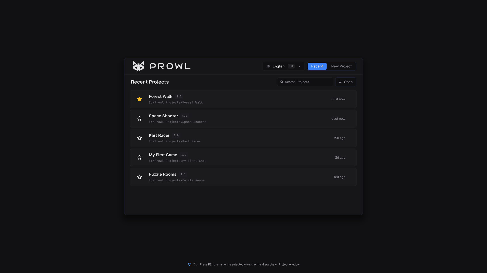
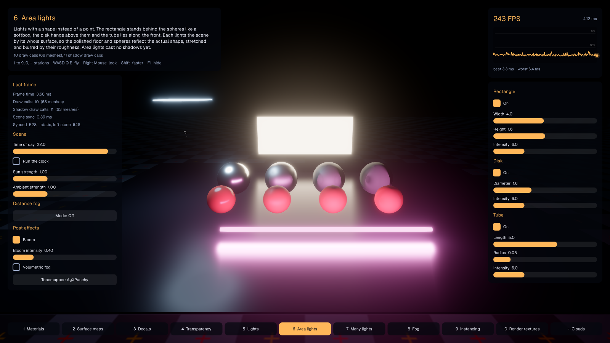

## Requirements

- The [.NET 10 SDK](https://dotnet.microsoft.com/en-us/download/dotnet/10.0)
- A GPU and driver with Vulkan 1.2 support
- Windows, Linux or macOS. On macOS Prowl runs through MoltenVK.

## Download a release




Prowl is currently at **1.0 Preview 5**. Download it from the [Releases page](https://github.com/ProwlEngine/Prowl/releases).

> [!WARNING]
> Prowl is in preview, and breaking changes are still expected before 1.0. Projects from earlier previews are backed up and migrated when opened, but keep your own backups too.

## Build from source

The recommended way to build Prowl is against a **local clone of Anthology**, the repository of libraries Prowl is built from. By default Prowl uses Anthology's NuGet packages, but those are pinned to a release and often lag behind the engine, so a fresh Prowl checkout can need Anthology changes that are not published yet.

### 1. Clone both repositories side by side

Anthology must sit next to Prowl, in a folder named `Anthology`:

```bash
git clone https://github.com/ProwlEngine/Anthology.git
git clone https://github.com/ProwlEngine/Prowl.git
```

```
Projects/
  Anthology/
  Prowl/
```

### 2. Turn on local Anthology

Create a file named `prowl.local.props` in the Prowl folder. Git ignores it, so it only affects your machine:

```xml
<Project>
  <PropertyGroup>
    <ProwlLocalAnthology>true</ProwlLocalAnthology>
  </PropertyGroup>
</Project>
```

Prowl.Runtime and the editor now reference the Anthology projects directly instead of the NuGet packages.

### 3. Open the solution and run

Open `Prowl.slnx` in Visual Studio, Rider or VS Code, then build and run `Prowl.Editor`. The Anthology libraries appear under an **Anthology** folder in the solution, so you can step into them while debugging and edit them like any other project.

> [!TIP]
> Pull both repositories together. When Prowl changes, the matching Anthology change has usually landed at the same time.

### Other ways to switch

`prowl.local.props` is the easiest, but the switch can also come from:

| Method | Example |
| --- | --- |
| One build | `dotnet build -p:ProwlLocalAnthology=true` |
| An environment variable | `PROWL_LOCAL_ANTHOLOGY=1` (or `true`) |

A `-p` argument wins over `prowl.local.props`, which wins over the environment variable.

### Building against NuGet instead

Leave local Anthology off and Prowl restores the Anthology libraries from NuGet, at the version set by `ProwlPackageVersion` in Prowl's `Directory.Build.props`. You only need the Prowl repository. If the build fails with missing types or members from a `Prowl.*` library, the packages are behind the engine; switch to local Anthology.

## Run the samples




Small, commented games live under `Samples/Runtime`: HelloProwl, RenderingShowcase, ManyLights, PhysicsShowcase, ControllerShowcase, VehicleShowcase, ParticleShowcase, ScriptingShowcase, VRBasics and VRShowcase. Each one is its own project that you can run directly.
