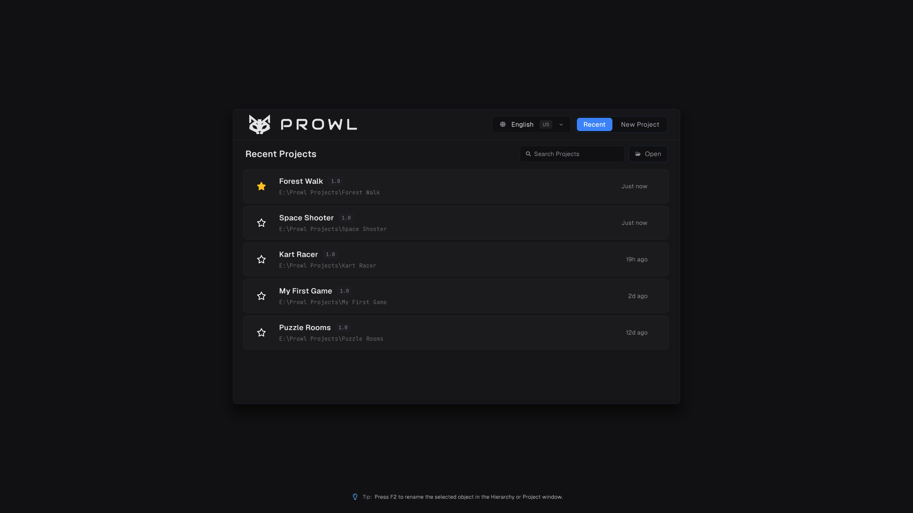
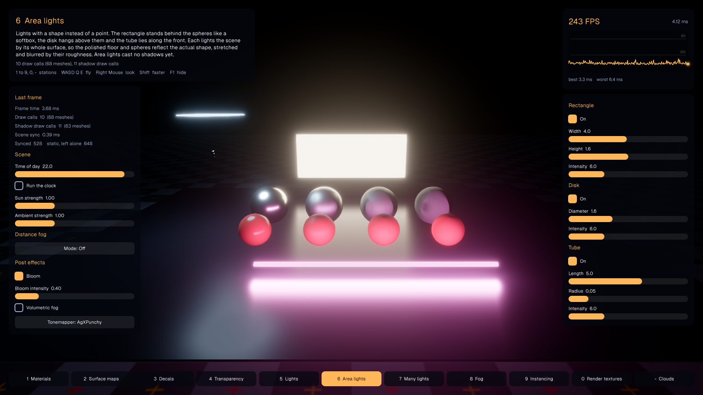

## Requirements

- The [.NET 10 SDK](https://dotnet.microsoft.com/en-us/download/dotnet/10.0)
- A GPU and driver with Vulkan 1.2 support
- Windows, Linux or macOS. On macOS Prowl runs through MoltenVK.

## Download a release




Prowl is currently at **1.0 Preview 5**. Download it from the [Releases page](https://github.com/ProwlEngine/Prowl/releases).

> [!WARNING]
> Prowl is in preview, and breaking changes are still expected before 1.0. Projects from earlier previews are backed up and migrated when opened, but keep your own backups too.

## Build from source

Prowl and the libraries it is built from live in one repository. The libraries sit in the `Anthology` folder and the engine references them as projects, so one clone is all you need:

```bash
git clone https://github.com/ProwlEngine/Prowl.git
```

Open `Prowl.slnx` in Visual Studio, Rider or VS Code, then build and run `Prowl.Editor`. The libraries appear under an **Anthology** folder in the solution, so you can step into them while debugging and edit them like any other project.

From a terminal:

```bash
dotnet build Prowl.slnx
```

> [!NOTE]
> The libraries and `Prowl.Runtime` are also published to NuGet as `Prowl.*` packages, for projects that use them without the engine source. See [Getting started with the runtime](03-runtime.md).

## Run the samples




Small, commented games live under `Samples/Runtime`: HelloProwl, RenderingShowcase, ManyLights, PhysicsShowcase, ControllerShowcase, VehicleShowcase, ParticleShowcase, ScriptingShowcase, VRBasics and VRShowcase. Each one is its own project that you can run directly.
