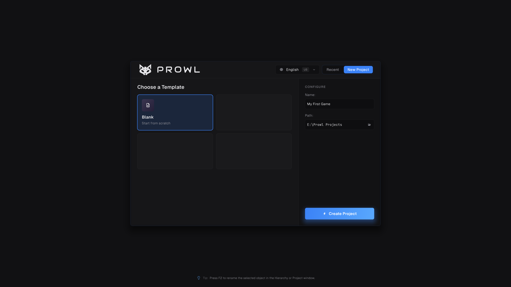
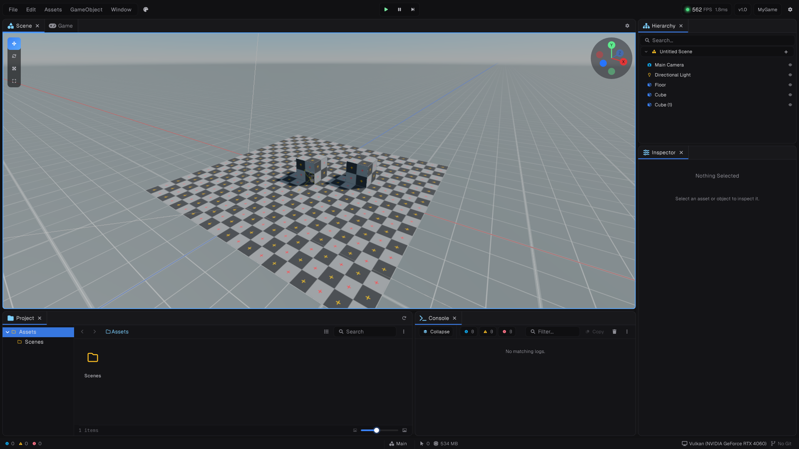
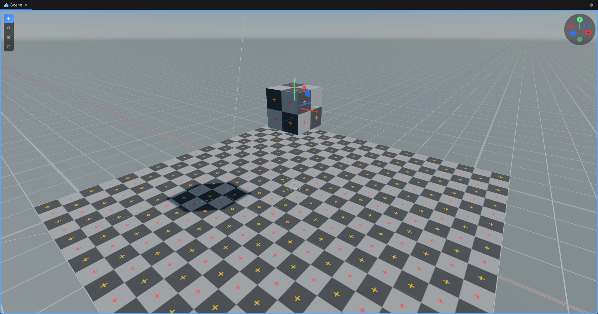
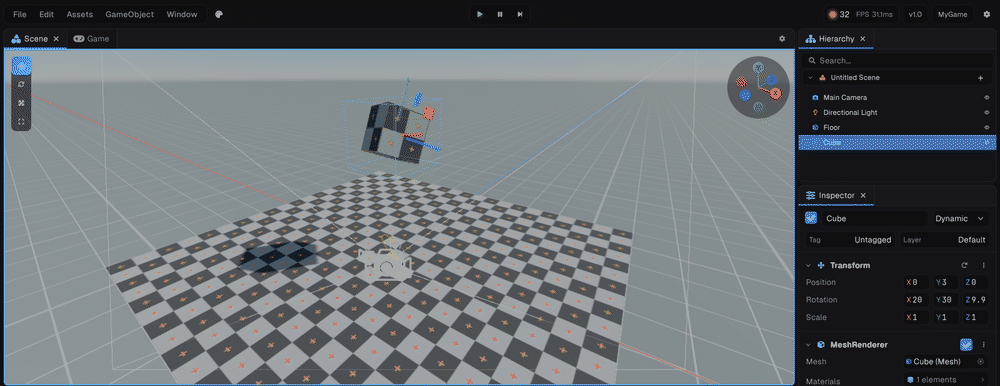
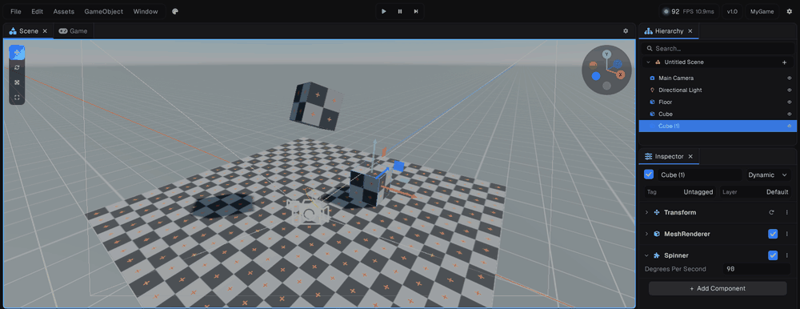
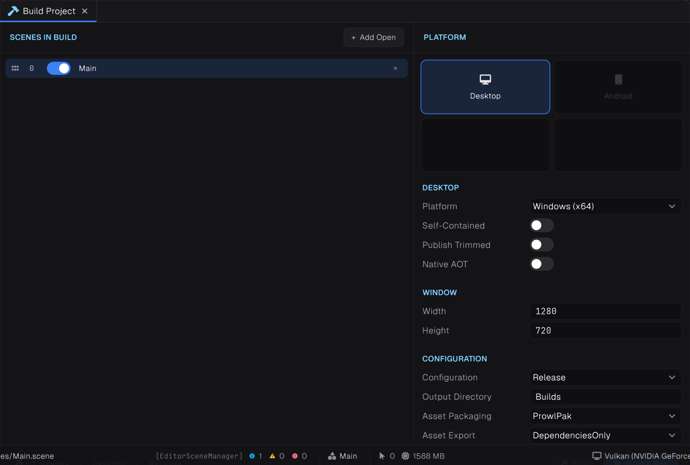

This walkthrough takes you from a new project to a running build: a cube that falls onto a floor and spins, with a script you write yourself.

## 1. Create a project

Run the editor. The project launcher opens.

1. Choose **New Project**.
2. Give it a name. New projects go in `Documents/Prowl Projects` unless you pick another folder.
3. Create it. The editor opens with an empty scene.



## 2. Find your way around

| Panel | Use |
| --- | --- |
| **Scene** | The 3D view you build in. Move, rotate and scale with the gizmos; shift-drag to duplicate |
| **Hierarchy** | Every GameObject in the scene, with parenting |
| **Inspector** | The components of whatever is selected |
| **Project** | Your Assets folder |
| **Console** | Logs, warnings and compile errors |
| **Game** | What the camera sees while playing |

Closed a panel? Every one is under **Window › General**. Panels dock, resize and remember their layout.



## 3. Build a scene

1. **GameObject › 3D Object › Plane** for a floor.
2. **GameObject › 3D Object › Cube**. Move it up a few units with the gizmo, so it floats above the floor.
3. If the scene has no camera or light yet, add **GameObject › Camera** and **GameObject › Light › Directional Light**, and point the camera at the cube.



## 4. Add physics

1. Select the cube. In the inspector, **Add Component** › **Rigidbody3D**, then **Box Collider**.
2. Select the plane and add a **Box Collider**, sized to cover it, so the cube has something to land on.
3. Press **F5** to play. The cube falls and lands. Press **F5** again to stop.



## 5. Write a script

1. In the Project panel, **Create › C# Script**, and name it `Spinner`.
2. Double-click it to open it in the built-in code editor, and replace its contents:

```csharp
using Prowl.Runtime;
using Prowl.Vector;

public sealed class Spinner : Component
{
    public float DegreesPerSecond = 90f;

    public override void Update()
    {
        Transform.Rotate(new Float3(0f, DegreesPerSecond * Time.DeltaTime, 0f));
    }
}
```

3. Save. The script compiles in the editor and hot-reloads; compile errors appear on the line and in the console.
4. Add a second cube with **GameObject › 3D Object › Cube**, and leave it without physics.
5. Select it, **Add Component**, and find **Spinner**. Its `DegreesPerSecond` field shows in the inspector, where you can change it, even while playing.

> [!NOTE]
> Leave the Spinner off the falling cube. A dynamic rigidbody is moved by physics, so rotating its Transform fights the simulation. Moving physics objects is covered in [Rigidbodies and collisions](../06-physics/01-rigidbodies-and-collisions.md).



## 6. Play, pause and save

| Shortcut | Does |
| --- | --- |
| **F5** | Play and stop |
| **F7** | Pause and resume |
| **Ctrl+N** | New scene |
| **Ctrl+Shift+S** | Save the scene as a new file |

Every shortcut can be rebound in **Window › General › Preferences**. Save your scene into the Assets folder before building.

## 7. Build it

Open **Build Settings**, add your scene to the build's scene list, choose a build profile for your platform, and build. The build packs only the assets your scenes use, and precompiles the shader variants they need.



## Next steps

- [Things to know first](04-things-to-know.md): the rules that trip people up.
- [Components](../02-scripting/01-components.md): the full lifecycle and inspector attributes.
- [Getting started with the runtime](03-runtime.md): the same engine, with no editor.
