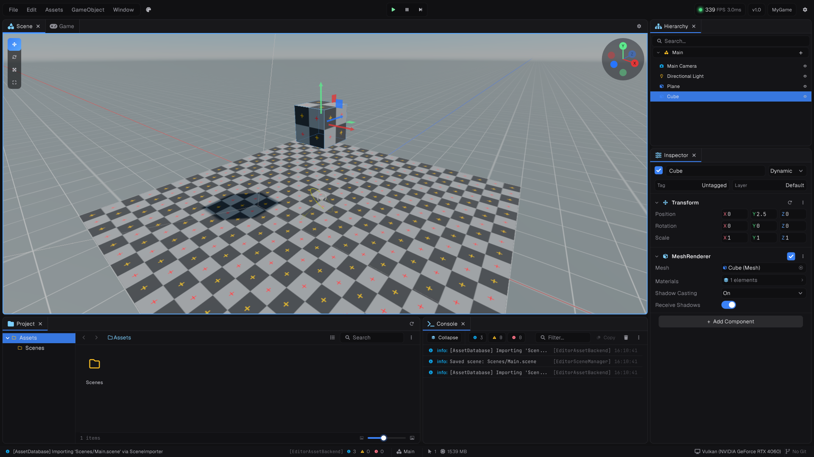

A few of Prowl's rules are easy to miss and cause confusing bugs. Learn these first.

## Components

- Scripts derive from **`Component`**.
- Lifecycle methods are **overrides**: `public override void Update()`. A method with the right name but no `override` is never called.
- Set up in **`OnEnable`** or **`Start`**, and clean up in **`OnDispose`**. See the full [lifecycle](../02-scripting/01-components.md#lifecycle).
- **No constructors.** Components are created before they are attached and before saved values are applied.

## Checking objects

A destroyed engine object is still a live C# reference, so ordinary null checks miss it. Prowl's analyzers make them compile errors on engine objects:

- `== null`, `!= null`, `is null` and `is not null`
- `?.` and `?[]`
- `??` and `??=`

Use `obj.IsValid()` and `obj.IsNotValid()` instead. For a true reference-null check, use `object.ReferenceEquals(obj, null)`.

## Scenes and objects

- `Scene` lives in `Prowl.Runtime.Resources`. Load scenes with `Scene.Load` and `Scene.LoadAsync`.
- `new GameObject("Name")` is not in any scene until you add it with `Scene.Current.Add(go)`.
- Destroy an object with `go.Destroy()`. It stays valid until the end of the frame.

## Physics

- Triggers are their own component: add a `TriggerVolume`.
- `Rigidbody3D` has a `MotionType` of `Dynamic`, `Kinematic` or `Static`.
- Move dynamic bodies with velocity or forces, never through their `Transform`.

## Rendering

- Colours are **linear**. A value picked in an image editor needs converting, roughly `value ^ 2.2`.
- For a per-object colour, `Clone()` the material and assign the copy.
