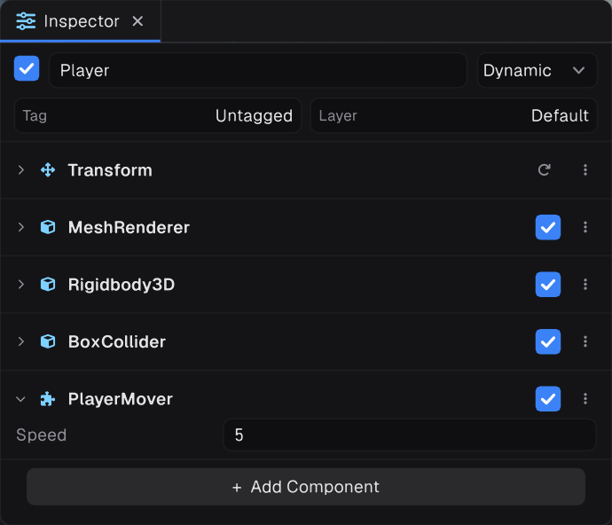
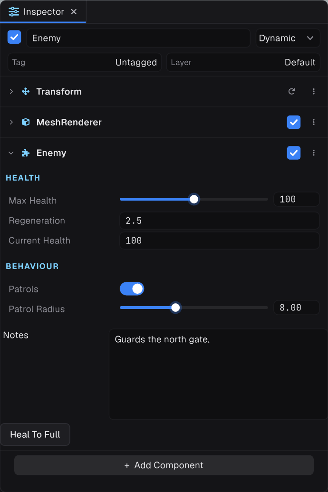

## A complete component




```csharp
using Prowl.Runtime;
using Prowl.Vector;

[RequireComponent(typeof(Rigidbody3D), typeof(BoxCollider))]
[AddComponentMenu("Game/Player Mover")]
public sealed class PlayerMover : Component
{
    public float Speed = 5f;          // saved and shown in the inspector
    private Rigidbody3D _body;        // no constructor, no engine calls in initializers

    public override void OnEnable() => _body = GetComponent<Rigidbody3D>();

    public override void Update()
    {
        Float2 move = Input.GetWASD();
        _body.LinearVelocity = new Float3(move.X * Speed, _body.LinearVelocity.Y, move.Y * Speed);
    }

    public override void OnCollisionBegin(Collision collision)
    {
        Debug.Log($"{GameObject.Name} hit {collision.GameObject.Name}");
    }
}
```

## Lifecycle

| Callback | When it runs |
| --- | --- |
| `OnAddedToScene()`, `OnEnable()` | When the object enters an active scene |
| `Start()` | Once, before the first `FixedUpdate` or `Update` |
| `FixedUpdate()` | Every fixed physics step |
| `Update()`, `LateUpdate()` | Every frame |
| `OnDisable()`, `OnRemovedFromScene()` | When it leaves the scene |
| `OnDispose()` | When it is destroyed |
| `OnValidate()` | After a field changes in the inspector |

An exception in a callback is logged and the frame continues.

## Attributes




- `[RequireComponent(typeof(A))]` adds missing components automatically.
- `[DisallowMultipleComponent]` refuses a second component of that type.
- `[AddComponentMenu("Path")]` places it in the Add Component menu.
- `[ExecuteAlways]` runs callbacks outside play mode.
- `[ExecutionOrder(n)]` changes when it updates relative to others.

Inspector attributes include `[Range]`, `[Header]`, `[Space]`, `[Tooltip]`, `[ReadOnly]`, `[TextArea]`, `[ShowIf]`, `[HideInInspector]` and `[Button]` on methods.

> [!NOTE]
> Never move a dynamic `Rigidbody3D` through its `Transform`. Set its velocity or apply forces instead.

## Analyzers

Prowl ships Roslyn analyzers that catch scripting mistakes as you type, in the editor and in your IDE.

| Rule | Severity | Catches |
| --- | --- | --- |
| `PROWLCO001` | Warning | A constructor declared on a component. It runs before the component is attached, so `GameObject`, `Transform` and saved values are not there yet |
| `PROWLCO002` | Error | A component with no public parameterless constructor, which the engine can never create |
| `PROWLCO003` | Warning | A field initializer that calls into game or engine code, which runs while the scene is still loading |
| `PROWLCO004` | Error | A field initializer that invokes a delegate, before anything has had a chance to assign it |
| `PROWLEO001` | Error | `?.` on an engine object, which runs on a destroyed object |
| `PROWLEO002` | Error | `??` or `??=` on an engine object, which keeps a destroyed object instead of the fallback |
| `PROWLEO003` | Error | `== null`, `!= null`, `is null` or `is not null` on an engine object, which misses destruction |
| `PROWLTH001` | Warning | A blocking wait such as `.Result` or `.Wait()` in a component, which never returns for asset loads and GameTask waits |

Use `IsValid()` and `IsNotValid()` for engine objects, `await` instead of blocking, and `OnEnable` or `Start` instead of constructors.
