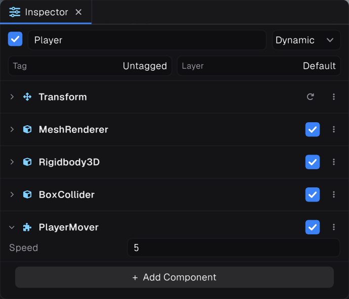
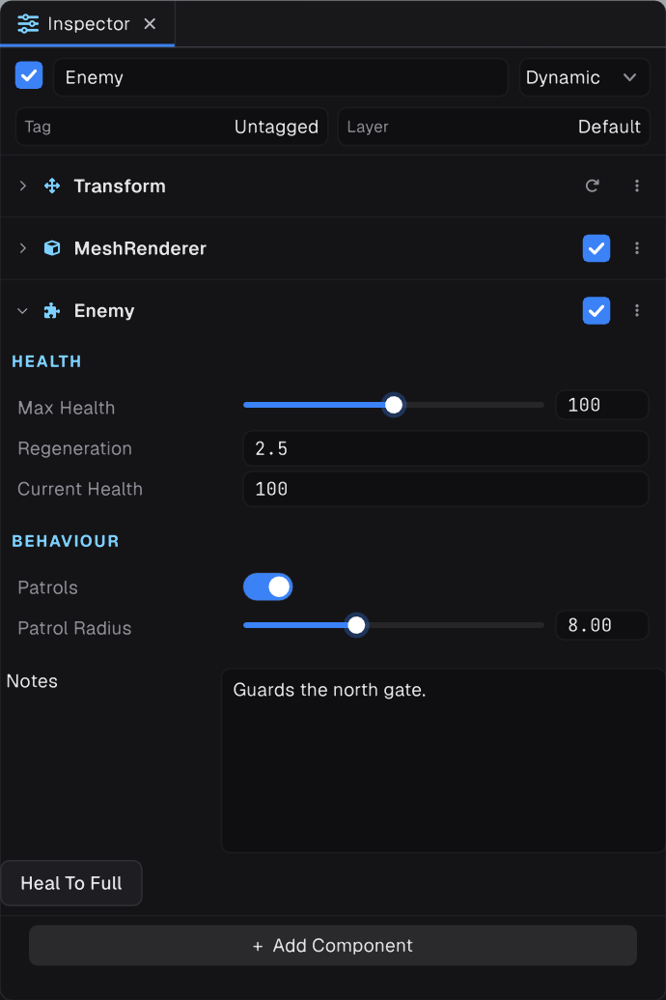

## A complete component




```csharp
using Prowl.Runtime;
using Prowl.Vector;

[RequireComponent(typeof(Rigidbody3D), typeof(BoxCollider))]
[AddComponentMenu("Game/Player Mover")]
public sealed class PlayerMover : Component
{
    public float Speed = 5f;          // saved and shown in the inspector
    private Rigidbody3D _body;        // no constructor, no engine calls in initializers

    public override void OnEnable() => _body = GetComponent<Rigidbody3D>();

    public override void Update()
    {
        Float2 move = Input.GetWASD();
        _body.LinearVelocity = new Float3(move.X * Speed, _body.LinearVelocity.Y, move.Y * Speed);
    }

    public override void OnCollisionBegin(Collision collision)
    {
        Debug.Log($"{GameObject.Name} hit {collision.GameObject.Name}");
    }
}
```

For which fields are saved and how to control it, see [Serialization](07-serialization.md).

## Lifecycle

| Callback | When it runs |
| --- | --- |
| `OnAddedToScene()` | When the object joins a world, in any state, the editor's edit world included |
| `OnEnable()` | When it is enabled in a running world |
| `Start()` | Once, before the first `FixedUpdate` or `Update` |
| `FixedUpdate()` | Every fixed physics step |
| `Update()`, `LateUpdate()` | Every frame |
| `OnDisable()` | When it is disabled, its world goes dormant, or its section unloads |
| `OnRemovedFromScene()` | When it leaves its world |
| `OnDispose()` | When it is destroyed |
| `OnValidate()` | After a field changes in the inspector |
| `OnCollisionBegin(Collision)` | A collision starts |
| `OnCollisionStay(Collision)` | A collision continues |
| `OnCollisionEnd(Collision)` | A collision ends |
| `OnTriggerEnter(Rigidbody3D)` | A body enters a trigger |
| `OnTriggerStay(Rigidbody3D)` | A body stays in a trigger |
| `OnTriggerExit(Rigidbody3D)` | A body leaves a trigger |
| `OnCharacterEnter(CharacterController)` | A character enters a trigger |
| `OnCharacterStay(CharacterController)` | A character stays in a trigger |
| `OnCharacterExit(CharacterController)` | A character leaves a trigger |
| `DrawGizmos()` | Every frame, to draw gizmos in the editor |
| `DrawGizmosSelected()` | Same, only while the object is selected |
| `OnGui(Paper)` | Every frame, to draw UI with Paper |

> [!NOTE]
> Prowl has no coroutines. Use `GameTask` and `async` instead, see [Async with GameTask](04-async-with-gametask.md).
> Prowl has no `Awake`. Use `OnAddedToScene` (once, when the object joins a world) or `OnEnable` (each time it is enabled in a running world).

An exception in a callback is logged and the frame continues.

Everything from `OnEnable` on runs only in a playing world, so not in the editor outside play mode, unless the component has `[ExecuteAlways]`. A paused world skips `Start`, `Update` and `FixedUpdate` but still delivers `OnEnable` and `OnDisable`. Inside any callback, `Scene` is the component's world. See [Scenes and worlds](05-scenes-and-worlds.md).

## Finding and checking

- `Enabled` turns a component on or off. `EnabledInHierarchy` also checks its parents.
- `GetComponents<T>()` returns every `T` on the object.
- `GetComponentsInChildren<T>(includeSelf = true)` and `GetComponentsInParent<T>(includeSelf = true)` search the tree. Pass `false` to skip the object itself.
- `CompareTag("Player")` checks the object's tag. It ignores case.

## Attributes




- `[RequireComponent(typeof(A))]` adds missing components automatically.
- `[DisallowMultipleComponent]` refuses a second component of that type.
- `[AddComponentMenu("Path")]` places it in the Add Component menu.
- `[ExecuteAlways]` runs callbacks outside play mode.
- `[ExecutionOrder(n)]` changes when it updates relative to others.

Inspector attributes include `[Range]`, `[Header]`, `[Space]`, `[Tooltip]`, `[ReadOnly]`, `[TextArea]`, `[ShowIf]`, `[HideInInspector]` and `[Button]` on methods.

> [!NOTE]
> Never move a dynamic `Rigidbody3D` through its `Transform`. Set its velocity or apply forces instead.

## Analyzers

Prowl ships Roslyn analyzers that catch scripting mistakes as you type, in the editor and in your IDE.

| Rule | Severity | Catches |
| --- | --- | --- |
| `PROWLCO001` | Warning | A constructor on a component |
| `PROWLCO002` | Error | No public parameterless constructor |
| `PROWLCO003` | Warning | A field initializer that calls game or engine code |
| `PROWLCO004` | Error | A field initializer that invokes a delegate |
| `PROWLEO001` | Error | `?.` on an engine object |
| `PROWLEO002` | Error | `??` or `??=` on an engine object |
| `PROWLEO003` | Error | `== null` or `is null` on an engine object |
| `PROWLTH001` | Warning | A blocking wait such as `.Result` or `.Wait()` |
| `PROWLSC001` | Error | Comparing a live world with a scene asset. Compare `Scene.Source` |
| `PROWLSC002` | Warning | A plain `SceneAsset` field. Use `AssetRef<SceneAsset>` |

Use `IsValid()` and `IsNotValid()` for engine objects, `await` instead of blocking, and `OnEnable` or `Start` instead of constructors.
