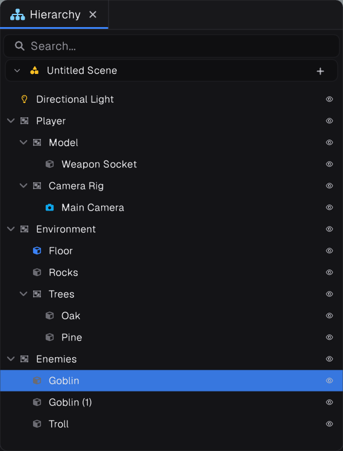

## GameObjects




- Components: `AddComponent<T>()`, `GetComponent<T>()`, `TryGetComponent<T>(out var c)`, `GetComponentInParent<T>()`, `GetComponentInChildren<T>()`, `RemoveComponent(c)`.
- Hierarchy: `SetParent(parent, worldPositionStays = true)`, `Parent`, `Children`, `GetChildrenDeep()`.
- `Find(name)` and `FindGameObjectWithTag(tag)` are instance methods that search the object's own scene.

## Spawning and destroying

```csharp
GameObject.Instantiate(prefab, Transform.Position + Transform.Forward, Transform.Rotation);

enemy.Destroy();   // removed at the end of the frame
```

Until the end of the frame a destroyed object is still valid and keeps updating. Check `IsDestroyQueued` to treat it as gone, or call `Dispose()` to tear it down immediately.

## Transform

`Transform` lives in `Prowl.Vector`. Angles on the Transform are in **degrees**; `Quaternion.AxisAngle` takes radians.

```csharp
Transform.Rotate(new Float3(0f, 90f * Time.DeltaTime, 0f));
Transform.LookAt(target.Transform.Position);
Float3 ahead = Transform.TransformPoint(new Float3(0f, 0f, 2f));
```

## Scenes

- `Scene.Current` is the live scene and is never null.
- `Scene.Load(sceneAsset)` blocks; `await Scene.LoadAsync(sceneAsset)` loads in the background.
- `Scene.DontDestroyOnLoad(go)` keeps a root object across loads.
- `Scene.Current.Environment` holds the sky, ambient light and fog.
