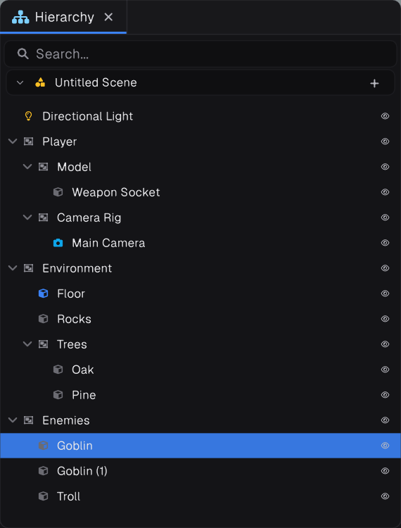

## GameObjects




Create a live object through the world it goes into. Inside a component that is `Scene`:

```csharp
GameObject marker = Scene.Create("Marker");
marker.Transform.Position = Transform.Position;
```

`new GameObject("Name")` makes a detached object in no world. Build it, then move it in with `go.MoveTo(Scene)`, or parent it under an object that is already in a world.

- Components: `AddComponent<T>()`, `GetComponent<T>()`, `TryGetComponent<T>(out var c)`, `GetComponentInParent<T>()`, `GetComponentInChildren<T>()`, `RemoveComponent(c)`.
- Hierarchy: `SetParent(parent, worldPositionStays = true)`, `Parent`, `Children`, `GetChildrenDeep()`.
- `Find(name)` and `FindGameObjectWithTag(tag)` are instance methods that search the object's own world. The world has more lookups, such as `Scene.GetAll<T>()` and `Scene.FindObjectByPath(path)`. See [Finding objects](05-scenes-and-worlds.md#finding-objects).
- `SiblingIndex` is the object's place among its parent's children, or for a root among its section's roots.

## Spawning and destroying

```csharp
GameObject.Instantiate(prefab, Transform.Position + Transform.Forward, Transform.Rotation);

enemy.Destroy();   // removed at the end of the frame
```

A prefab spawns into the active section of the world your code runs in, so it unloads with the level. `Instantiate(prefab, parent)` spawns into the parent's section instead, and copying an existing object with `Instantiate(original)` keeps the copy in the original's section.

Until the end of the frame a destroyed object is still valid and keeps updating. Check `IsDestroyQueued` to treat it as gone, or call `Dispose()` to tear it down immediately.

## Transform

`Transform` lives in `Prowl.Vector`. Angles on the Transform are in **degrees**; `Quaternion.AxisAngle` takes radians.

```csharp
Transform.Rotate(new Float3(0f, 90f * Time.DeltaTime, 0f));
Transform.LookAt(target.Transform.Position);
Float3 ahead = Transform.TransformPoint(new Float3(0f, 0f, 2f));
```

## Scenes

A `Scene` is the `.scene` asset. The running game is a world, a `SceneInstance`, which a component reaches through its `Scene` property. A world holds one section per scene loaded into it.

- `NextLevel.Load()` replaces the level, `LoadAdditive` adds one beside it, and `Open` makes a separate world.
- `GameObject.Persistent = true` keeps a root object across loads.
- `Scene.Environment` holds the sky, ambient light and fog of the world's active section.
- `Camera.Main` is the main camera of the world your code runs in.

[Scenes and worlds](05-scenes-and-worlds.md) and [Loading scenes](06-loading-scenes.md) cover them in full.
