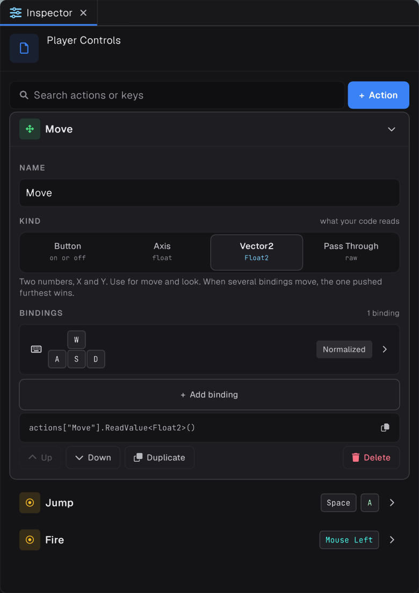

## Time

`Time.DeltaTime`, `Time.UnscaledDeltaTime`, `Time.FixedDeltaTime`, `Time.TimeScale`, `Time.FrameCount` and `Time.TimeSinceStartup`.

## Direct input

```csharp
if (Input.GetKeyDown(KeyCode.Space)) Jump();
if (Input.GetMouseButton(0)) Fire();

Float2 move = Input.GetWASD();
Float2 look = Input.MouseDelta;
```

> [!NOTE]
> `Input.MouseDelta.Y` is positive when the mouse moves **down**, as in window coordinates. For mouse look, subtract it from the pitch.

## Input actions




For rebindable controls, create an Input Actions asset from the create menu and edit it in its dedicated editor. Actions support composites such as WASD to a `Float2`, D-pads, gamepads and XR controllers.

```csharp
Input.RegisterActionMap(map);
map.Enable();   // actions start disabled

var move = Input.FindAction("Move");
Float2 value = move.ReadValue<Float2>();
if (Input.FindAction("Jump").WasPressedThisFrame()) Jump();
```

## Logging

`Debug.Log`, `LogWarning`, `LogError` and `LogOnce(id, message)` for messages that would otherwise repeat every frame. `Debug.DrawLine`, `DrawWireCube` and `DrawWireSphere` draw gizmos.
