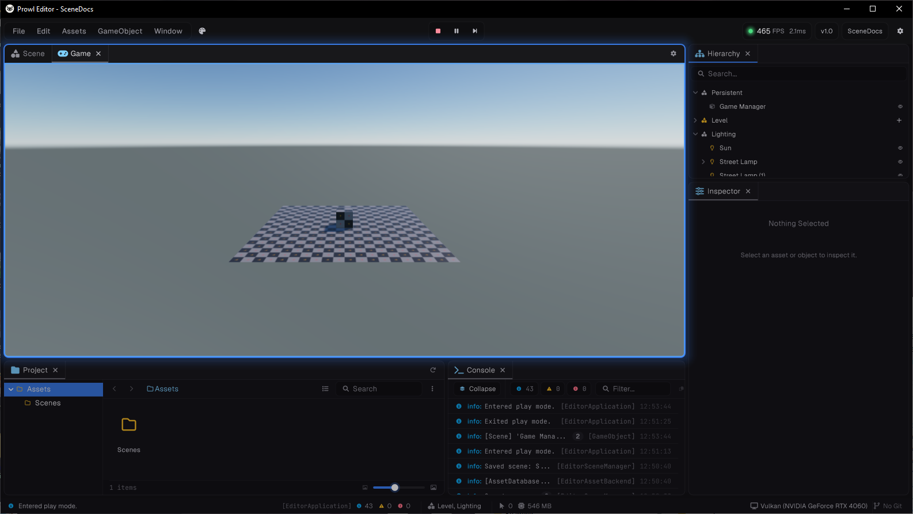

A `.scene` file and the game that runs from it are two different things in Prowl. The file is an asset you can hold, list and load. The running game is a world with its own objects, physics, clock and cameras. A world can hold several scenes at once, each one a section of it.

## Scenes, worlds and sections

| Type | What it is |
| --- | --- |
| `Scene` | The asset, a `.scene` file. What you put in a field and load |
| `SceneInstance` | A live world: its objects, physics, navigation, animation, cameras, clock and environment |
| `SceneSection` | One scene loaded into a world. Unloading it removes exactly the objects it brought |
| `SceneContent` | What a `Scene` stores: objects, environment and baked lighting, as plain data in no world. For tools |

All four live in `Prowl.Runtime.Resources`.

Most game code never names `SceneInstance`. A component reaches its world through its own `Scene` property:

```csharp
using Prowl.Runtime;
using Prowl.Runtime.Resources;

public sealed class Alarm : Component
{
    public override void Start()
    {
        SceneInstance world = Scene;                    // the world this component is in
        GameObject? door = Scene.FindObject("Door");
        Guard[] guards = Scene.GetAll<Guard>();          // Guard is another component of yours

        Debug.Log($"{guards.Length} guards in {world.Name}, door found: {door.IsValid()}");
    }
}
```

> [!NOTE]
> Inside a component, `Scene` in an expression is the component's world, a `SceneInstance`. In a type, like `AssetRef<Scene>`, it is the asset. That is why the `Scene` asset has no static methods: inside a component they could never be reached.

`Component.Scene` throws when the component is in no world: on a detached object, on a prefab asset, and in `OnValidate` and `OnAfterDeserialize`, which run detached. Check `IsInWorld` first where that can happen. `GameObject.Scene` returns null instead.

## The active world

Code with no component to ask, such as a static helper, uses `SceneInstance.Active`, the world whose code is running right now:

- While the engine runs a callback on a component, it is that component's world.
- Inside `using (world.Enter()) { }`, it is that world. Scopes nest.
- After an `await`, it is the world that was active where the await started.
- Otherwise it is `SceneInstance.Main`.

The static conveniences all go through it, so a component always talks to its own world, even when several worlds run at once:

| Static | Acts on |
| --- | --- |
| `Camera.Main` | `SceneInstance.Active.MainCamera` |
| `Physics.Raycast` and every other `Physics` call | `SceneInstance.Active.Physics` |
| `Time.DeltaTime`, `Time.TimeScale`, `Time.TimeSinceStartup` and the other scaled values | `SceneInstance.Active.Clock` |
| `GameObject.Instantiate(prefab)` | The active world's `ActiveSection` |
| `AudioSource.PlayClipAtPoint` | The active world |
| `Debug.DrawLine` and the other gizmo draws | The active world's gizmos |

To act on another world from your own code, enter it:

```csharp
using (minimap.Enter())
{
    Camera? camera = Camera.Main;       // the minimap's camera, not the game's
}
```

`SceneInstance.Active` and everything that goes through it are main thread only. Reading it from a worker throws.

## Main and other worlds

`SceneInstance.Main` is the game world. The player creates it before your first scene loads and keeps it until the game quits, and levels load into it. In the editor, Main is the edit world outside play and the play world during play. Reading Main when nothing is bound throws. It is never created on the fly.

You can run more worlds beside Main: a pause menu, a minimap, a loading screen.

```csharp
SceneInstance menu = SceneInstance.Create("Pause Menu");
menu.Present = true;        // draw it to the game's output
menu.RenderOrder = 100;     // over Main

GameObject canvas = menu.Create("Canvas");
// ... build the menu ...

menu.Activate();            // dormant until now
```

| Member | Meaning |
| --- | --- |
| `Mode` | `Game`, `Edit` or `Preview`, fixed at creation. Only a `Game` world plays |
| `State` | `Dormant`, `Running`, `Destroying` or `Destroyed` |
| `IsPlaying` | A `Game` world that is running or being torn down |
| `Paused` | Stops `Start`, `Update`, `FixedUpdate`, physics, animation and navigation. The clock stands still |
| `Present` | The engine draws this world to the game's output while it runs |
| `RenderOrder` | Presented worlds draw lowest first, each over the one before |
| `Clock` | This world's time scale, scaled time and fixed step |

A world's life:

1. `SceneInstance.Create(name)` makes a **dormant** world with one empty section. Objects exist and get `OnAddedToScene`, but no `OnEnable`, and nothing ticks.
2. `Activate()` makes it **running** and delivers `OnEnable`. The engine ticks every running game world that is not paused.
3. `Deactivate()` delivers `OnDisable` and sends it back to dormant, keeping everything in it. You can activate it again.
4. `Destroy()` tears it down at the end of the frame: every component gets `OnDisable`, then `OnRemovedFromScene`, then is disposed. `Dispose()` does the same at once.

> [!WARNING]
> Worlds are held weakly. Keep a reference to every world you create or open, in a field of a persistent object for example. Main is held by the engine.

Pausing stops the world's UI too, since UI updates in `Update`. To freeze the game under a pause menu, either put the menu in its own world and pause Main, or keep one world and set `Time.TimeScale = 0`, which keeps `Update` running.

Each world has its own clock, so a paused world's time stands still while a menu world over it keeps animating. `Time.FixedDeltaTime`, `Time.UnscaledDeltaTime` and `Time.FrameCount` are shared by every world.

## Sections

Every root object belongs to exactly one section of its world. Children belong to their root's section.

```csharp
foreach (SceneSection section in Scene.Sections)
    Debug.Log($"{section.Name}, persistent: {section.IsPersistent}, active: {section.IsActive}");

SceneSection mine = GameObject.Section!;
```

- `Sections` lists them: `Persistent` first, then in load order.
- `Persistent` is the section that survives every load. It is never saved and never active.
- `ActiveSection` is where new objects go by default, and the world shows its sky, ambient light, fog and baked lighting. Setting it switches the environment. `world.Environment` is the active section's.
- `Source` on a section is the `Scene` asset it was loaded from, null for one made at runtime. `world.Source` is the active section's.
- `CreateSection(name)` adds an empty runtime section.
- `section.Unload()` removes it and everything in it at the end of the frame. The persistent section and the last other section cannot be unloaded. Load another scene instead.

Where new objects go:

| Call | Section |
| --- | --- |
| `world.Create(name)` | `ActiveSection` |
| `world.Create(name, parent)` | The parent's section |
| `world.Create(section, name)` | That section |
| `GameObject.Instantiate(prefab)` | The active world's `ActiveSection` |
| `GameObject.Instantiate(prefab, parent)` | The parent's section |
| `GameObject.Instantiate(original)` | The original's section |
| `go.MoveTo(section)` | That section. Roots only |
| `go.MoveTo(world)` | That world's `ActiveSection`, with the full lifecycle on the way |

Bullets and enemies spawned at runtime land in the active section, so they unload with the level.

`SetParent` under an object in another section moves the whole subtree into that section. `SetParent(null)` keeps the subtree in the section it was in. Parenting under an object in another world throws: use `MoveTo` to move between worlds.

## Finding objects

Every lookup is on the world, so inside a component they read `Scene.Something`:

```csharp
PlayerHealth? player = Scene.Get<PlayerHealth>();
Enemy[] enemies = Scene.GetAll<Enemy>();
GameObject? door = Scene.FindObjectByPath("Level/Props/Door");

var spawns = new List<GameObject>();
Scene.FindObjectsWithTag("Respawn", spawns);
```

| Member | Finds |
| --- | --- |
| `Get<T>()` | The first enabled component of type `T` |
| `GetAll<T>(includeDisabled)` | Every component of type `T`, as a new array |
| `GetAll<T>(list, includeDisabled)` | The same, copied into your list |
| `FindObject(name)` | The first object with this name |
| `FindObjectByPath(path)` | The object at a path of names from a root |
| `FindObjectWithTag(tag)` | The first object with this tag |
| `FindObjectsWithTag(tag, list)` | Every object with this tag |
| `FindObject(guid)`, `FindObject<T>(guid)`, `TryFindObject<T>(guid, out t)` | An object or component by identifier |
| `FindObject(section, guid)` | By identifier in one section, exact when a scene is loaded twice |
| `Roots` | The root objects, section by section |
| `Objects`, `ObjectCount` | Every object, children included |

`T` can be a class or an interface. Each type you query gets an index the first time, kept up to date after that, so `GetAll<T>()` every frame is cheap. A one off search over a type you never ask for again still builds its index.

`go.Find(name)` and `go.FindGameObjectWithTag(tag)` on a GameObject search that object's world. `section.Roots` lists one section's roots.

> [!NOTE]
> A dormant world answers `Get<T>()` and `GetAll<T>()` with nothing, since none of its components are enabled. Pass `includeDisabled: true`, or activate the world first.

## The main camera

`Camera.Main` is the active world's `MainCamera`: the enabled camera with the highest `Depth` that draws to the screen. A camera with a `Target` render texture, a `Background` of `None` (a stacked camera) or a hidden editor helper never counts. Tags play no part.

Each world has its own, so code in a minimap world gets the minimap's camera. A camera added this frame is main straight away. `Camera.Main` is null when the world has no such camera.

## Objects that survive a load

Set `Persistent` on a root to keep it, and everything under it, when a new level loads:

```csharp
public sealed class GameManager : Component
{
    public override void Start()
    {
        GameObject.Persistent = true;
    }
}
```



- It moves the root into the world's `Persistent` section. The object never leaves its world, so it keeps running with no `OnDisable` or `OnEnable` on the way.
- Roots only. Setting it on a child throws. Reading it on a child answers for its root.
- Game worlds only, so play mode only in the editor. Setting it in the edit world throws, since persistent objects are never saved.
- `Persistent = false` moves it back into the active section, to unload with the level.
- Setting it from `OnDisable` while a load tears the level down still saves the object.
- Parenting an object into or out of the persistent section logs a warning. That is almost always a mistake: a persistent tree under a level object dies with the level.

Helper roots a component builds for itself, like a ragdoll's puppet, can be made with an owner: `Scene.Create("Puppet", owner: this)`. An owned root joins its owner's section and follows it into and out of `Persistent`.

## When a world or section ends

Async code that outlives what it works on should stop. Pick the token that matches:

| Token | Cancelled when |
| --- | --- |
| `DestroyCancellationToken` | This component is destroyed |
| `GameObject.Section!.UnloadToken` | This object's section unloads |
| `Scene.Token` | This world is destroyed, or play stops, or scripts reload |
| `GameTask.SessionToken` | Play stops, scripts reload or the game quits |

```csharp
public override async void Start()
{
    try
    {
        while (true)
        {
            await GameTask.Delay(5f, GameObject.Section!.UnloadToken);
            SpawnWave();
        }
    }
    catch (OperationCanceledException) { }
}
```

`GameTask.Delay` already counts game time of the world it was called in: it holds while that world is paused, and is cancelled when that world is destroyed. After an `await`, `SceneInstance.Active` is still your world. If that world has been destroyed in the meantime, reading it throws `ObjectDisposedException` rather than quietly acting on another world. See [Async with GameTask](04-async-with-gametask.md).

## World events

```csharp
public override void OnEnable() => SceneInstance.Loaded += OnLoaded;
public override void OnDisable() => SceneInstance.Loaded -= OnLoaded;

private void OnLoaded(SceneLoadedArgs args)
{
    Debug.Log($"{args.Section.Name} loaded into {args.Section.Instance.Name}, additive: {args.Additive}");
}
```

| Event | Fires |
| --- | --- |
| `SceneInstance.Loaded` | A section finished loading. `SceneLoadedArgs` has the `Section` and whether it was `Additive` |
| `SceneInstance.Unloading` | Before a section's objects tear down |
| `SceneInstance.Created` | A world was made with `SceneInstance.Create` |
| `SceneInstance.Destroying` | A world starts its teardown |
| `SceneInstance.MainChanged` | Main was bound to another world, with the old and the new one |

The events are static and fire for every world. Each handler runs inside the world that raised it, and one that throws is logged without stopping the others. Unsubscribe in `OnDisable`, or a destroyed component keeps receiving them.

## Common mistakes

- **`new GameObject("Name")` is in no world.** Use `Scene.Create("Name")`, or build the object and then `go.MoveTo(Scene)`.
- **Comparing a world with a scene asset.** `Scene == level` compiles but is always false, and analyzer `PROWLSC001` makes it an error. Compare the asset the world came from: `Scene.Source == level`, or `GameObject.Section?.Source == level`.
- **A plain `Scene` field.** It keeps the scene and everything it uses loaded with your component, and analyzer `PROWLSC002` warns. Use `AssetRef<Scene>`. See [Loading scenes](06-loading-scenes.md).
- **Querying a world that is not running.** A dormant world's `Get<T>()` and `GetAll<T>()` return nothing.
- **Dropping the reference to a world you made.** It is collected without its teardown. Keep it in a field and `Destroy()` it when done.
- **Expecting `OnAddedToScene` to wait for play.** It runs whenever an object joins a world, the editor's edit world included. `OnEnable` and the rest only run in a playing world, or with `[ExecuteAlways]`.
- **Reading `Scene` in `OnValidate` or `OnAfterDeserialize`.** Those run detached, so `Component.Scene` throws. Check `IsInWorld`.
