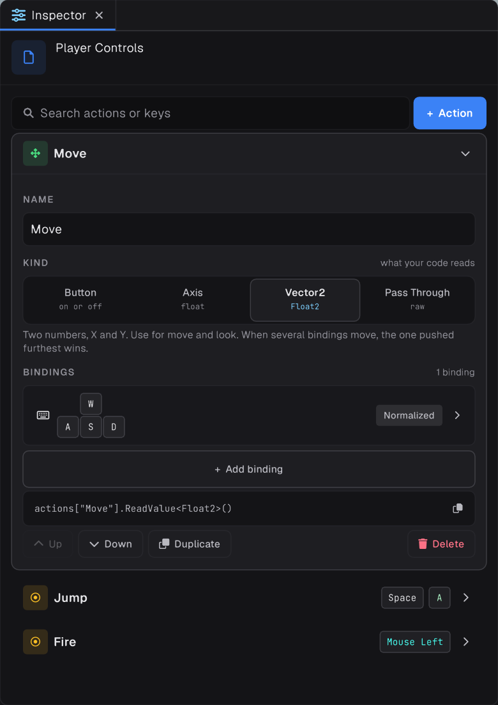

An **input action** is a named thing the player can do, such as `Jump` or `Move`. You bind keys, mouse buttons and gamepad controls to it in an Input Actions asset, and your code reads the action instead of a key.

Use actions when one script should work for keyboard and gamepad, or when you want to change controls without editing code. For direct key checks, see [Input and time](03-input-and-time.md).

## Quick recipe

1. In the **Project** panel, right-click and choose **Create > Input Actions**. Name it `Controls`.
2. Select the asset. Its editor opens in the **Inspector**. Click **Action**.
3. Rename the action to `Move`. Set **Kind** to **Vector2**.
4. Click **Add binding**, then choose the **WASD** preset.
5. Click **Save**.

[screenshot needed: the Input Actions editor with a Move action and the WASD composite]

Add the asset to a component, register it, and read the action:

```csharp
using Prowl.Runtime;
using Prowl.Vector;

public sealed class Walker : Component
{
    public AssetRef<InputActionMap> Controls;
    public float Speed = 4f;

    private InputActionMap _map;
    private InputAction _move;

    public override void OnEnable()
    {
        _map = Controls.LoadImmediate();
        Input.RegisterActionMap(_map);
        _map.Enable();
        _move = _map.GetAction("Move");
    }

    public override void OnDisable() => _map.Disable();

    public override void Update()
    {
        Float2 move = _move.ReadValue<Float2>();
        Transform.Position += new Float3(move.X, 0f, move.Y) * Speed * Time.DeltaTime;
    }
}
```

Drag the asset onto the **Controls** field. Press **Play** and hold W, A, S or D to move the object.

## The asset

An Input Actions asset is a `.inputactions` file. It holds a list of actions, which the code sees as an `InputActionMap`. The map's name is the file name.

The editor shows one row per action. Click a row to open it. A row has a name, a kind, and a list of bindings. Use the search box to filter by action name or key. A flag shows **No bindings** or **Shared key** when an action needs a look.

Edits apply to the loaded map straight away. Click **Save** to write them to the file, or **Revert** to drop them.



## Kinds

The **Kind** says what your code reads.

| Kind | You read | Use for |
|---|---|---|
| Button | on or off | Jump, fire, interact |
| Axis | `float` | Throttle, zoom |
| Vector2 | `Float2` | Move, look |
| Pass Through | `float` or `Float2` | A mouse delta |

When several bindings move at once, Axis and Vector2 take the one pushed furthest. Pass Through follows the one that moved last.

## Bindings and composites

A **binding** ties one control to an action. **Add binding** offers a **Listen** button that records the next key, mouse button or gamepad button you press. You can also pick a control from the list. Gamepad and XR controls are available too.

A **composite** builds one value from several controls.

| Composite | Parts | Gives |
|---|---|---|
| Vector2 | up, down, left, right | `Float2`, normalized by default |
| Axis | positive, negative | `float` |
| Dual axis | x, y | `Float2` |

The editor offers presets such as WASD, arrow keys, A and D, and mouse delta.

Click a binding to set its **interaction**: Default, Press, Release, Hold, Tap, Multi tap or Press and release. You can also add processors, which reshape the value. They are Normalize, Invert, Scale, Clamp, Deadzone and Exponential.

## Read an action

`Input.FindAction(name)` searches every registered map and returns `null` when nothing matches. `map.GetAction(name)` throws instead. Find an action once and keep it in a field.

| Call | Returns |
|---|---|
| `ReadValue<T>()` | The current value as `float` or `Float2` |
| `WasPressedThisFrame()` | True on the frame a Button action starts |
| `WasReleasedThisFrame()` | True on the frame a Button action ends |
| `IsPressed()` | True while a Button action is held |
| `WasPerformedThisFrame()` | True on the frame an interaction completes, for any kind |

A disabled action reads zero and never reports a press. To react to changes instead of polling, subscribe to the action's `Started`, `Performed` or `Canceled` events.

> [!WARNING]
> Actions only update after you call `Input.RegisterActionMap(map)` and `map.Enable()`. Skip either call and every read returns zero.

## Not covered

The engine has no control schemes and no runtime rebinding helper. To switch layouts, enable and disable separate maps.

## See also

- [Input and time](03-input-and-time.md)
- [Read player input](../09-how-to/05-read-player-input.md)
