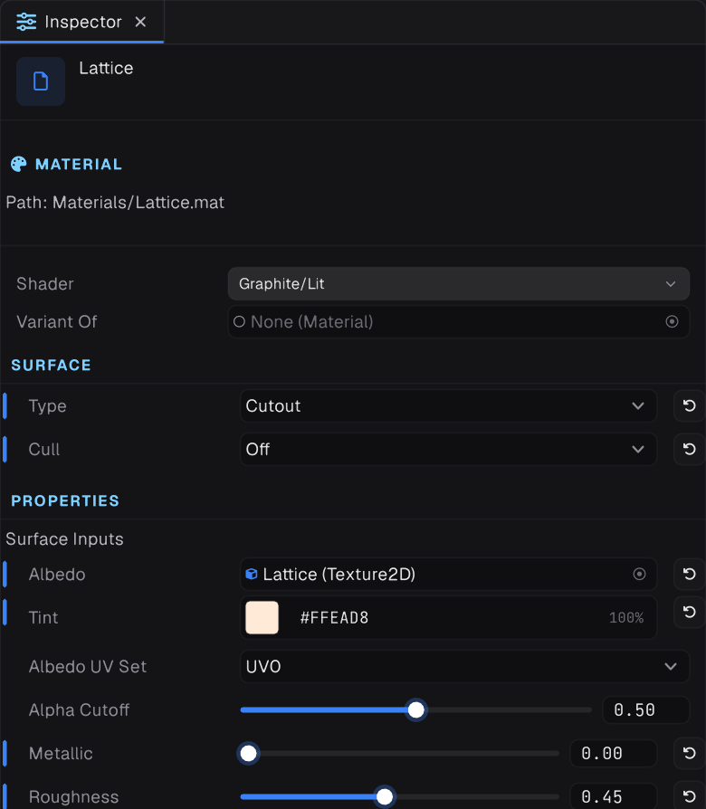
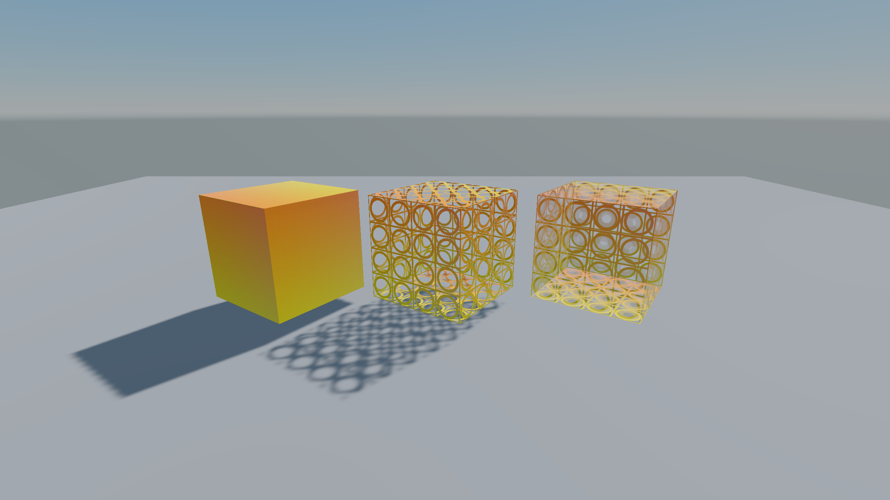

## Colours are linear

Colour values in materials and lights are linear. Textures are decoded from sRGB, but a colour you type is used as is. Convert a picked colour first, roughly `value ^ 2.2`: sRGB 0.5 grey is linear 0.21.

## The Lit shader




The built-in Lit shader is OpenPBR Surface v1.1.1. Its properties are the spec's parameters under their spec names, so values from a tool that speaks OpenPBR carry across unchanged.

| Group | Properties |
| --- | --- |
| Base | `base_weight`, `base_color`, `base_metalness`, `base_diffuse_roughness` |
| Specular | `specular_weight`, `specular_color`, `specular_roughness`, `specular_roughness_anisotropy`, `specular_ior` |
| Transmission | `transmission_weight`, `transmission_color`, `transmission_depth`, `transmission_scatter`, `transmission_scatter_anisotropy`, `transmission_dispersion_scale`, `transmission_dispersion_abbe_number` |
| Subsurface | `subsurface_weight`, `subsurface_color`, `subsurface_radius`, `subsurface_radius_scale`, `subsurface_scatter_anisotropy` |
| Coat | `coat_weight`, `coat_color`, `coat_roughness`, `coat_roughness_anisotropy`, `coat_ior`, `coat_darkening` |
| Fuzz | `fuzz_weight`, `fuzz_color`, `fuzz_roughness` |
| Emission | `emission_luminance` (nits), `emission_color` |
| Thin film | `thin_film_weight`, `thin_film_thickness` (micrometres), `thin_film_ior` |
| Geometry | `geometry_opacity`, `geometry_thin_walled` |
| Prowl extras | `ambient_occlusion`, `ambient_occlusion_map_strength`, `normal_scale`, `coat_normal_scale`, `height_scale`, `tangent_rotation`, `alpha_cutoff` |

The defaults are the spec's: a grey `base_color` of 0.8, `specular_roughness` 0.3, `specular_ior` 1.5, and every optional layer off.

### Maps

Every input `X` that can take a texture has a map named `X_map`, such as `base_color_map` or `specular_roughness_map`. The input is `X` times its map wherever the map is set. Normals, tangents and height have maps of their own: `geometry_normal_map`, `geometry_coat_normal_map`, `geometry_tangent_map` and `geometry_height_map`.

Each map carries its own settings, so one packed texture can feed several inputs:

```csharp
material.SetTexture("specular_roughness_map", orm);
material.SetTextureChannel("specular_roughness_map", 1);   // 0 to 3 for R to A
material.SetTexture("base_metalness_map", orm);
material.SetTextureChannel("base_metalness_map", 2);
material.SetTextureUVSet("ambient_occlusion_map", 1);      // UV0 or UV1
material.SetTextureScaleOffset("base_color_map", new Float4(4f, 4f, 0f, 0f));
material.SetTextureRotation("base_color_map", MathF.PI * 0.25f);   // radians, counter clockwise
```

Scalar inputs read one channel of their map, colours read RGB.

### Optional layers cost nothing until used

Coat, fuzz, thin film, subsurface, anisotropy, transmission and parallax are each compiled in only while their weight is above zero: `coat_weight`, `fuzz_weight`, `thin_film_weight`, `subsurface_weight`, either roughness anisotropy, `transmission_weight` and `height_scale`. A plain material pays for none of them.

- **Parallax:** set `geometry_height_map` (white at the surface, black `height_scale` below it) and a `height_scale` above 0. Every map, and the cutout of the shadow, follows the relief. It needs mesh tangents.
- **Thin walled:** `geometry_thin_walled` on draws both sides whatever the material's culling. With subsurface it makes leaves and paper glow when lit from behind.
- **Transmission:** glass and liquids. A material with `transmission_weight` above 0 draws as transparent whatever its surface type, refracting the opaque scene behind it.

### Emission is in nits

`emission_luminance` is in nits, like a real screen or lamp, and is 0 by default. How bright it looks depends on the camera's exposure, see [Exposure](02-cameras-and-post-processing.md#exposure-and-physical-light). At the default exposure, EV100 14, about 20000 nits shows as white; a phone screen at 500 nits barely shows in daylight, as a real one does. Bloom picks up whatever goes above white.

## Setting properties in code

```csharp
var renderer = GetComponent<MeshRenderer>();
renderer.Material!.SetColor("base_color", new Color(0.9f, 0.22f, 0.03f, 1f));
renderer.Material!.SetFloat("specular_roughness", 0.4f);
renderer.Material!.SetFloat("coat_weight", 1f);
```

For a per-object value, `Clone()` the material and assign the copy, and dispose clones you no longer need.

## Opaque, cutout and transparent




The built-in Lit and Unlit shaders switch per material:

```csharp
material.Surface = new SurfaceSettings(SurfaceType.Transparent, SurfaceBlend.Alpha, SurfaceCull.Back);
```

`SurfaceType` is `Opaque`, `Cutout` or `Transparent`; `SurfaceBlend` is `Alpha`, `Premultiplied`, `Additive` or `Multiply`; `SurfaceCull` is `Back`, `Front` or `Off`. Cutout tests `geometry_opacity` against `alpha_cutoff`, and transparent surfaces fade by `geometry_opacity`. Load the built-in shaders with `Shader.LoadDefault(DefaultShader.Lit)` or `DefaultShader.Unlit`.

Transparent materials still cast shadows, dithered by how much light they let through.

## Unlit

The Unlit shader has `base_color`, `base_color_map`, `emission_luminance` and `alpha_cutoff`. It glows at `emission_luminance` nits, 20000 by default, which shows its colour as it is at the default exposure, EV100 14. Lower it for a scene exposed for night or indoors, or it glows past white.


## Writing your own

Shader files use Graphite's ShaderDef format with GLSL bodies, compiled to SPIR-V by Prism. See the [Shaders](../04-shaders/index.md) section.
