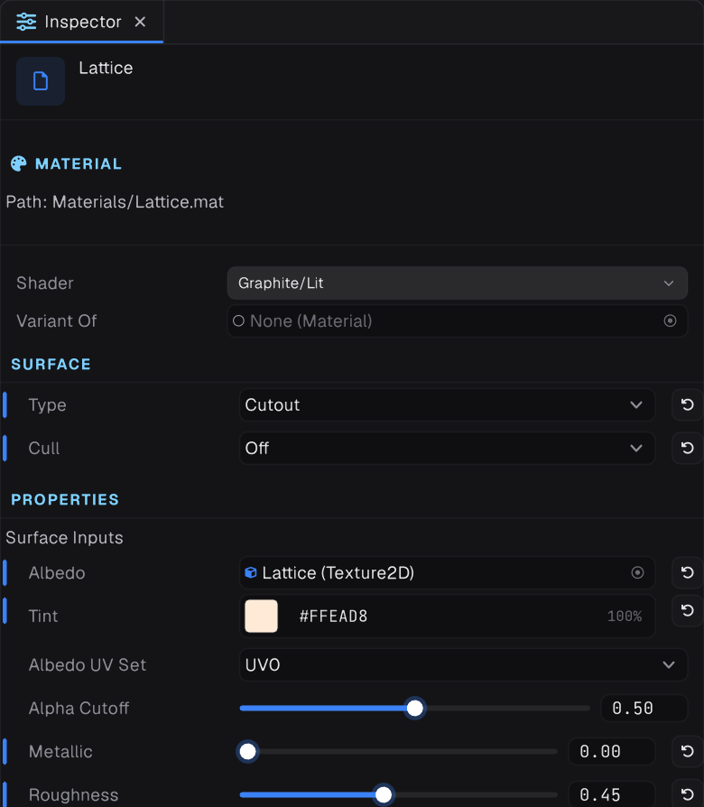
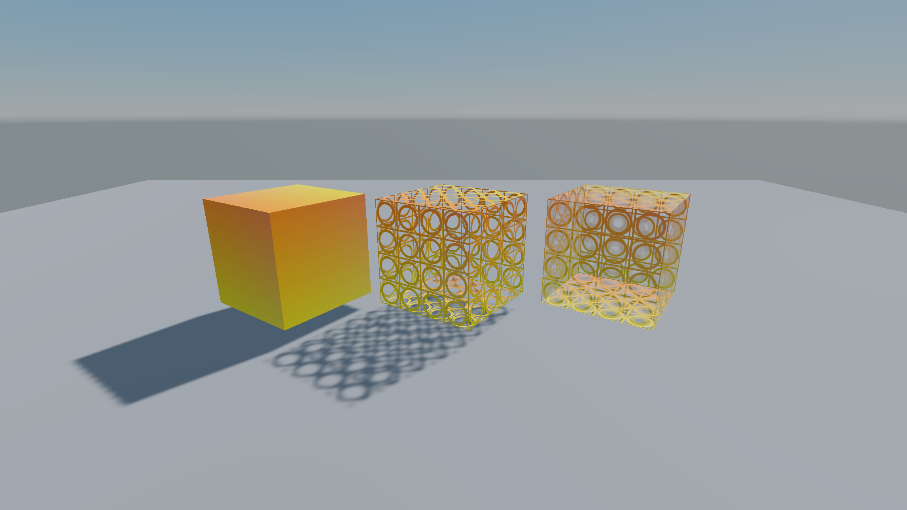

## Colours are linear

Colour values in materials and lights are linear. Textures are decoded from sRGB, but a colour you type is used as is. Convert a picked colour first, roughly `value ^ 2.2`: sRGB 0.5 grey is linear 0.21.

## Standard shader properties




| Property | Meaning |
| --- | --- |
| `_MainTex`, `_MainColor` | Albedo texture and tint |
| `_NormalTex`, `_NormalScale` | Normal map |
| `_SurfaceTex` | G is roughness, B is metallic |
| `_Roughness`, `_Metallic` | Multipliers on the surface texture |
| `_OcclusionTex` | Ambient occlusion in R |
| `_EmissionTex`, `_EmissiveColor`, `_EmissionIntensity` | Emission |
| `_Tiling`, `_Offset` | UV tiling and offset |

> [!IMPORTANT]
> Metallic and emission do nothing on their own. Metallic is `_SurfaceTex.b * _Metallic`, and emission is `_EmissionTex * _EmissiveColor * _EmissionIntensity`. Assign a surface or emission texture first.

## Setting properties in code

```csharp
var renderer = GetComponent<MeshRenderer>();
renderer.Material!.SetColor("_MainColor", new Color(0.9f, 0.22f, 0.03f, 1f));
renderer.Material!.SetFloat("_Roughness", 0.4f);
```

For a per-object colour, `Clone()` the material and assign the copy, and dispose clones you no longer need.

## Opaque, cutout and transparent




The built-in Lit and Unlit shaders switch per material:

```csharp
material.Surface = new SurfaceSettings(SurfaceType.Transparent, SurfaceBlend.Alpha, SurfaceCull.Back);
```

`SurfaceType` is `Opaque`, `Cutout` or `Transparent`; `SurfaceBlend` is `Alpha`, `Premultiplied`, `Additive` or `Multiply`; `SurfaceCull` is `Back`, `Front` or `Off`. Load the built-in shaders with `Shader.LoadDefault(DefaultShader.Lit)` or `DefaultShader.Unlit`.

## Writing your own

Shader files use Graphite's ShaderDef format with GLSL bodies, compiled to SPIR-V by Prism. See the [Shaders](../04-shaders/index.md) section.
