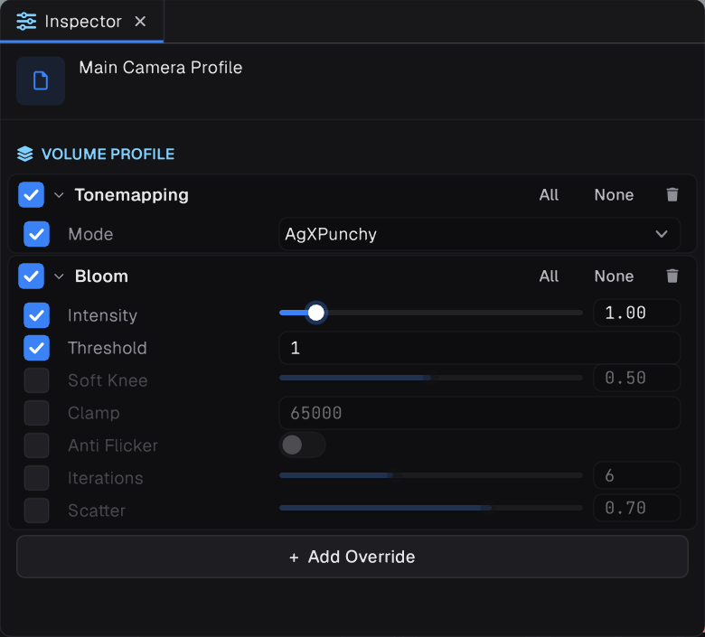

## Camera defaults

A new Camera has `FieldOfView` 60 and no anti-aliasing. `Camera.Main` is the enabled camera with the highest `Depth` that draws to the screen.

Cameras render in HDR by default (`camera.HDR`), and a **Tonemapping** volume component maps that light to the display. Which cameras have one:

| Camera made by | Profile |
| --- | --- |
| A new scene, or **GameObject › Camera** | `VolumeProfile.CreateCameraDefault`, with Tonemapping set to **AgX Punchy** |
| `AddComponent<Camera>()` in code | **None.** Without tonemapping, light above 1 clips, so give it the default profile |

```csharp
using Prowl.Runtime.Rendering;

var camera = cameraObject.AddComponent<Camera>();
camera.Profile = VolumeProfile.CreateCameraDefault("Main Camera Profile");
```

Anti-aliasing is a camera setting, not an effect:

```csharp
camera.AntiAliasing = AntiAliasingMode.TAA;   // or FXAA, SMAA
```

## Volume profiles




Post processing comes from a `VolumeProfile`. Each setting only counts once it is overridden, so use `.Set(value)` to set and override in one go.

```csharp
using Prowl.Runtime.Rendering;

camera.Profile = VolumeProfile.CreateCameraDefault("Main Camera Profile");
camera.Profile.Add<Bloom>().Intensity.Set(1f);
camera.Profile.Get<Tonemapping>()!.Mode.Set(TonemappingMode.ACES);
```

Available components include `Tonemapping`, `Bloom`, `AutoExposure`, `AmbientOcclusion`, `ScreenSpaceReflections`, `MotionBlur`, `DepthOfField`, `GodRays`, `Vignette`, `ChromaticAberration`, `FilmGrain`, `ColorGrading` and `ColorLookup`.

> [!TIP]
> `Bloom` is off until `Intensity` is above 0, and its `Threshold` defaults to 1.2, so mostly emissive surfaces glow. Lower the threshold to make lit surfaces bloom too.

## Tonemapping

`Tonemapping.Mode` is a `TonemappingMode`:

| Mode | Look |
| --- | --- |
| `AgXPunchy` | The default. AgX with more contrast and saturation |
| `AgXNeutral` | AgX with no look: flat and desaturated, a good base for colour grading |
| `ACES` | Punchy, filmic contrast |
| `Reinhard` | Extended Reinhard on luminance, white at 2 |
| `RomBinDaHouse`, `Uncharted2` | Classic game curves |
| `None` | Off. Light above 1 clips |

## Custom post effects

A `PostEffect` is a post effect written as one fragment shader. Each `VolumeParameter` field reaches the shader as a uniform named after it with an underscore, so `Amount` becomes `_Amount`. The shader reads the image with `Graphite_SampleSource(vUV)` and writes `outColor`.

```csharp
using Prowl.Runtime.Rendering;

[VolumeComponentMenu("Custom/Invert")]
public sealed class Invert : PostEffect
{
    public VolumeParameter<float> Amount = new(0f);
    public override bool IsActive => Amount.Value > 0f;

    protected override string Shader => """
        uniform float _Amount;
        void main()
        {
            vec4 c = Graphite_SampleSource(vUV);
            outColor = vec4(mix(c.rgb, 1.0 - c.rgb, _Amount), c.a);
        }
        """;
}
```

Floats, ints and enums arrive as themselves, bools as 0 or 1, colours and `Float2` to `Float4` as vectors, and a `Texture2D` as a `sampler2D`. Add the effect to a volume profile like any built-in component.

| `Stage` | Runs |
| --- | --- |
| `AfterOpaques` | After the opaques and sky, before transparents, in linear light |
| `BeforeTonemap` | After transparents, in linear light, where bloom and depth of field run |
| `Tonemap` | **Instead of** the Tonemapping component, as a custom tonemapper |
| `AfterTonemap` (default) | On the colour as displayed |

Override `Order` to sort effects in the same stage, and `ReadsDepth` to read the scene depth as `_CameraDepthTexture`. Effects that need several passes or their own textures derive from `VolumeComponent<TFeature>` instead.

### A custom tonemapper

At the `Tonemap` stage, your shader maps linear HDR light to linear 0 to 1. Prowl clamps the result and encodes it for the display afterwards, and your effect takes the place of the Tonemapping component.

```csharp
[VolumeComponentMenu("Custom/Soft Tonemap")]
public sealed class SoftTonemap : PostEffect
{
    public VolumeParameter<float> Exposure = new(1f);
    public VolumeParameter<float> Shoulder = new(0.8f);
    public override bool IsActive => true;
    protected override PostEffectStage Stage => PostEffectStage.Tonemap;

    protected override string Shader => """
        uniform float _Exposure;
        uniform float _Shoulder;
        void main()
        {
            vec3 c = Graphite_SampleSource(vUV).rgb * _Exposure;
            outColor = vec4(c / (c + vec3(_Shoulder)) * (1.0 + _Shoulder), 1.0);
        }
        """;
}
```

> [!NOTE]
> Using `override string Shader` does mean the Build pipeline cant pre-compile the shader. Using a Material is preferred, but for Simplicity sake the override is fine.
