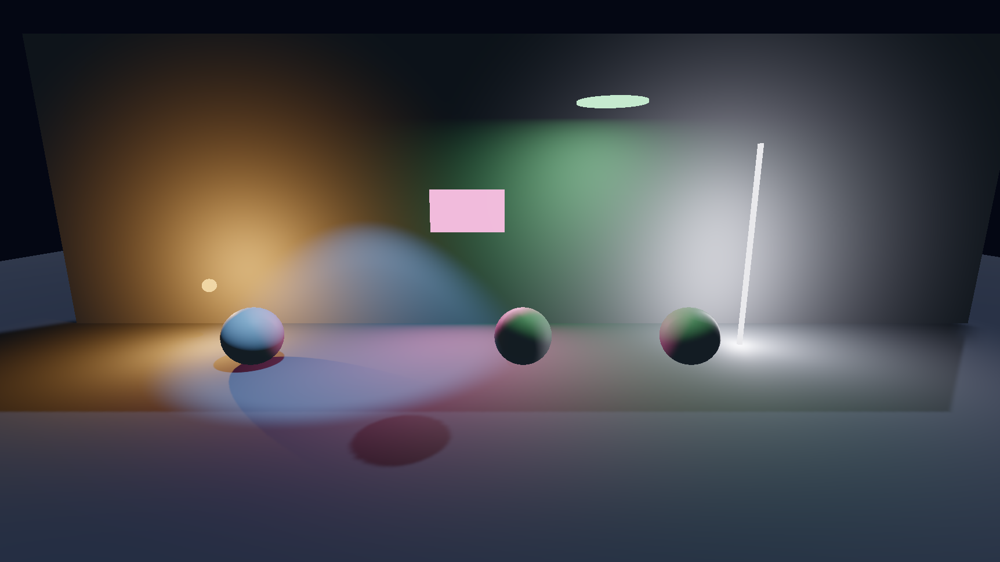
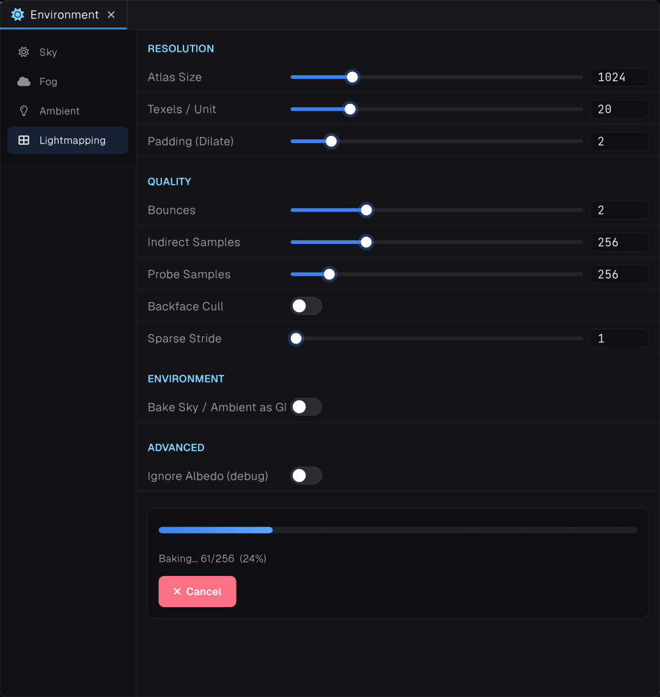

## Light types




A single `Light` component covers every type. It shines along its Transform's forward axis.

| `LightType` | Shape settings |
| --- | --- |
| `Directional` | Up to 4 shadow cascades |
| `Point` | Point light shadows |
| `Spot` | `InnerAngle`, `OuterAngle` (half angles) |
| `Rect` | `Width`, `Height` |
| `Disk` | `Width` as the diameter |
| `Tube` | `Length`, `SourceRadius` |

```csharp
var lamp = new GameObject("Lamp");
var light = lamp.AddComponent<Light>();
light.Type = LightType.Spot;
Scene.Current.Add(lamp);
```

Lights also support cookies and IES profiles.

## Shadows

Renderers have `ShadowCasting` (`Off`, `On`, `ShadowsOnly`) and `ReceiveShadows`. Shadows live in an atlas that caches static shadows and sizes each one by how much of the screen it covers.

## Baked lighting




Only objects marked `IsStatic` receive lightmaps. Bake from the Environment panel; the bake only progresses while that panel is open.
