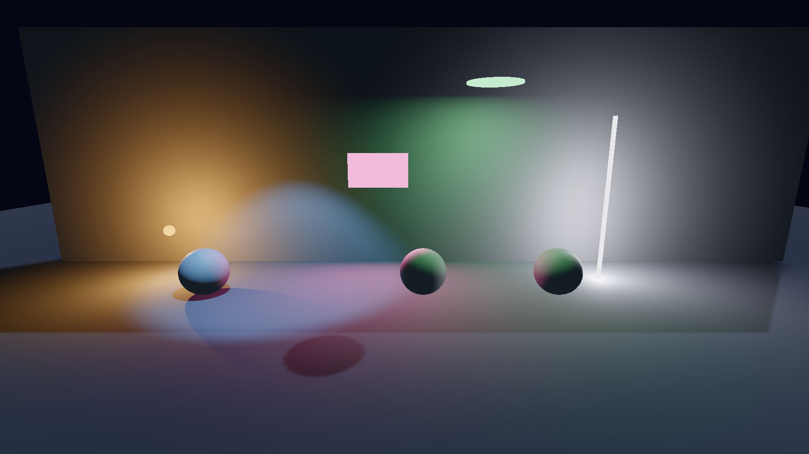
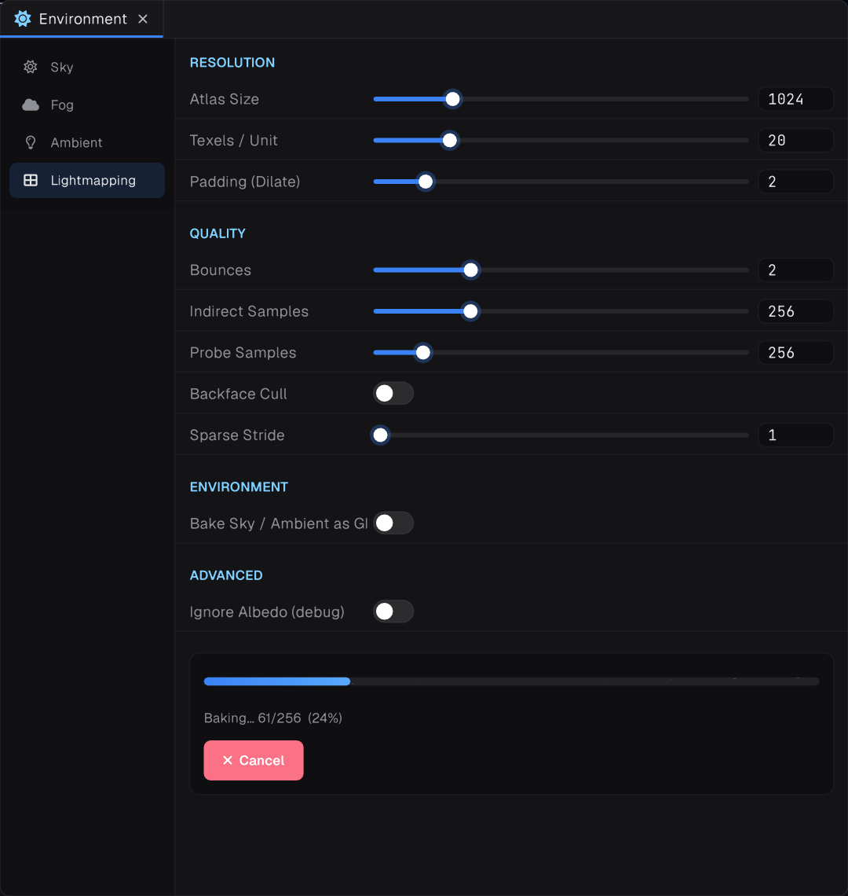

## Light types




Each kind of light is its own component, under **Add Component > Rendering > Lights**. Every light shines along its Transform's forward axis.

| Component | Like | Intensity in | Shape settings |
| --- | --- | --- | --- |
| `DirectionalLight` | The sun | lux | `AngularRadius`, `CascadeBlend` |
| `PointLight` | A bare bulb | candela | `SourceRadius` |
| `SpotLight` | A flashlight | candela | `SpotAngle` (the whole cone, in degrees), `SpotSoftness`, `SourceRadius` |
| `RectLight` | A panel or screen | nits | `Width`, `Height` |
| `DiskLight` | A round ceiling light | nits | `Diameter` |
| `TubeLight` | A fluorescent tube | nits | `Length`, `Radius` |

Point and spot lights can shine through a `Cookie` texture (a 2D texture across a spot's cone, a cubemap around a point) and an `IesProfile`.

## Units and presets

Lights are in real world units, so they match the camera's exposure, see [Exposure](02-cameras-and-post-processing.md#exposure-and-physical-light). A new light starts as a real one: a 60 W bulb, a downlight, a midday sun. Pick another from the preset list in the inspector, or from code:

```csharp
var sun = GetComponent<DirectionalLight>();
sun.ApplyPreset(sun.Presets[2]);   // Sunset
```

`Intensity` is kept in the light's own unit from the table above. The inspector also takes lumens (the number on a bulb box) for local lights and EV100 for directional lights. Convert in code with `ToStored` and `FromStored`:

```csharp
var bulb = Scene.Create("Bulb").AddComponent<PointLight>();
bulb.Intensity = bulb.ToStored(LightUnit.Lumen, 1600f);   // a 100 W bulb
```

| Preset | Amount |
| --- | --- |
| Candle, 40 W, 60 W and 100 W bulbs, street lamp | 12, 450, 800, 1600 and 15000 lumens |
| Flashlight, downlight, car headlight, stage spot | 300, 800, 1500 and 10000 lumens |
| Midday sun, low sun, sunset, full moon | 100000, 20000, 2000 and 0.25 lux |

## Colour and temperature

`Color` is linear. With `UseTemperature` on, the light takes the colour of a glowing body at `Temperature` Kelvin, tinted by `Color` like a filter: a candle about 1900, a bulb 2700, daylight 5600, an overcast sky 6500. `FinalColor` is the colour it shines.

## Range

Local lights fade with distance as real light does, and stop where their brightest channel falls below the quality level's `LightCutoff`, 0.01 lux by default. That is their `AutomaticRange`. Set `Range` to choose one yourself, which turns `OverrideRange` on.

## Shadows

Directional, point and spot lights cast shadows. Area lights do not yet.

| Setting | Meaning |
| --- | --- |
| `CastShadows`, `ShadowStrength` | On or off, and how dark |
| `ShadowResolution` | The largest shadow tile the light takes, capped by the quality level |
| `ShadowFilter` | `Hard`, `Tent` (soft, even width) or `ContactHardening` (sharp where objects touch, wider further away) |
| `DepthBias`, `NormalBias` | How far receivers are pushed before the test, in shadow map texels |

Contact hardening takes its softness from the light's size: `SourceRadius` for point and spot lights, `AngularRadius` for a directional light (the sun's is about 0.27 degrees).

How far directional shadows reach and how many cascades they split into come from the [quality level](06-quality.md), not the light. Shadows live in an atlas that caches static shadows and sizes each one by how much of the screen it covers. Dense volumetric clouds also shade the ground under them.

Renderers have `ShadowCasting` (`Off`, `On`, `ShadowsOnly`) and `ReceiveShadows`. Transparent materials cast shadows dithered by how much light they let through.

## Layers

`LayerMask` picks the layers a light reaches. Objects on other layers are not lit by it.

## Baked lighting




`BakeMode` decides what a light gives the bake:

| `LightBakeMode` | Meaning |
| --- | --- |
| `Realtime` | The default. Never baked |
| `Mixed` | Direct light and shadows stay realtime, bounced light is baked into lightmaps and probes |
| `Baked` | Baked into lightmaps and probes and left out of realtime lighting |

Only objects marked `IsStatic` receive lightmaps. Bake from the Environment panel; the bake only progresses while that panel is open. Every loaded scene bakes together, each keeping its own lightmaps and probes.
