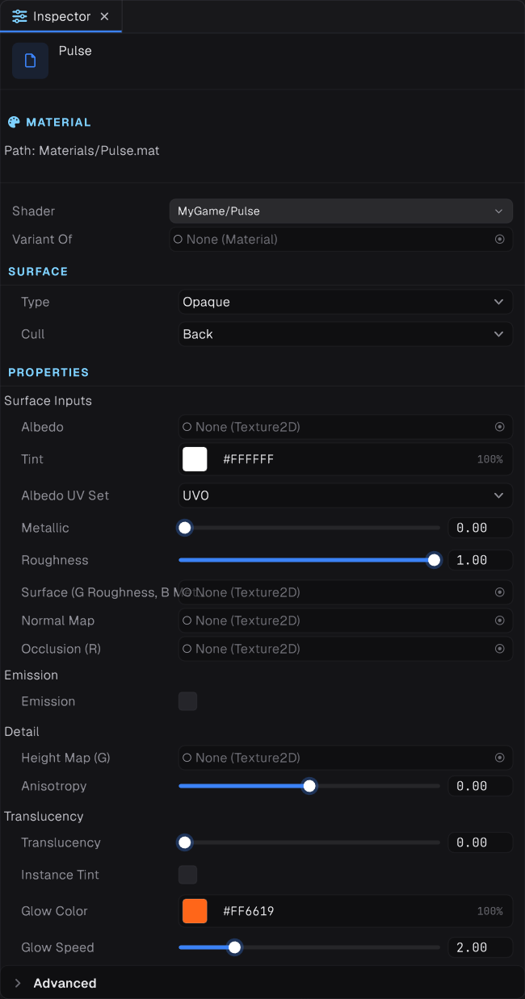
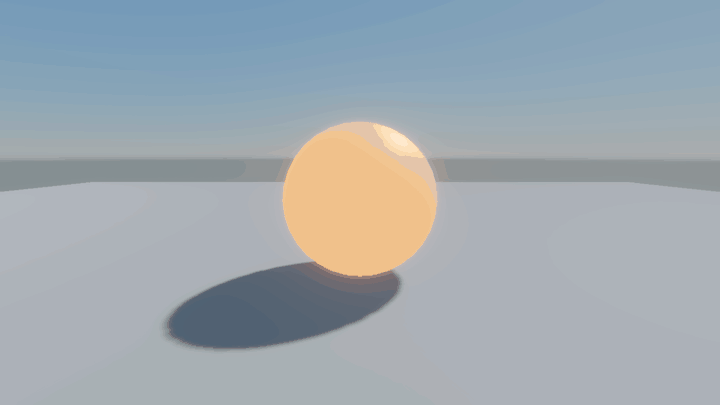

This walkthrough builds a lit shader with a coloured glow that pulses over time. It uses a `Surface "Lit"` block, so shadows, lighting and fog all work without extra code.

## 1. Create the file

Create `Assets/Shaders/Pulse.shader`:

```glsl
Shader "MyGame/Pulse"
{
    Surface "Lit"
    {
    }
}
```

This already works. A `Surface "Lit"` block with no code gives you a shader identical to the built-in Lit shader, with all its properties: albedo, normal map, metallic, roughness, emission and the rest.

## 2. Add properties




Properties are the values a material can change. They appear in the inspector.

```glsl
Shader "MyGame/Pulse"
{
    Properties
    {
        _GlowColor("Glow Color", Color) = (1.0, 0.4, 0.1, 1.0) [HDR]
        _GlowSpeed("Glow Speed", Float) = 2.0 [Range(0, 10)]
    }

    Surface "Lit"
    {
    }
}
```

Your properties are added to the standard Lit ones, so the material still has its albedo texture, tint and so on.

## 3. Write the surface function

```glsl
    Surface "Lit"
    {
        GLSLPROGRAM
        uniform vec4 _GlowColor;
        uniform float _GlowSpeed;

        void Surface(inout Graphite_SurfaceData s)
        {
            float time = Graphite_View().time.x;
            float pulse = 0.5 + 0.5 * sin(time * _GlowSpeed);
            s.Emission += _GlowColor.rgb * pulse;
        }
        ENDGLSL
    }
```

`Surface` runs for every pixel before lighting. `s` already holds the standard surface built from the material's textures; you change what you want and leave the rest.

- Each property is read by declaring a `uniform` with the same name and a matching type.
- `Graphite_View()` returns the camera's data. Its `time.x` is the time in seconds.

## 4. Use it




1. Create a material and choose **MyGame/Pulse** as its shader.
2. Assign the material to a mesh.
3. Turn on Bloom in the camera's volume profile to make the glow bleed. See [Cameras and post processing](../03-rendering/02-cameras-and-post-processing.md).

From code:

```csharp
public sealed class PulseSetup : Component
{
    public Shader PulseShader;   // assign MyGame/Pulse in the inspector

    public override void Start()
    {
        var material = new Material(PulseShader);
        material.SetColor("_GlowColor", new Color(0.1f, 0.6f, 1f, 1f));
        material.SetFloat("_GlowSpeed", 4f);
        GetComponent<MeshRenderer>()!.Material = material;
    }
}
```

> [!TIP]
> Colours are linear. A colour picked in an image editor looks washed out unless you convert it, or mark the property `[Gamma]` so the inspector converts it for you.

## Next

- Everything a surface function can read and change: [Surface shaders](02-surface-shaders.md)
- Every property type and attribute: [Properties and attributes](03-properties-and-attributes.md)
