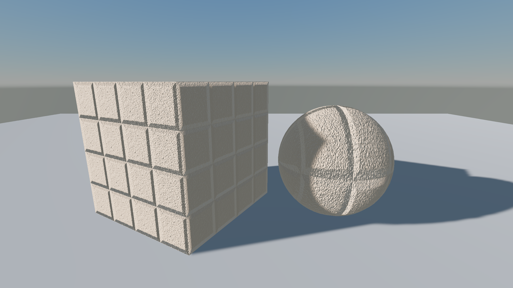
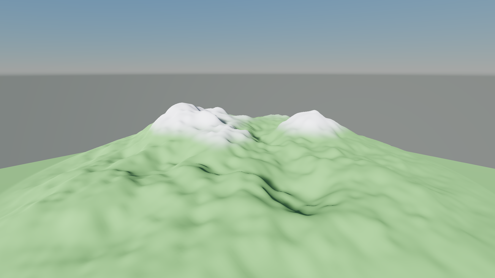
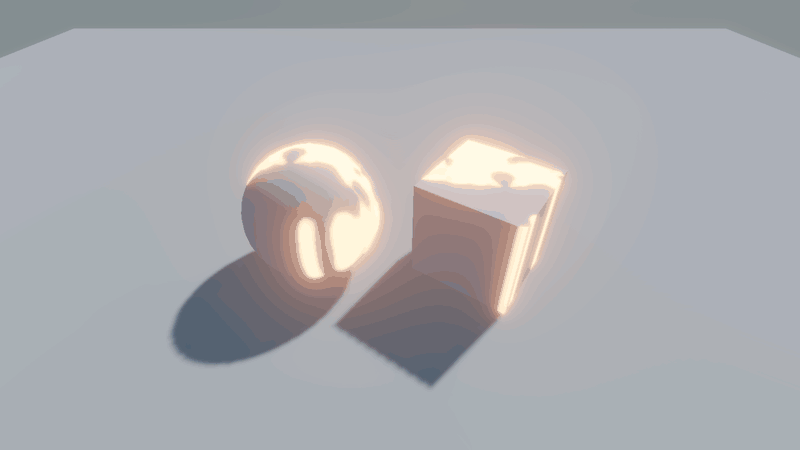
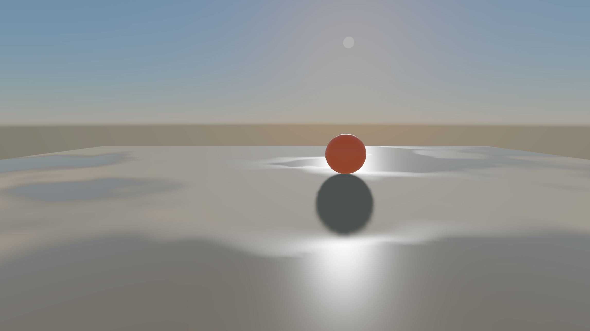

A `Surface` block gives your shader Graphite's standard passes, **Forward**, **Prepass**, **ShadowCaster** and **Debug** (the editor's debug views), with every feature of the built-in shader. You write only the parts you want to change.

## The three parts

```glsl
Surface "Lit"
{
    GLSLPROGRAM
    // 1. The surface: change colour, normals, roughness, emission and alpha per pixel
    void Surface(inout Graphite_SurfaceData s) { ... }
    ENDGLSL

    Vertex
    {
        GLSLPROGRAM
        // 2. Optional: move vertices, in every pass
        void SurfaceVertex(inout Graphite_SurfaceVertex v) { ... }
        ENDGLSL
    }

    Lighting
    {
        GLSLPROGRAM
        // 3. Optional: replace how lights and ambient light shade the surface
        vec3 Graphite_BRDF(Graphite_Surface s, Graphite_LightContribution c) { ... }
        vec3 Graphite_AmbientBRDF(Graphite_Surface s, vec3 irradiance, vec3 specular) { ... }
        ENDGLSL
    }
}
```

All three are optional. A `Surface "Lit" { }` with nothing in it is the built-in Lit shader.

| Part | Runs in | See |
| --- | --- | --- |
| Surface code | Forward and Debug; the depth passes too for cutout surfaces | This page |
| `Vertex` block | Every pass, so shadows and depth match | [Vertex animation](05-vertex-animation.md) |
| `Lighting` block | The lit passes, Forward and Debug. `Surface "Unlit"` has no lights and refuses one | [Custom lighting](06-custom-lighting.md) |

- `"Lit"` is the standard physically based surface: shadows, lightmaps, probes, decals, fog, normal maps, parallax, translucency and anisotropy.
- `"Unlit"` skips lighting, ambient and the PBR inputs.
- Your `Properties` are added to the standard ones. A property with the same name as a standard one replaces it.
- Further `Pass` blocks may follow, as long as their names do not clash with the standard passes. This is how a surface shader adds an [outline pass](06-custom-lighting.md#outlines).

## How it works

A surface model is an ordinary library shader: `Surface "Lit"` expands `Graphite/Standard/Lit.shader`. Its passes mark where your code goes: `#pragma surface` in the fragment stage, `#pragma surface_vertex` in the vertex stage, and `#pragma surface_lighting` in the lit passes' Shared section, where it turns on the custom BRDF.

For each vertex, in every pass:

1. The vertex is loaded in object space.
2. **Your `SurfaceVertex` runs.**
3. It is transformed. The Forward pass runs your function again at last frame's time, for motion vectors.

For each pixel of the Forward pass:

1. Parallax moves the UVs, if the material has a height map.
2. The standard textures are sampled: albedo, normal map, surface map, occlusion and emission.
3. Decals are applied.
4. **Your `Surface` function runs.**
5. Cutout surfaces discard pixels below `_AlphaCutoff`.
6. The surface is lit: every light through `Graphite_BRDF`, ambient light and reflections through `Graphite_AmbientBRDF` (**your Lighting block** for either), then emission and fog.

## Graphite_SurfaceData

| Field | Type | Meaning |
| --- | --- | --- |
| `UV` | `vec2` | UV0, after parallax, before any texture's scale and offset |
| `UV1` | `vec2` | UV1, before any texture's scale and offset |
| `VertexColor` | `vec4` | The mesh's vertex colour |
| `RelativePos` | `vec3` | Position relative to the camera. `Graphite_RelativeToWorld(s.RelativePos)` gives the world position |
| `ViewDir` | `vec3` | Unit direction from the surface toward the camera |
| `GeometryNormal` | `vec3` | The mesh normal, world space, facing the camera on back faces |
| `Tangent`, `Bitangent` | `vec3` | World space tangent frame for normal maps. Arbitrary when the mesh has no tangents |
| `BaseColor` | `vec3` | Albedo, linear |
| `Alpha` | `float` | Opacity, used by cutout and transparent surfaces |
| `Normal` | `vec3` | World space shading normal, after the normal map |
| `Metallic` | `float` | 0 to 1 |
| `Roughness` | `float` | 0 to 1 |
| `Occlusion` | `float` | Ambient occlusion, 1 is unoccluded |
| `Emission` | `vec3` | Light the surface gives off, linear, can exceed 1 |

The first eight are inputs. Change any of the rest.

> [!IMPORTANT]
> **Relative and world.** Graphite renders relative to the camera, so huge worlds stay precise. A *relative* position is world space moved so the camera sits at the origin; *world* means true world space. Use `RelativePos` for lighting maths, and `Graphite_RelativeToWorld(s.RelativePos)` for effects fixed to the world, such as world-space noise or stripes. Directions and normals are always world space, because moving the origin changes none of them.

> [!NOTE]
> The standard textures are sampled **before** your function runs, so changing `s.UV` does not move them. To scroll, distort or triplanar-map a texture, declare your own texture property and sample it in your function.

## Normal maps in surface code

| Function | Use |
| --- | --- |
| `Graphite_SurfaceNormalMap(s, texel, scale)` | A tangent space normal map texel placed on the mesh's frame. Returns a world space normal |
| `Graphite_StandardNormalMap(texel, normal, tangent, bitangent, scale)` | The same on any frame, for blending onto `s.Normal` or for triplanar mapping |

### Example: a detail normal map

```glsl
Shader "MyGame/DetailNormal"
{
    Properties
    {
        _DetailNormal("Detail Normal", Texture2D) = "normal" {} [Normal]
        _DetailScale("Detail Strength", Float) = 0.5 [Range(0, 2)]
        _DetailTiling("Detail Tiling", Float) = 8.0
    }

    Surface "Lit"
    {
        GLSLPROGRAM
        uniform sampler2D _DetailNormal;
        uniform float _DetailScale;
        uniform float _DetailTiling;

        void Surface(inout Graphite_SurfaceData s)
        {
            vec3 texel = texture(_DetailNormal, s.UV * _DetailTiling).rgb;
            // The detail rides on the already normal mapped surface
            s.Normal = Graphite_StandardNormalMap(texel, s.Normal, s.Tangent, s.Bitangent, _DetailScale);
        }
        ENDGLSL
    }
}
```



## Depth passes

The Prepass and ShadowCaster passes run your `Surface` function only for **cutout** surfaces, so a cutout shader casts correctly shaped shadows. They fill in `UV`, `UV1`, `BaseColor`, `Alpha`, `VertexColor` and `RelativePos`, so a cut driven by any of them matches between the lit surface, its depth and its shadow. Their `ViewDir` points toward the depth pass's own camera, which for shadows is the light, and their normals keep defaults.

For opaque surfaces your function only runs in Forward and Debug.

## Keywords you can test

The standard model's variant axes are visible to your code:

| Keyword | Defined when |
| --- | --- |
| `_SURFACE_OPAQUE`, `_SURFACE_CUTOUT`, `_SURFACE_TRANSPARENT` | The material's surface type, set by `material.Surface` |
| `_NORMALMAP`, `_SURFACEMAP`, `_OCCLUSIONMAP`, `_PARALLAXMAP` | The matching texture is set |
| `_EMISSION`, `_TRANSLUCENCY`, `_ANISOTROPIC` | The feature is turned on |
| `_INSTANCE_TINT` | Instance colours multiply the vertex colour |
| `GRAPHITE_STANDARD_FORWARD`, `GRAPHITE_STANDARD_DEPTH` | Which pass is compiling |

## Example: tint by height

```glsl
Shader "MyGame/HeightTint"
{
    Properties
    {
        _LowColor("Low Color", Color) = (0.2, 0.35, 0.15, 1.0)
        _HighColor("High Color", Color) = (0.9, 0.9, 0.95, 1.0)
        _Height("Blend Height", Float) = 10.0
        _Softness("Softness", Float) = 3.0
    }

    Surface "Lit"
    {
        GLSLPROGRAM
        uniform vec4 _LowColor;
        uniform vec4 _HighColor;
        uniform float _Height;
        uniform float _Softness;

        void Surface(inout Graphite_SurfaceData s)
        {
            float y = Graphite_RelativeToWorld(s.RelativePos).y;
            float t = smoothstep(_Height - _Softness, _Height + _Softness, y);
            s.BaseColor *= mix(_LowColor.rgb, _HighColor.rgb, t);
        }
        ENDGLSL
    }
}
```



## Example: world-space dissolve

A dissolve throws pixels away. Set the material's surface to **Cutout**, so the standard passes test `Alpha` against `_AlphaCutoff`. Because the depth passes fill in `RelativePos`, a dissolve in world space cuts the shadow the same way.

```glsl
Shader "MyGame/Dissolve"
{
    Properties
    {
        _NoiseTex("Noise", Texture2D) = "white" {}
        _NoiseScale("Noise Scale", Float) = 0.5
        _Dissolve("Dissolve", Float) = 0.0 [Range(0, 1)]
        _EdgeColor("Edge Color", Color) = (1.0, 0.5, 0.1, 1.0) [HDR]
        _EdgeWidth("Edge Width", Float) = 0.05 [Range(0, 0.2)]
    }

    Surface "Lit"
    {
        GLSLPROGRAM
        uniform sampler2D _NoiseTex;
        uniform float _NoiseScale;
        uniform float _Dissolve;
        uniform vec4 _EdgeColor;
        uniform float _EdgeWidth;

        void Surface(inout Graphite_SurfaceData s)
        {
            vec3 world = Graphite_RelativeToWorld(s.RelativePos);
            float noise = texture(_NoiseTex, world.xz * _NoiseScale).r;
            float edge = noise - _Dissolve;
            s.Alpha = edge < 0.0 ? 0.0 : 1.0;
            s.Emission += _EdgeColor.rgb * (1.0 - smoothstep(0.0, _EdgeWidth, edge));
        }
        ENDGLSL
    }
}
```

```csharp
material.Surface = new SurfaceSettings(SurfaceType.Cutout);
material.SetFloat("_Dissolve", 0.6f);
```



Every texture property automatically has a `_ST` vector with its tiling in `xy` and offset in `zw`. Do not declare it yourself.

## Example: vertex colour masks

The standard surface already multiplies `BaseColor` and `Alpha` by the vertex colour, so a mask painted into red would also tint the surface red. Keep the vertex colour white and paint the mask into vertex alpha instead, where lower alpha means wetter.

```glsl
void Surface(inout Graphite_SurfaceData s)
{
    // Vertex alpha marks wet areas: darker and glossier
    float wet = 1.0 - s.VertexColor.a;
    s.BaseColor *= mix(1.0, 0.55, wet);
    s.Roughness = mix(s.Roughness, 0.08, wet);
    s.Alpha = 1.0;
}
```



## When to write passes instead

Surface shaders now cover vertex animation and custom lighting. Write your own passes for:

- Reading the scene colour or depth: refraction, soft edges. See [Transparency and screen effects](07-transparency-and-screen-effects.md).
- Skies. See [Custom skies](11-custom-skies.md).
- Anything that is not a lit surface at all.
