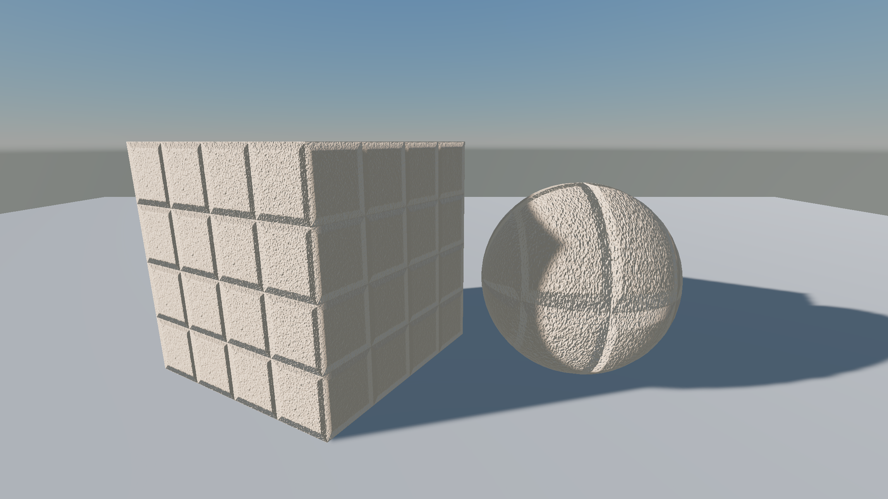
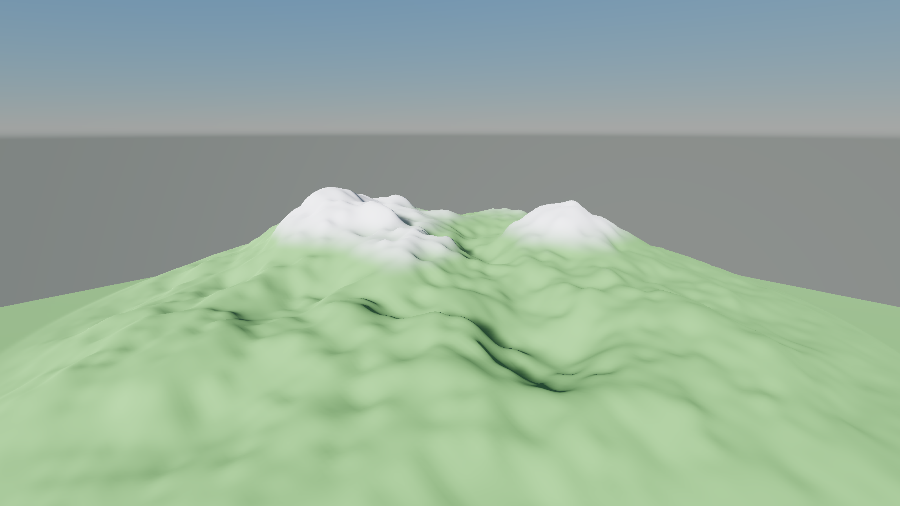
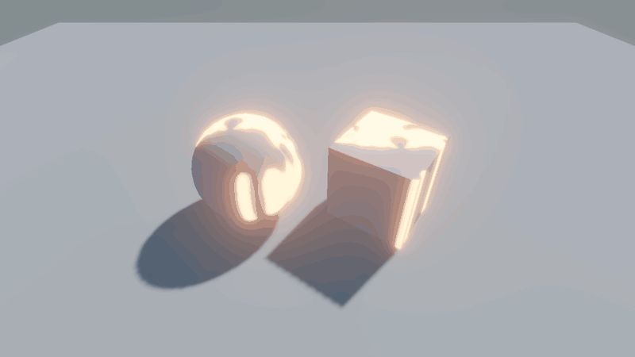
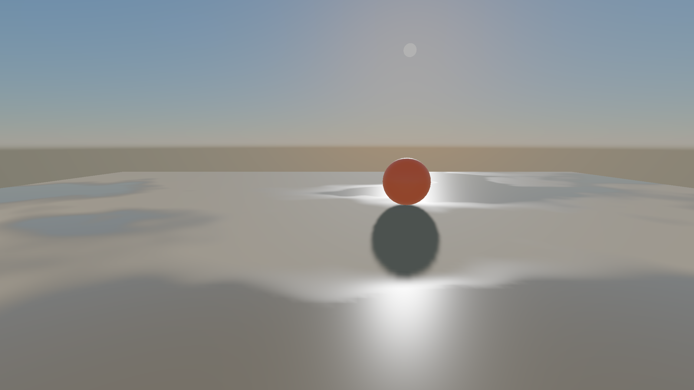

A `Surface` block gives your shader Graphite's standard passes, **Forward**, **Prepass**, **ShadowCaster**, **Transmission**, **BackDepth** and **Debug** (the editor's debug views), with every feature of the built-in shader. You write only the parts you want to change.

## The three parts

```glsl
Surface "Lit"
{
    GLSLPROGRAM
    // 1. The surface: change colour, normals, roughness, emission, opacity and every other input per pixel
    void Surface(inout PBR_Params p, Graphite_SurfaceData i) { ... }
    ENDGLSL

    Vertex
    {
        GLSLPROGRAM
        // 2. Optional: move vertices, in every pass
        void SurfaceVertex(inout Graphite_SurfaceVertex v) { ... }
        ENDGLSL
    }

    Lighting
    {
        GLSLPROGRAM
        // 3. Optional: replace how lights and ambient light shade the surface
        vec3 Graphite_BRDF(PBR_Closure c, Graphite_LightContribution l) { ... }
        vec3 Graphite_AmbientBRDF(PBR_Closure c, PBR_Indirect i) { ... }
        ENDGLSL
    }
}
```

All three are optional. A `Surface "Lit" { }` with nothing in it is the built-in Lit shader.

| Part | Runs in | See |
| --- | --- | --- |
| Surface code | Forward, Transmission and Debug; the depth passes too when they need it | This page |
| `Vertex` block | Every pass, so shadows and depth match | [Vertex animation](05-vertex-animation.md) |
| `Lighting` block | The lit passes. `Surface "Unlit"` has no lights and refuses one | [Custom lighting](06-custom-lighting.md) |

| Model | Is | Surface function |
| --- | --- | --- |
| `"Lit"` | The OpenPBR surface: shadows, lightmaps, probes, decals, fog, normal maps, parallax, coat, fuzz, thin film, subsurface and transmission | `void Surface(inout PBR_Params p, Graphite_SurfaceData i)` |
| `"Unlit"` | A colour that glows at a set brightness, fogged | `void Surface(inout Unlit_Params p, Graphite_SurfaceData i)` |
| `"Sky"` | A sky, see [Custom skies](11-custom-skies.md) | `vec3 Sky(vec3 direction)` |

- Your `Properties` are added to the model's. A property with the same name as a standard one replaces it.
- Further `Pass` blocks may follow, as long as their names do not clash with the standard passes. This is how a surface shader adds an [outline pass](06-custom-lighting.md#outlines).

## How it works

A surface model is an ordinary library shader: `Surface "Lit"` expands `Graphite/Standard/Lit.shader`. Its passes mark where your code goes: `#pragma surface` in the fragment stage, `#pragma surface_vertex` in the vertex stage, and `#pragma surface_lighting` in the lit passes' Shared section, where it turns on the custom BRDF.

For each vertex, in every pass:

1. The vertex is loaded in object space.
2. **Your `SurfaceVertex` runs.**
3. It is transformed. The Forward pass runs your function again at last frame's time, for motion vectors.

For each pixel of the Forward pass:

1. Parallax moves both UV sets, if the material has a height map and a `height_scale`.
2. The material's inputs are built: every value times its map.
3. **Your `Surface` function runs.**
4. Decals are applied over what it made.
5. Cutout surfaces discard pixels whose `geometryOpacity` is below `alpha_cutoff`.
6. The surface is lit: every light through `Graphite_BRDF`, ambient light and reflections through `Graphite_AmbientBRDF` (**your Lighting block** for either), then emission and fog.

## Graphite_SurfaceData

The second argument tells you about the point. It is read only.

| Field | Type | Meaning |
| --- | --- | --- |
| `uv` | `vec2` | UV0, after parallax, before any texture's scale and offset |
| `uv1` | `vec2` | UV1, the same |
| `vertexColor` | `vec4` | The mesh's vertex colour times the object's colour |
| `relativePos` | `vec3` | Position relative to the camera. `Graphite_RelativeToWorld(i.relativePos)` gives the world position |
| `viewDir` | `vec3` | Unit direction from the surface toward the camera |
| `geometryNormal` | `vec3` | The mesh normal, world space, facing the camera on back faces |
| `tangent`, `bitangent` | `vec3` | World space tangent frame for normal maps. Arbitrary when the mesh has no tangents |

> [!IMPORTANT]
> **Relative and world.** Graphite renders relative to the camera, so huge worlds stay precise. A *relative* position is world space moved so the camera sits at the origin; *world* means true world space. Use `relativePos` for lighting maths, and `Graphite_RelativeToWorld(i.relativePos)` for effects fixed to the world, such as world-space noise or stripes. Directions and normals are always world space, because moving the origin changes none of them.

## PBR_Params

The first argument holds every OpenPBR input, already built from the material's values and maps. Its fields are the material properties in camel case: `base_color` is `baseColor`.

| Field | Type | Meaning |
| --- | --- | --- |
| `baseWeight`, `baseColor` | `float`, `vec3` | Diffuse colour, linear. `baseColor` already includes the vertex colour |
| `baseMetalness` | `float` | 0 to 1 |
| `baseDiffuseRoughness` | `float` | Rough diffuse, like clay or the moon |
| `specularWeight`, `specularColor`, `specularIor` | | The dielectric reflection |
| `specularRoughness`, `specularRoughnessAnisotropy` | `float` | 0 to 1 |
| `coatWeight`, `coatColor`, `coatRoughness`, `coatIor`, `coatDarkening` | | A clear coat on top |
| `fuzzWeight`, `fuzzColor`, `fuzzRoughness` | | Velvet and dust |
| `subsurfaceWeight`, `subsurfaceColor`, `subsurfaceRadius` | | Light scattering under the surface |
| `transmissionWeight`, `transmissionColor`, `transmissionDepth` | | Glass and liquids |
| `thinFilmWeight`, `thinFilmThickness`, `thinFilmIor` | | Soap bubble and oil slick colours, thickness in micrometres |
| `emissionColor`, `emissionLuminance` | `vec3`, `float` | Light given off, in nits |
| `geometryOpacity` | `float` | Coverage, used by cutout and transparent surfaces. Includes the vertex alpha |
| `geometryNormal`, `geometryTangent` | `vec3` | World space shading normal after the normal map, and the anisotropy direction |
| `geometryCoatNormal` | `vec3` | The coat's own normal |
| `geometryThinWalled` | `bool` | A thin sheet rather than a solid |
| `occlusion` | `float` | Ambient occlusion, 1 is unoccluded. Darkens indirect light only |

> [!IMPORTANT]
> Coat, fuzz, thin film, subsurface, anisotropy and transmission are compiled in only while the material's weight for them is above zero. Raising `p.coatWeight` from zero in your function does nothing unless the material turns the layer on: give the property a nonzero value, or call `material.SetKeyword("PBR_COAT", true)`. The axes are `PBR_COAT`, `PBR_FUZZ`, `PBR_THIN_FILM`, `PBR_SUBSURFACE`, `PBR_ANISOTROPY` and `PBR_TRANSMISSION`.

> [!NOTE]
> The material's maps are sampled **before** your function runs, and `i` is read only, so you cannot move them through the UVs. To scroll, distort or triplanar-map a texture, declare your own texture property and sample it in your function.

## Unlit_Params

`Surface "Unlit"` gives you `baseColor`, `emissionLuminance` and `alpha`. The surface glows at `baseColor * emissionLuminance` nits.

## Normal maps in surface code

| Function | Use |
| --- | --- |
| `Graphite_SurfaceNormalMap(i, texel, scale)` | A tangent space normal map texel placed on the mesh's frame. Returns a world space normal |
| `Graphite_StandardNormalMap(texel, normal, tangent, bitangent, scale)` | The same on any frame, for blending onto `p.geometryNormal` or for triplanar mapping |

Both rebuild Z from X and Y, so two channel normal maps read the same as three channel ones.

### Example: a detail normal map

```glsl
Shader "MyGame/DetailNormal"
{
    Properties
    {
        _DetailNormal("Detail Normal", Texture2D) = "normal" {} [Normal]
        _DetailScale("Detail Strength", Float) = 0.5 [Range(0, 2)]
        _DetailTiling("Detail Tiling", Float) = 8.0
    }

    Surface "Lit"
    {
        GLSLPROGRAM
        uniform sampler2D _DetailNormal;
        uniform float _DetailScale;
        uniform float _DetailTiling;

        void Surface(inout PBR_Params p, Graphite_SurfaceData i)
        {
            vec3 texel = texture(_DetailNormal, i.uv * _DetailTiling).rgb;
            // The detail rides on the already normal mapped surface
            p.geometryNormal = Graphite_StandardNormalMap(texel, p.geometryNormal, i.tangent, i.bitangent, _DetailScale);
        }
        ENDGLSL
    }
}
```



## Depth passes

The Prepass and ShadowCaster passes run your `Surface` function only when they need it: for **cutout** surfaces, so a cutout shader casts correctly shaped shadows; for transparent and transmissive shadow casters, which dither by their opacity; and in the prepass while the camera asks for normals. They fill in `uv`, `uv1`, `vertexColor` and `relativePos`, so a cut driven by any of them matches between the lit surface, its depth and its shadow. Their `viewDir` points toward the depth pass's own camera, which for shadows is the light.

Write your function so it works in every pass: only its effect on `geometryOpacity` and `geometryNormal` matters there.

## Keywords you can test

The standard model's variant axes are visible to your code:

| Keyword | Defined when |
| --- | --- |
| `_SURFACE_OPAQUE`, `_SURFACE_CUTOUT`, `_SURFACE_TRANSPARENT` | The material's surface type, set by `material.Surface` |
| `PBR_COAT`, `PBR_FUZZ`, `PBR_THIN_FILM`, `PBR_SUBSURFACE`, `PBR_ANISOTROPY`, `PBR_TRANSMISSION` | The layer's weight is above zero |
| `PBR_THIN_WALLED` | `geometry_thin_walled` is on |
| `PBR_PARALLAX` | `height_scale` is above zero |
| `PBR_TIER_FULL`, `PBR_TIER_LITE` | The quality level's PBR tier |
| `GRAPHITE_STANDARD_FORWARD`, `GRAPHITE_STANDARD_DEPTH`, `GRAPHITE_STANDARD_SHADOW` | Which pass is compiling |

## Example: tint by height

```glsl
Shader "MyGame/HeightTint"
{
    Properties
    {
        _LowColor("Low Color", Color) = (0.2, 0.35, 0.15, 1.0)
        _HighColor("High Color", Color) = (0.9, 0.9, 0.95, 1.0)
        _Height("Blend Height", Float) = 10.0
        _Softness("Softness", Float) = 3.0
    }

    Surface "Lit"
    {
        GLSLPROGRAM
        uniform vec4 _LowColor;
        uniform vec4 _HighColor;
        uniform float _Height;
        uniform float _Softness;

        void Surface(inout PBR_Params p, Graphite_SurfaceData i)
        {
            float y = Graphite_RelativeToWorld(i.relativePos).y;
            float t = smoothstep(_Height - _Softness, _Height + _Softness, y);
            p.baseColor *= mix(_LowColor.rgb, _HighColor.rgb, t);
        }
        ENDGLSL
    }
}
```



## Example: world-space dissolve

A dissolve throws pixels away. Set the material's surface to **Cutout**, so the standard passes test `geometryOpacity` against `alpha_cutoff`. Because the depth passes fill in `relativePos`, a dissolve in world space cuts the shadow the same way.

```glsl
Shader "MyGame/Dissolve"
{
    Properties
    {
        _NoiseTex("Noise", Texture2D) = "white" {}
        _NoiseScale("Noise Scale", Float) = 0.5
        _Dissolve("Dissolve", Float) = 0.0 [Range(0, 1)]
        _EdgeColor("Edge Color", Color) = (1.0, 0.5, 0.1, 1.0)
        _EdgeLuminance("Edge Luminance", Float) = 60000.0
        _EdgeWidth("Edge Width", Float) = 0.05 [Range(0, 0.2)]
    }

    Surface "Lit"
    {
        GLSLPROGRAM
        uniform sampler2D _NoiseTex;
        uniform float _NoiseScale;
        uniform float _Dissolve;
        uniform vec4 _EdgeColor;
        uniform float _EdgeLuminance;
        uniform float _EdgeWidth;

        void Surface(inout PBR_Params p, Graphite_SurfaceData i)
        {
            vec3 world = Graphite_RelativeToWorld(i.relativePos);
            float noise = texture(_NoiseTex, world.xz * _NoiseScale).r;
            float edge = noise - _Dissolve;
            p.geometryOpacity = edge < 0.0 ? 0.0 : 1.0;
            p.emissionColor = _EdgeColor.rgb;
            p.emissionLuminance = _EdgeLuminance * (1.0 - smoothstep(0.0, _EdgeWidth, edge));
        }
        ENDGLSL
    }
}
```

```csharp
material.Surface = new SurfaceSettings(SurfaceType.Cutout);
material.SetFloat("_Dissolve", 0.6f);
```



Every texture property automatically has a `_ST` vector with its tiling in `xy` and offset in `zw`. Do not declare it yourself.

## Example: vertex colour masks

The standard surface already multiplies `baseColor` and `geometryOpacity` by the vertex colour, so a mask painted into red would also tint the surface red. Keep the vertex colour white and paint the mask into vertex alpha instead, where lower alpha means wetter.

```glsl
void Surface(inout PBR_Params p, Graphite_SurfaceData i)
{
    // Vertex alpha marks wet areas: darker and glossier
    float wet = 1.0 - i.vertexColor.a;
    p.baseColor *= mix(1.0, 0.55, wet);
    p.specularRoughness = mix(p.specularRoughness, 0.08, wet);
    p.geometryOpacity = 1.0;
}
```



## Example: car paint

The coat is a clear layer over the base, its own roughness and normal. Give the material a `coat_weight` above zero so the layer is compiled in, then shape it per pixel:

```glsl
Shader "MyGame/Flake"
{
    Properties
    {
        coat_weight("Coat Weight", Float) = 1.0 [Range(0, 1)] [Toggle(PBR_COAT)]
        _FlakeTex("Flakes", Texture2D) = "black" {}
        _FlakeTiling("Flake Tiling", Float) = 40.0
    }

    Surface "Lit"
    {
        GLSLPROGRAM
        uniform sampler2D _FlakeTex;
        uniform float _FlakeTiling;

        void Surface(inout PBR_Params p, Graphite_SurfaceData i)
        {
            // Metallic flakes under a smooth coat
            float flake = texture(_FlakeTex, i.uv * _FlakeTiling).r;
            p.baseMetalness = mix(p.baseMetalness, 1.0, flake);
            p.specularRoughness = mix(p.specularRoughness, 0.25, flake);
            p.coatRoughness = 0.02;
        }
        ENDGLSL
    }
}
```

Redeclaring `coat_weight` with its `[Toggle(PBR_COAT)]` keeps the toggle while changing the default.

## When to write passes instead

Surface shaders cover vertex animation, custom lighting, transmission and skies. Write your own passes for:

- Reading the scene colour or depth yourself: custom refraction, soft edges. See [Transparency and screen effects](07-transparency-and-screen-effects.md).
- Anything that is not a lit surface at all.
