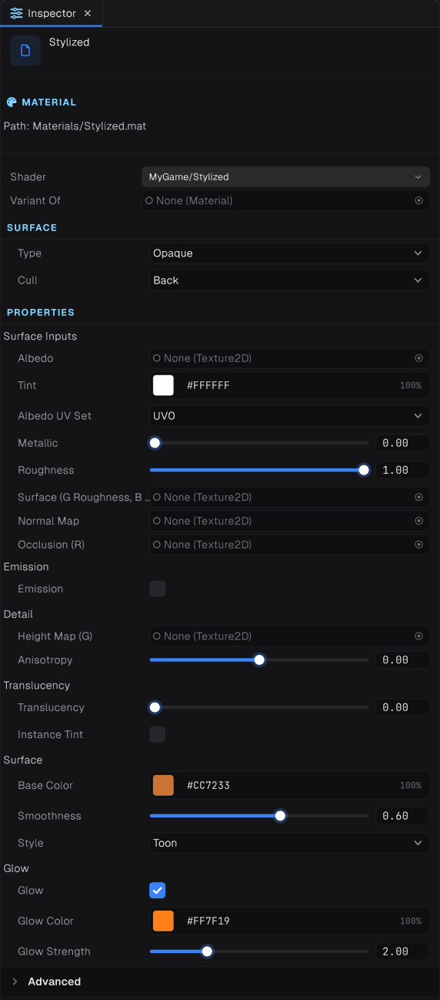

## Declaring properties

```glsl
Properties
{
    PropertyName("Display Name", Type) = DefaultValue [Attribute] [Attribute]
}
```

The default is optional; without one the property is zero. Property names conventionally start with an underscore.

## Types

| Type | Default syntax | GLSL declaration |
| --- | --- | --- |
| `Integer` | `= 4` | `uniform int` |
| `Float` | `= 0.5` | `uniform float` |
| `Vector2` | `= (1, 1)` | `uniform vec2` |
| `Vector3` | `= (0, 1, 0)` | `uniform vec3` |
| `Vector` | `= (0, 1, 0, 0)` | `uniform vec4` |
| `Color` | `= (1, 1, 1, 1)` | `uniform vec4` |
| `Matrix` | `= ((1,0,0,0)(0,1,0,0)(0,0,1,0)(0,0,0,1))` | `uniform mat4` |
| `Texture2D` | `= "white" {}` | `uniform sampler2D` |
| `Texture2DArray` | `= "" {}` | `uniform sampler2DArray` |
| `Texture3D` | `= "" {}` | `uniform sampler3D` |
| `TextureCubemap` | `= "" {}` | `uniform samplerCube` |
| `TextureCubemapArray` | `= "" {}` | `uniform samplerCubeArray` |

A texture's default names a built-in texture, such as `"white"`, `"black"` or `"normal"`, or `""` for none.

## Reading properties in GLSL

Declare a uniform with the same name:

```glsl
uniform vec4 _Tint;
uniform sampler2D _MainTex;

vec3 albedo = texture(_MainTex, uv * _MainTex_ST.xy + _MainTex_ST.zw).rgb * _Tint.rgb;
```

In a material shader, properties are not real uniforms. Graphite rewrites them to read from the material's record in a GPU buffer, which is how thousands of materials draw in a few calls. Three rules follow:

> [!IMPORTANT]
> - **Every uniform a material pass reads must be a declared property** (or a [global](08-variants-and-globals.md)). Reading any other loose uniform is a compile error.
> - **Every texture gets `NAME_ST`**, its scale in `xy` and offset in `zw`. Use it without declaring it.
> - **To pass a material texture into a function**, pass `NAME_Texture` and `NAME_Sampler` and build the sampler inside: `texture(sampler2D(tex, smp), uv)`.

## Attributes




Attributes go after the default value, each in brackets.

| Attribute | On | Effect |
| --- | --- | --- |
| `[Range(min, max)]` | Float, Integer | A slider between the bounds |
| `[Enum(A, B, C)]` | Integer | A dropdown, stored as the index |
| `[Gamma]` | Color | Entered in gamma space, stored linear |
| `[HDR]` | Color | The colour may go above 1 |
| `[Header("Text")]` | any | A heading above the property |
| `[Space]` | any | A gap above the property |
| `[ShowIf(AXIS)]` | any | Shown only while toggle `AXIS` is on |
| `[ShowIf(AXIS, VALUE)]` | any | Shown only while enum `AXIS` has `VALUE` |
| `[HideInInspector]` | any | Not shown |
| `[NoScaleOffset]` | textures | Hides the tiling and offset fields |
| `[Normal]` | textures | Expects a tangent space normal map |
| `[Keyword(AXIS)]` | textures | Turns toggle `AXIS` on while a texture is set |
| `[Toggle(AXIS)]` | Float, Integer | Turns toggle `AXIS` on while the value is not zero |
| `[KeywordEnum(AXIS)]` | Integer | Sets enum `AXIS` to the value at that index |

The last three connect properties to [variants](08-variants-and-globals.md), so a feature compiles in only while it is used:

```glsl
Properties
{
    _DetailTex("Detail", Texture2D) = "white" {} [Keyword(_DETAIL)]
    _DetailScale("Detail Scale", Float) = 8.0 [ShowIf(_DETAIL)]
}
```

## The material API

```csharp
var material = new Material(myShader);

material.SetFloat("_Roughness", 0.3f);
material.SetInt("_Steps", 8);
material.SetColor("_Tint", new Color(0.8f, 0.2f, 0.1f, 1f));
material.SetVector("_Wind", new Float4(1f, 0f, 0.5f, 0f));
material.SetTexture("_MainTex", albedo);
material.SetTextureScaleOffset("_MainTex", new Float4(4f, 4f, 0f, 0f));   // writes _MainTex_ST

material.SetKeyword("_DETAIL", true);
float roughness = material.GetFloat("_Roughness");
```

- Changing a shared material asset changes every object that uses it. For a per-object value, `Clone()` the material and assign the copy, then dispose clones you no longer need.
- `material.Surface` sets opaque, cutout or transparent, the blend and the culling. See [Transparency and screen effects](07-transparency-and-screen-effects.md).
- `material.RenderQueue` and `material.CastShadows` override the shader's defaults.
