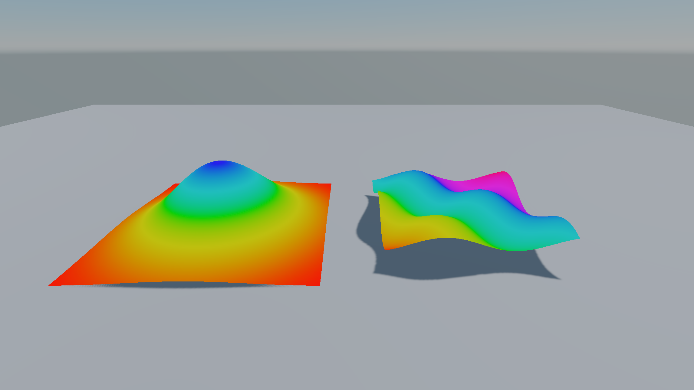

When a surface shader is not enough, write the passes yourself. A pass is one way of drawing the object; the renderer picks passes by their `LightMode` tag.

## Anatomy of a pass

```glsl
Pass
{
    Name "Forward"
    Tags { "LightMode" = "Forward" }

    Cull Back
    ZWrite On

    GLSLPROGRAM
    Shared
    {
        // added to every stage of this pass
    }
    Vertex
    {
        void main() { ... }
    }
    Fragment
    {
        void main() { ... }
    }
    ENDGLSL
}
```

- `Name` is optional, but two passes in one shader may not share a name.
- Render state commands such as `Cull`, `ZWrite` and `Blend` are covered in [Render state and stencil](09-render-state-and-stencil.md).
- Each pass has exactly one `GLSLPROGRAM … ENDGLSL` block. The markers are uppercase.

## Pass types

| `LightMode` | Drawn as |
| --- | --- |
| `Forward` | The lit colour pass |
| `Prepass` | The depth prepass |
| `ShadowCaster` | Shadow maps |
| `Sky` | The sky, see [Custom skies](11-custom-skies.md) |
| `Debug` | The editor's debug views (albedo, normals, lighting and so on) |
| `ObjectId` | Object picking in the editor |
| any other name | Drawn by a **Draw Pass** component or a render feature, such as `"Outline"` |

An opaque material shader should normally have **Forward**, **Prepass** and **ShadowCaster** passes. Leave out ShadowCaster and the object casts no shadows.

> [!IMPORTANT]
> **Only the first pass with a given `LightMode` is drawn.** For an extra pass such as an outline, give it its own `LightMode` and add a **Draw Pass** component to the scene. See [Outlines](06-custom-lighting.md#outlines).

Other tags the renderer reads:

| Tag | Meaning |
| --- | --- |
| `"RenderQueue" = "3000"` | The default queue of the shader's materials. 2500 and up is transparent |
| `"SceneColor" = "Read"` | The pass samples the opaque scene colour |
| `"SceneDepth" = "Read"` | The pass reads the opaque scene depth |

## The GLSL sections

| Section | Notes |
| --- | --- |
| `Shared` | Optional. Prepended to every stage of the pass |
| `Vertex` | Required for a graphics pass |
| `Fragment` | Optional. A pass without one writes depth only |
| `Compute` | A compute pass, the only section besides `Shared` |

The code is plain GLSL in the OpenGL style, and Graphite makes it Vulkan-ready:

- **No `#version` line.** Graphite adds `#version 460`; writing one is an error.
- **Loose uniforms** from all stages are gathered into one uniform block.
- **Varyings match by name.** Declare `out vec3 vNormal;` in Vertex and `in vec3 vNormal;` in Fragment. No layout locations needed.
- **Textures and buffers get bindings by name.** Explicit `layout(...)` qualifiers are kept.
- `GRAPHITE_VERTEX`, `GRAPHITE_FRAGMENT` or `GRAPHITE_COMPUTE` is defined for the stage being compiled.
- `#include "Name"` and `#pragma once` work. See [Include library reference](10-include-library.md).

## Vertex inputs

Prowl's renderer is GPU-driven: vertices are pulled from a shared buffer rather than bound as attributes. Include `Graphite/Vertex.glsl` and read them through these names:

| Name | Type | Missing from the mesh |
| --- | --- | --- |
| `vertexPosition` | `vec3` | |
| `vertexNormal` | `vec3` | `(0, 0, 1)` |
| `vertexTangent` | `vec4` | `(1, 0, 0, 1)` |
| `vertexColor` | `vec4` | white |
| `vertexUV0` … `vertexUV3` | `vec2` | zero |
| `vertexBoneIndices`, `vertexBoneWeights` | `uvec4`, `vec4` | zero |
| `vertexCustom0`, `vertexCustom1` | `vec4` | zero |

Each is a function call under the hood, so store it in a local if you use it more than once. `Graphite_HasStream(n)` tells you whether the mesh has a stream.

## Relative and world

Graphite renders relative to the camera so huge worlds stay precise. A **relative** position is world space moved so the camera sits at the origin. **World** means true world space. Directions and normals are world space either way.

| Function | Returns |
| --- | --- |
| `Graphite_ObjectToRelative(p)` | Relative position of an object space point |
| `Graphite_ObjectToWorldNormal(n)` | World space normal |
| `Graphite_ObjectToWorldDirection(d)` | World space direction |
| `Graphite_RelativeToClip(p)` | Clip position of a camera relative point |
| `Graphite_ObjectToClip(p)` | Both steps at once |
| `Graphite_RelativeToWorld(p)` | The world position, for noise and patterns fixed to the world |
| `Graphite_ViewDir(relativePos)` | Unit direction to the camera |

## A complete unlit shader




```glsl
Shader "MyGame/VertexColorUnlit"
{
    Properties
    {
        _Tint("Tint", Color) = (1, 1, 1, 1)
    }

    Pass
    {
        Name "Forward"
        Tags { "LightMode" = "Forward" }
        GLSLPROGRAM
        Vertex
        {
            #include "Graphite/Vertex.glsl"
            out vec4 vColor;

            void main()
            {
                vColor = vertexColor;
                gl_Position = Graphite_ObjectToClip(vertexPosition);
            }
        }
        Fragment
        {
            #include "Graphite/Passes.glsl"
            uniform vec4 _Tint;
            in vec4 vColor;
            layout(location = 0) out vec4 fragColor;

            void main()
            {
                fragColor = vColor * _Tint;
                Graphite_WriteGBuffer(vec3(0.0, 1.0, 0.0), 1.0, 0.0);
            }
        }
        ENDGLSL
    }

    Pass
    {
        Name "Prepass"
        Tags { "LightMode" = "Prepass" }
        GLSLPROGRAM
        Vertex
        {
            #include "Graphite/Vertex.glsl"
            void main() { gl_Position = Graphite_ObjectToClip(vertexPosition); }
        }
        Fragment
        {
            void main() { }
        }
        ENDGLSL
    }

    Pass
    {
        Name "ShadowCaster"
        Tags { "LightMode" = "ShadowCaster" }
        GLSLPROGRAM
        Vertex
        {
            #include "Graphite/Vertex.glsl"
            void main() { gl_Position = Graphite_ObjectToClip(vertexPosition); }
        }
        ENDGLSL
    }

    Fallback "Graphite/Fallback"
}
```

## The G-buffer

An opaque Forward pass writes a thin G-buffer next to its colour: motion vectors, the world normal, and roughness and metallic. Effects such as TAA, motion blur, SSR and ambient occlusion read it. Call `Graphite_WriteGBuffer(worldNormal, roughness, metallic)` from `Graphite/Passes.glsl` in every opaque Forward fragment shader. Your colour goes to `location = 0`.

## Useful per-draw data

- `Graphite_View()` returns the camera's [view data](10-include-library.md#view-data): matrices, screen size, jitter and time.
- `Graphite_InstanceIndex()` is the instance being drawn in an instanced draw.
- `Graphite_Object()` is the object's record. Its `custom0` holds a per-instance colour in instance batches.

> [!NOTE]
> The library wraps your vertex `main`: it sets up the draw first, then runs your code, then records motion vectors. Write `void main()` as usual.
