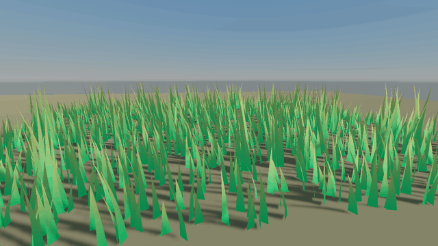
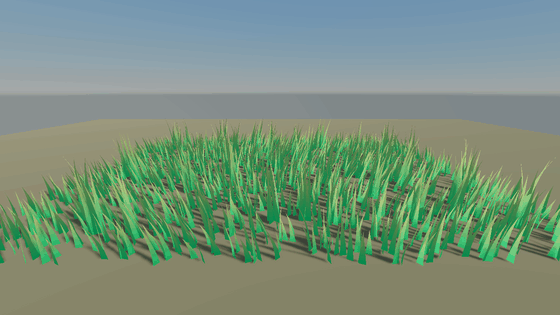

A Surface block's `Vertex` block moves vertices before they are transformed, **in every pass**, so shadows and depth always match what you see. The Forward pass also runs your function at last frame's time to work out where each vertex was, which keeps motion vectors, TAA and motion blur correct.



## Graphite_SurfaceVertex

| Field | Type | Meaning |
| --- | --- | --- |
| `Position` | `vec3` | Object space position |
| `Normal` | `vec3` | Object space normal |
| `Tangent` | `vec4` | Object space tangent; `w` is the handedness |
| `Color` | `vec4` | Vertex colour, handy as a mask |
| `UV`, `UV1` | `vec2` | Texture coordinates |
| `Time` | `float` | Seconds. Last frame's while the motion vector evaluation runs |

> [!IMPORTANT]
> Animate with `v.Time`, never `Graphite_View().time`. The motion vector pass needs to rerun your function at last frame's time, and only `v.Time` changes for it.

## Example: foliage in the wind

```glsl
Shader "MyGame/Foliage"
{
    Properties
    {
        _Flexibility("Flexibility", Float) = 0.15 [Range(0, 1)]
    }

    Surface "Lit"
    {
        Vertex
        {
            GLSLPROGRAM
            #pragma global vec4 _Wind     // xyz direction, w strength, set from C#
            uniform float _Flexibility;

            void SurfaceVertex(inout Graphite_SurfaceVertex v)
            {
                // A world-space phase, so neighbouring plants sway out of step
                vec3 world = Graphite_RelativeToWorld(Graphite_ObjectToRelative(v.Position));
                float phase = dot(world.xz, vec2(0.35, 0.21));
                float sway = sin(v.Time * 1.7 + phase) * 0.6 + sin(v.Time * 3.9 + phase * 1.3) * 0.25;

                // Vertex colour red marks how free each vertex is: 0 at the trunk, 1 at the tips
                v.Position += _Wind.xyz * (sway * _Wind.w * _Flexibility * v.Color.r);
            }
            ENDGLSL
        }
    }
}
```

Make a material with it, then set leaves to cutout and double sided:

```csharp
material.Surface = new SurfaceSettings(SurfaceType.Cutout, SurfaceBlend.Alpha, SurfaceCull.Off);
```

Everything else comes from the Lit model: albedo with alpha, normal maps, translucency for light shining through leaves, shadows, decals and fog.

### Drive the wind from C#

```csharp
using System;

using Prowl.Runtime;
using Prowl.Runtime.Resources;
using Prowl.Vector;

public sealed class WindZone : Component
{
    public Float3 Direction = new(1f, 0f, 0.3f);
    public float Strength = 1f;

    public override void Update()
    {
        float gust = 1f + 0.4f * MathF.Sin(Time.TimeSinceStartup * 0.5f);
        Material.SetGlobalVector("_Wind", new Float4(Direction.X, Direction.Y, Direction.Z, Strength * gust));
    }
}
```



## Example: water waves with correct normals

Moving vertices does not update the normal. For lighting to follow the waves, set `v.Normal` from the slope of the same function.

```glsl
Shader "MyGame/Waves"
{
    Properties
    {
        _WaveHeight("Wave Height", Float) = 0.3
        _WaveFrequency("Wave Frequency", Float) = 0.6
        _WaveSpeed("Wave Speed", Float) = 1.2
    }

    Surface "Lit"
    {
        Vertex
        {
            GLSLPROGRAM
            uniform float _WaveHeight;
            uniform float _WaveFrequency;
            uniform float _WaveSpeed;

            void SurfaceVertex(inout Graphite_SurfaceVertex v)
            {
                float k = _WaveFrequency, t = v.Time * _WaveSpeed;
                vec2 p = v.Position.xz;

                float a = p.x * k + t, b = p.y * k * 0.8 + t * 0.7;
                v.Position.y += sin(a) * cos(b) * _WaveHeight;

                // Partial derivatives of the height give the normal
                float dx = cos(a) * cos(b) * k * _WaveHeight;
                float dz = -sin(a) * sin(b) * k * 0.8 * _WaveHeight;
                v.Normal = normalize(vec3(-dx, 1.0, -dz));
            }
            ENDGLSL
        }
    }
}
```

This works in object space, so it suits a flat, unrotated plane. For seamless waves across many tiles, compute `p` from the world position as in the foliage example.

## Hand-written passes

For full control, write the passes yourself. Every pass must move its vertices the same way, so put the movement in an include, and tell the library where the vertex was last frame:

```glsl
#include "Graphite/Vertex.glsl"
#include "Wind.glsl"   // your WindSway(position, freedom, time)

out vec3 vRelativePos;

void main()
{
    Graphite_ViewData view = Graphite_View();
    vec3 moved = WindSway(vertexPosition, vertexColor.r, view.time.x);
    Graphite_SetPreviousPosition(WindSway(vertexPosition, vertexColor.r, view.time.x - view.time.y));

    vRelativePos = Graphite_ObjectToRelative(moved);
    gl_Position = Graphite_RelativeToClip(vRelativePos);
}
```

Repeat the movement in the Prepass and ShadowCaster passes. Prowl's built-in **Grass** shader is a complete hand-written example, with wind and translucency.
