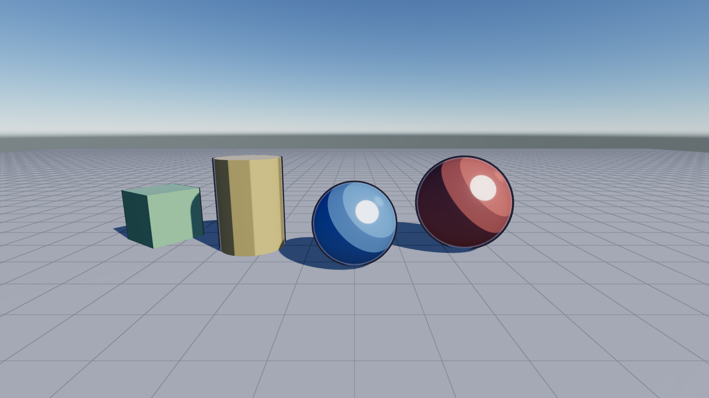
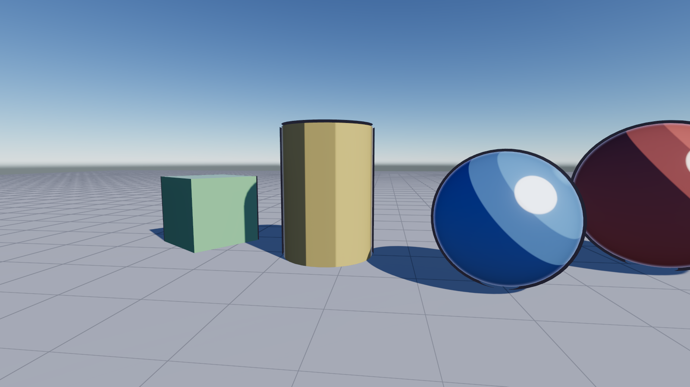

A lit surface receives light in two ways, and each goes through one function you can replace:

| Function | Shades |
| --- | --- |
| `Graphite_BRDF` | Every directional and local light: shadows, cookies, IES profiles, area lights and clustered local lights included |
| `Graphite_AmbientBRDF` | Ambient light from the lightmap, light probes or sky, and reflections |

Replace the first for toon bands and custom highlights, the second to tint or band the shadow side.



## The Lighting block

The easiest way is a `Lighting` block inside a `Surface "Lit"` block. Define either function or both. Everything else about the Lit model keeps working: normal maps, parallax, decals, every surface type, and the editor's debug views.

```glsl
Surface "Lit"
{
    Lighting
    {
        GLSLPROGRAM
        vec3 Graphite_BRDF(PBR_Closure c, Graphite_LightContribution l)
        {
            float ramp = step(0.5, dot(c.normal, l.diffuseL) * 0.5 + 0.5);
            return c.diffuseAlbedo * GRAPHITE_INV_PI * ramp * l.attenuation * l.radiance;
        }

        vec3 Graphite_AmbientBRDF(PBR_Closure c, PBR_Indirect i)
        {
            return c.diffuseAlbedo * i.irradiance * vec3(0.6, 0.55, 0.8);   // a cool shadow side
        }
        ENDGLSL
    }
}
```

- Only the lit passes take it. `Surface "Unlit"` has no lights and refuses a Lighting block.
- Whichever function you leave out keeps its default. A block that defines neither is an error.
- `Graphite_BRDF` can call `PBR_EvaluateLight(c, l)` to build on the standard BRDF, and `Graphite_AmbientBRDF` can call `PBR_EvaluateAmbient(c, i)`.
- The block may declare the same uniforms as your Surface code; every material uniform is a property.

## What the BRDF receives

`PBR_Closure c` is the surface prepared once per pixel, after your Surface function and the decals:

| Field | Meaning |
| --- | --- |
| `position` | Relative position |
| `view` | Unit direction to the camera |
| `normal` | Shading normal, world space |
| `geomNormal` | Normal before normal mapping |
| `NdotV` | The cosine between them |
| `roughness` | The base specular roughness, after the coat and specular antialiasing |
| `metalness` | 0 to 1 |
| `diffuseAlbedo` | The diffuse lobe's colour, after the specular layer above it took its share |
| `specularAlbedo` | How much the base specular lobe reflects in total, tinted |
| `emission` | Nits, before exposure |
| `opacity`, `occlusion` | Coverage and ambient occlusion |

`Graphite_LightContribution l`:

| Field | Meaning |
| --- | --- |
| `radiance` | The light's colour times intensity, times the camera's exposure, with **shadow**, cookie and IES profile already applied |
| `diffuseL` | Unit direction to the light, for diffuse |
| `diffuse` | The light reaching the surface per unit radiance: N.L over distance squared for a point, the shape's cosine weighted solid angle for an area light |
| `attenuation` | The same for a surface facing the light, without the cosine |
| `specularL` | Direction to the light's most representative point, for highlights |
| `specular` | The specular share, scaled for the light's size |
| `extent` | The light's angular size across two axes, 0 for a point |
| `shareSpecular` | True for rect, disk and tube lights, whose `specular` is the share of the highlight they cover |

A Lambert surface is `c.diffuseAlbedo * GRAPHITE_INV_PI * l.diffuse * l.radiance`. Occlusion only darkens ambient light, so leave `c.occlusion` out of your BRDF.

## What the ambient function receives

```glsl
vec3 Graphite_AmbientBRDF(PBR_Closure c, PBR_Indirect i)
```

| Field of `i` | Meaning |
| --- | --- |
| `irradiance` | Diffuse light from the lightmap, light probes or sky, already divided by pi, so a white surface reflects it as is |
| `specular` | Reflections from reflection probes or the sky for the base specular lobe |

Both already have occlusion applied. The default, without the optional layers, is:

```glsl
return c.diffuseAlbedo * i.irradiance + c.specularAlbedo * i.specular;
```

Drop the specular term for a matte, painted look; keep it for glossy toon materials such as metal or lacquer.

## A toon shader

Soft-edged light bands, a hard highlight, a tinted shadow side, rim light and an outline, on top of every Lit feature.

```glsl
Shader "MyGame/Toon"
{
    Properties
    {
        _Bands("Light Bands", Integer) = 3 [Range(1, 8)] [Header("Toon")]
        _BandSoftness("Band Softness", Float) = 0.05 [Range(0, 0.5)]
        _SpecColor("Highlight Color", Color) = (1, 1, 1, 1) [HDR]
        _SpecSize("Highlight Size", Float) = 0.04 [Range(0, 0.3)]
        _ShadowTint("Shadow Tint", Color) = (0.55, 0.5, 0.75, 1)
        _AmbientStrength("Ambient Strength", Float) = 1.0 [Range(0, 2)]
        _RimColor("Rim Color", Color) = (0.5, 0.6, 1.0, 1)
        _RimLuminance("Rim Luminance", Float) = 10000.0
        _RimWidth("Rim Width", Float) = 0.3 [Range(0, 1)]
        _OutlineColor("Outline Color", Color) = (0.05, 0.05, 0.08, 1) [Header("Outline")]
        _OutlineWidth("Outline Width", Float) = 0.02 [Range(0, 0.1)]
    }

    Surface "Lit"
    {
        GLSLPROGRAM
        uniform vec4 _RimColor;
        uniform float _RimLuminance;
        uniform float _RimWidth;

        // Rim light, added as emission so it shows on the shadowed side too
        void Surface(inout PBR_Params p, Graphite_SurfaceData i)
        {
            float rim = smoothstep(1.0 - _RimWidth, 1.0, 1.0 - max(dot(p.geometryNormal, i.viewDir), 0.0));
            p.emissionColor = _RimColor.rgb;
            p.emissionLuminance = _RimLuminance * rim;
        }
        ENDGLSL

        Lighting
        {
            GLSLPROGRAM
            uniform int _Bands;
            uniform float _BandSoftness;
            uniform vec4 _SpecColor;
            uniform float _SpecSize;

            // One light, toon style. Shadows are already inside l.radiance.
            vec3 Graphite_BRDF(PBR_Closure c, Graphite_LightContribution l)
            {
                float bands = float(max(_Bands, 1));
                float x = clamp(dot(c.normal, l.diffuseL), 0.0, 1.0) * bands;
                float band = (floor(x) + smoothstep(1.0 - _BandSoftness, 1.0, fract(x))) / bands;

                vec3 H = normalize(l.specularL + c.view);
                float edge = 1.0 - _SpecSize;
                float spec = smoothstep(edge - 0.004, edge + 0.004, max(dot(c.normal, H), 0.0)) * step(1e-4, l.specular);

                return (c.diffuseAlbedo * band + _SpecColor.rgb * spec) * GRAPHITE_INV_PI * l.attenuation * l.radiance;
            }

            uniform vec4 _ShadowTint;
            uniform float _AmbientStrength;

            // The shadow side: ambient light tinted, and no glossy reflections for a painted look
            vec3 Graphite_AmbientBRDF(PBR_Closure c, PBR_Indirect i)
            {
                return c.diffuseAlbedo * i.irradiance * _ShadowTint.rgb * _AmbientStrength;
            }
            ENDGLSL
        }
    }

    // Drawn by a Draw Pass component set to "Outline"
    Pass
    {
        Name "Outline"
        Tags { "LightMode" = "Outline" }
        Cull Front
        GLSLPROGRAM
        Vertex
        {
            #include "Graphite/Vertex.glsl"
            uniform float _OutlineWidth;
            void main()
            {
                gl_Position = Graphite_ObjectToClip(vertexPosition + normalize(vertexNormal) * _OutlineWidth);
            }
        }
        Fragment
        {
            uniform vec4 _OutlineColor;
            layout(location = 0) out vec4 fragColor;
            void main() { fragColor = vec4(_OutlineColor.rgb, 1.0); }
        }
        ENDGLSL
    }
}
```

The bands use `l.attenuation`, the light without the cosine, so the band shape alone decides the falloff toward the terminator.

### Ideas for further styling

- **Ramp texture:** declare `_Ramp` in the Lighting block and use `texture(_Ramp, vec2(clamp(dot(c.normal, l.diffuseL), 0.0, 1.0), 0.5)).rgb` for hand-painted falloff.
- **Wrap the default:** return `PBR_EvaluateLight(c, l)` blended with your bands for a softer, semi-realistic look.
- **Banded ambient:** quantize the irradiance's brightness in `Graphite_AmbientBRDF` when probes give too smooth a gradient.
- **Glossy toon:** add `+ c.specularAlbedo * i.specular` back in `Graphite_AmbientBRDF` for metal or lacquer.

## Building on the default

```glsl
vec3 Graphite_BRDF(PBR_Closure c, Graphite_LightContribution l)
{
    vec3 pbr = PBR_EvaluateLight(c, l);
    float wrap = clamp((dot(c.normal, l.diffuseL) + 0.5) / 1.5, 0.0, 1.0);   // softer terminator
    return pbr + c.diffuseAlbedo * GRAPHITE_INV_PI * wrap * 0.15 * l.attenuation * l.radiance;
}
```

`PBR_EvaluateDiffuse(c, L)` and `PBR_EvaluateSpecular(c, L)` give each lobe toward a direction on its own, without the cosine.

## Outlines

The renderer draws only the first pass of each `LightMode`. To draw extra passes, such as outlines, use a **Draw Pass**.

1. Give your shader a pass with its own `LightMode`, such as `"Outline"`, as in the toon shader above.
2. Add a **Draw Pass** component to any GameObject in the scene, from **Add Component > Rendering > Draw Pass**.
3. Set its **Pass Type** to `Outline` (the default) and its **Stage**.

| Draw Pass setting | Meaning |
| --- | --- |
| Pass Type | The `LightMode` tag to draw |
| Stage | `BeforeOpaques` (after the depth prepass), `AfterOpaques` (default) or `AfterTransparents` |
| Order | Draw passes in the same stage draw lowest first |

One Draw Pass draws that pass for every visible renderer in every camera, so you need only one per scene. Each pass draws with its own render state from the shader. Because it is the same renderer drawing again, the outline follows its object exactly.

```csharp
var drawPass = GameObject.AddComponent<DrawPass>();
drawPass.PassType = "Outline";
drawPass.Stage = DrawPassStage.AfterOpaques;
```



> [!NOTE]
> Meshes with hard edges split their normals, which opens gaps in the inflated hull. Smooth the normals in your modelling tool, or store smoothed normals in a spare stream such as `vertexCustom0` and inflate along those.

Draw Pass works for any extra pass: an x-ray silhouette drawn through walls with `ZTest Less` (Graphite's depth is reversed, see [Render state](09-render-state-and-stencil.md#depth)), a highlight for selected objects, and so on.

## Full control: hand-written passes

The Lighting block covers direct and ambient light, so hand-written lit passes are rarely needed. If you do write one, mirror what the standard shader does in its fragment stage:

| Step | Function |
| --- | --- |
| Inputs | `PBR_Params p = PBR_DefaultParams(geomNormal, tangent);` then set its fields |
| Normal map | `p.geometryNormal = Graphite_StandardNormalMap(texel, N, T, B, scale);` |
| Decals | `Graphite_ApplyDecals(relativePos, geomN, p.baseColor, p.geometryNormal, p.specularRoughness, p.baseMetalness, p.occlusion);` |
| Prepare | `PBR_Closure c = PBR_Prepare(p, relativePos, viewDir, geomN, 0.0);` |
| Direct light | `PBR_ShadeLights(c)`, through `Graphite_BRDF` |
| Ambient | `Graphite_AmbientBRDF(c, PBR_GatherIndirect(c, lightmapUV, PBR_FindProbes(c)))` |
| Emission | `c.emission * Graphite_Exposure()` |
| Fog | `Graphite_ApplyFog(color, relativePos)` |
| G-buffer | `PBR_TopReflectance(c, normal, roughness)` then `Graphite_WriteGBuffer(normal, reflectance, roughness)` for opaque surfaces |

Include `Graphite/PBR/Closure.glsl`, which brings in the whole lighting library, plus `Graphite/Decals.glsl` and `Graphite/Passes.glsl`. Pass the lightmap UV from `Graphite_LightmapUV()` in the vertex stage. To supply your own BRDF, define `GRAPHITE_CUSTOM_BRDF`, `GRAPHITE_CUSTOM_AMBIENT_BRDF` or both before the include, and write the matching functions after it:

```glsl
#define GRAPHITE_CUSTOM_BRDF
#include "Graphite/PBR/Closure.glsl"

vec3 Graphite_BRDF(PBR_Closure c, Graphite_LightContribution l) { ... }
```

Define `GRAPHITE_HARD_SHADOWS` before the include to take every shadow hard, unfiltered.

[Writing passes](04-writing-passes.md) covers the rest of a hand-written pass, and the built-in `Particle` shader is a complete example of a hand-written lit pass.
