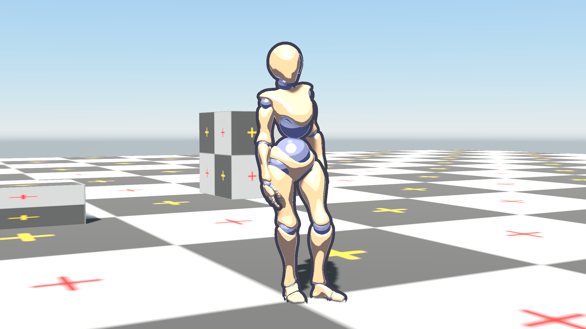
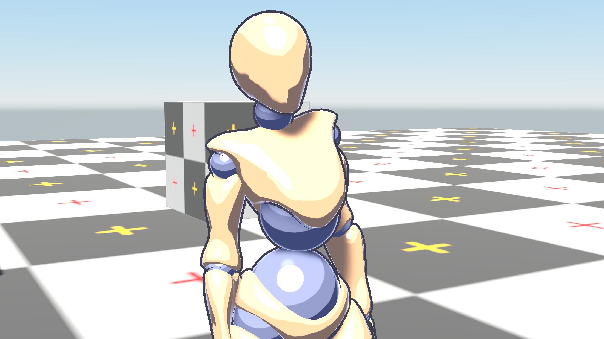

A lit surface receives light in two ways, and each goes through one function you can replace:

| Function | Shades |
| --- | --- |
| `Graphite_BRDF` | Every directional and local light: shadows, cookies, IES profiles, area lights and clustered local lights included |
| `Graphite_AmbientBRDF` | Ambient light from the lightmap, light probes or sky, and reflections |

Replace the first for toon bands and custom highlights, the second to tint or band the shadow side.



## The Lighting block

The easiest way is a `Lighting` block inside a `Surface "Lit"` block. Define either function or both. Everything else about the Lit model keeps working: normal maps, parallax, decals, translucency, anisotropy, cutout and transparent surfaces, and the editor's debug views.

```glsl
Surface "Lit"
{
    Lighting
    {
        GLSLPROGRAM
        vec3 Graphite_BRDF(Graphite_Surface s, Graphite_LightContribution c)
        {
            float ramp = step(0.5, dot(s.normal, c.diffuseL) * 0.5 + 0.5);
            return s.albedo * ramp * c.diffuse * c.radiance;
        }

        vec3 Graphite_AmbientBRDF(Graphite_Surface s, vec3 irradiance, vec3 specular)
        {
            return irradiance * s.albedo * vec3(0.6, 0.55, 0.8);   // a cool shadow side
        }
        ENDGLSL
    }
}
```

- Only the lit passes, Forward and Debug, take it. `Surface "Unlit"` has no lights and refuses a Lighting block.
- Whichever function you leave out keeps its default. A block that defines neither is an error.
- `Graphite_BRDF` can call `Graphite_DefaultBRDF(s, c)` to build on the standard BRDF.
- The block may declare the same uniforms as your Surface code; every material uniform is a property.

## What the BRDF receives

`Graphite_Surface s`:

| Field | Meaning |
| --- | --- |
| `position` | Relative position |
| `normal` | Shading normal, world space |
| `geomNormal` | Normal before normal mapping |
| `view` | Unit direction to the camera |
| `albedo`, `metallic`, `roughness`, `ao` | Material inputs, after your Surface function |

`Graphite_LightContribution c`:

| Field | Meaning |
| --- | --- |
| `radiance` | The light's colour times intensity, with **shadow**, cookie and IES profile already applied |
| `diffuseL` | Unit direction to the light, for diffuse |
| `diffuse` | Exactly N·L for a directional light; for local lights it includes distance falloff and the light's shape |
| `specularL` | Direction to the light's most representative point, for highlights |
| `specular` | N·L of `specularL`, with falloff |
| `extent` | The light's angular size, which widens highlights; 0 for a point |
| `attenuation` | The falloff alone |

Occlusion is applied once to the sum of all lights, so leave `s.ao` out of your BRDF.

## What the ambient function receives

```glsl
vec3 Graphite_AmbientBRDF(Graphite_Surface s, vec3 irradiance, vec3 specular)
```

| Parameter | Meaning |
| --- | --- |
| `s` | The same surface the lights see |
| `irradiance` | Diffuse light reaching the surface from the lightmap, light probes or sky |
| `specular` | Reflections from reflection probes or the sky, already weighted by Fresnel |

Both already have occlusion applied, so leave `s.ao` out here too. The default is:

```glsl
return irradiance * s.albedo * (1.0 - s.metallic) + specular;
```

Drop `specular` for a matte, painted look; keep it for glossy toon materials such as metal or lacquer.

## A toon shader

Soft-edged light bands, a hard highlight, a tinted shadow side, rim light and an outline, on top of every Lit feature.

```glsl
Shader "MyGame/Toon"
{
    Properties
    {
        _Bands("Light Bands", Integer) = 3 [Range(1, 8)] [Header("Toon")]
        _BandSoftness("Band Softness", Float) = 0.05 [Range(0, 0.5)]
        _SpecColor("Highlight Color", Color) = (1, 1, 1, 1) [HDR]
        _SpecSize("Highlight Size", Float) = 0.04 [Range(0, 0.3)]
        _ShadowTint("Shadow Tint", Color) = (0.55, 0.5, 0.75, 1)
        _AmbientStrength("Ambient Strength", Float) = 1.0 [Range(0, 2)]
        _RimColor("Rim Color", Color) = (0.5, 0.6, 1.0, 1) [HDR]
        _RimWidth("Rim Width", Float) = 0.3 [Range(0, 1)]
        _OutlineColor("Outline Color", Color) = (0.05, 0.05, 0.08, 1) [Header("Outline")]
        _OutlineWidth("Outline Width", Float) = 0.02 [Range(0, 0.1)]
    }

    Surface "Lit"
    {
        GLSLPROGRAM
        uniform vec4 _RimColor;
        uniform float _RimWidth;

        // Rim light, added as emission so it shows on the shadowed side too
        void Surface(inout Graphite_SurfaceData s)
        {
            float rim = smoothstep(1.0 - _RimWidth, 1.0, 1.0 - max(dot(s.Normal, s.ViewDir), 0.0));
            s.Emission += _RimColor.rgb * rim;
        }
        ENDGLSL

        Lighting
        {
            GLSLPROGRAM
            uniform int _Bands;
            uniform float _BandSoftness;
            uniform vec4 _SpecColor;
            uniform float _SpecSize;

            // One light, toon style. Shadows are already inside c.radiance.
            vec3 Graphite_BRDF(Graphite_Surface s, Graphite_LightContribution c)
            {
                float bands = float(max(_Bands, 1));
                float x = clamp(c.diffuse, 0.0, 1.0) * bands;
                float band = (floor(x) + smoothstep(1.0 - _BandSoftness, 1.0, fract(x))) / bands;

                vec3 H = normalize(c.specularL + s.view);
                float edge = 1.0 - _SpecSize;
                float spec = smoothstep(edge - 0.004, edge + 0.004, max(dot(s.normal, H), 0.0)) * step(1e-4, c.specular);

                return (s.albedo * band + _SpecColor.rgb * spec) / PI * c.radiance;
            }

            uniform vec4 _ShadowTint;
            uniform float _AmbientStrength;

            // The shadow side: ambient light tinted, and no glossy reflections for a painted look
            vec3 Graphite_AmbientBRDF(Graphite_Surface s, vec3 irradiance, vec3 specular)
            {
                return irradiance * s.albedo * _ShadowTint.rgb * _AmbientStrength;
            }
            ENDGLSL
        }
    }

    // Drawn by a Draw Pass component set to "Outline"
    Pass
    {
        Name "Outline"
        Tags { "LightMode" = "Outline" }
        Cull Front
        GLSLPROGRAM
        Vertex
        {
            #include "Graphite/Vertex.glsl"
            uniform float _OutlineWidth;
            void main()
            {
                gl_Position = Graphite_ObjectToClip(vertexPosition + normalize(vertexNormal) * _OutlineWidth);
            }
        }
        Fragment
        {
            uniform vec4 _OutlineColor;
            layout(location = 0) out vec4 fragColor;
            void main() { fragColor = vec4(_OutlineColor.rgb, 1.0); }
        }
        ENDGLSL
    }
}
```

### Ideas for further styling

- **Ramp texture:** declare `_Ramp` in the Lighting block and use `texture(_Ramp, vec2(clamp(c.diffuse, 0.0, 1.0), 0.5)).rgb` for hand-painted falloff.
- **Wrap the default:** return `Graphite_DefaultBRDF(s, c)` blended with your bands for a softer, semi-realistic look.
- **Banded ambient:** quantize the irradiance's brightness in `Graphite_AmbientBRDF` when probes give too smooth a gradient: `irradiance * floor(dot(irradiance, vec3(0.333)) * 3.0 + 0.5) / 3.0 / max(dot(irradiance, vec3(0.333)), 1e-4)`.
- **Glossy toon:** add `+ specular` back in `Graphite_AmbientBRDF` for metal or lacquer.

## Outlines

The renderer draws only the first pass of each `LightMode`. To draw extra passes, such as outlines, use a **Draw Pass**.

1. Give your shader a pass with its own `LightMode`, such as `"Outline"`, as in the toon shader above.
2. Add a **Draw Pass** component to any GameObject in the scene, from **Add Component › Rendering › Draw Pass**.
3. Set its **Pass Type** to `Outline` (the default) and its **Stage**.

| Draw Pass setting | Meaning |
| --- | --- |
| Pass Type | The `LightMode` tag to draw |
| Stage | `BeforeOpaques` (after the depth prepass), `AfterOpaques` (default) or `AfterTransparents` |
| Order | Draw passes in the same stage draw lowest first |

One Draw Pass draws that pass for every visible renderer in every camera, so you need only one per scene. Each pass draws with its own render state from the shader. Because it is the same renderer drawing again, the outline follows its object exactly.

```csharp
var drawPass = GameObject.AddComponent<DrawPass>();
drawPass.PassType = "Outline";
drawPass.Stage = DrawPassStage.AfterOpaques;
```



> [!NOTE]
> Meshes with hard edges split their normals, which opens gaps in the inflated hull. Smooth the normals in your modelling tool, or store smoothed normals in a spare stream such as `vertexCustom0` and inflate along those.

Draw Pass works for any extra pass: an x-ray silhouette drawn through walls with `ZTest Greater`, a highlight for selected objects, and so on.

## Full control: hand-written passes

The Lighting block covers direct and ambient light, so hand-written lit passes are rarely needed now. If you do write one, mirror what the standard shader does:

| Step | Function |
| --- | --- |
| Normal map | `Graphite_StandardNormalMap(texel, N, T, B, scale)` |
| Decals | `Graphite_ApplyDecals(relativePos, geomN, albedo, N, roughness, metallic, ao)` |
| Direct light | `Graphite_ShadeLights(Graphite_MakeSurface(...))`, through `Graphite_BRDF` |
| Ambient | `Graphite_AmbientBRDF(s, Graphite_IndirectDiffuse(N, lightmapUV) * ao, Graphite_IndirectSpecular(relativePos, N, V, F0, roughness, ao, irradiance))` |
| Emission | Add it |
| Fog | `ApplyFog(color, relativePos)` |
| G-buffer | `Graphite_WriteGBuffer(N, roughness, metallic)` for opaque surfaces |

Define `GRAPHITE_CUSTOM_BRDF`, `GRAPHITE_CUSTOM_AMBIENT_BRDF` or both before including `Graphite/Lighting.glsl`, and write the matching functions after it:

```glsl
#define GRAPHITE_CUSTOM_BRDF
#define GRAPHITE_CUSTOM_AMBIENT_BRDF
#include "Graphite/Lighting.glsl"

vec3 Graphite_BRDF(Graphite_Surface s, Graphite_LightContribution c) { ... }
vec3 Graphite_AmbientBRDF(Graphite_Surface s, vec3 irradiance, vec3 specular) { ... }
```

[Writing passes](04-writing-passes.md) covers the rest of a hand-written pass.

## Building on the default

```glsl
vec3 Graphite_BRDF(Graphite_Surface s, Graphite_LightContribution c)
{
    vec3 pbr = Graphite_DefaultBRDF(s, c);
    float wrap = clamp((dot(s.normal, c.diffuseL) + 0.5) / 1.5, 0.0, 1.0);   // softer terminator
    return pbr + s.albedo / PI * wrap * 0.15 * c.radiance;
}
```

## The lighting building blocks

| Function | Use |
| --- | --- |
| `Graphite_MakeSurface(relativePos, N, geomN, V, albedo, metallic, roughness, ao)` | Builds a `Graphite_Surface` |
| `Graphite_ShadeLights(s)` | Every directional and local light through `Graphite_BRDF`, times occlusion |
| `Graphite_DefaultBRDF(s, c)` | The standard GGX, Smith, Fresnel and Disney diffuse BRDF |
| `Graphite_AmbientBRDF(s, irradiance, specular)` | Ambient light and reflections, through your function or the default |
| `Graphite_IndirectDiffuse(N, lightmapUV)` | Ambient from lightmaps, light probes or the sky |
| `Graphite_IndirectSpecular(relativePos, N, V, F0, roughness, ao, ambient)` | Reflections from probes |
| `Graphite_SurfaceF0(s)` | Reflectance at normal incidence |
| `Graphite_ViewDir(relativePos)` | Unit direction to the camera |
| `ApplyFog(color, relativePos)` | The scene's fog |
