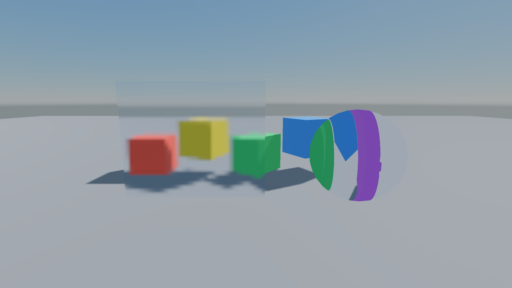
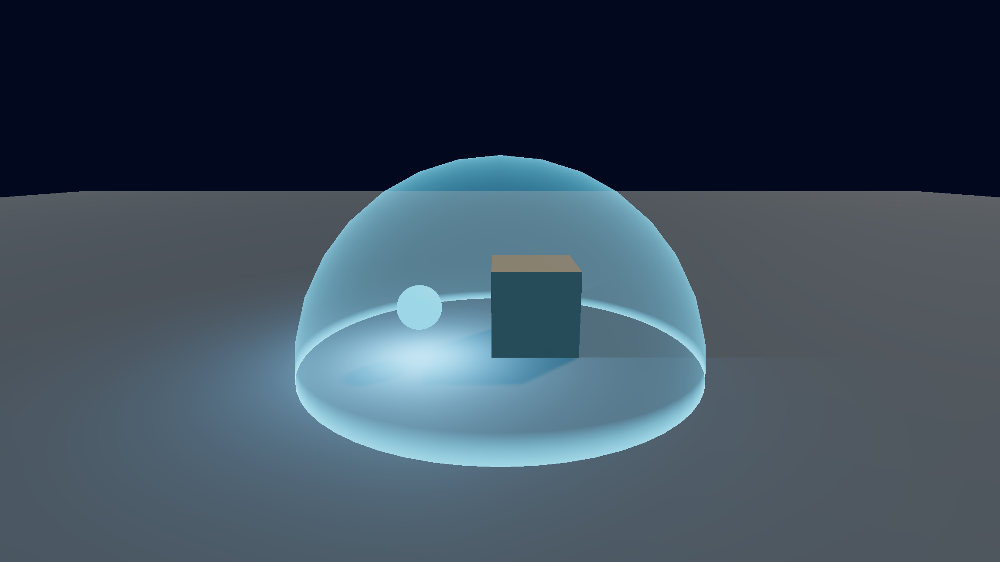

## Transparency with the standard shaders

The built-in Lit and Unlit shaders, and every surface shader, switch to transparency per material:

```csharp
material.Surface = new SurfaceSettings(SurfaceType.Transparent, SurfaceBlend.Alpha, SurfaceCull.Back);
```

| Setting | Values |
| --- | --- |
| `SurfaceType` | `Opaque`, `Cutout` (alpha tested against `_AlphaCutoff`), `Transparent` |
| `SurfaceBlend` | `Alpha`, `Premultiplied`, `Additive`, `Multiply` |
| `SurfaceCull` | `Back`, `Front`, `Off` (double sided, back faces flip their normal) |

Transparent surfaces draw back to front after the opaques and do not write depth. In a surface shader, set `s.Alpha`.

A material's surface settings also override the render state and queue of any custom shader.

## Transparency in your own passes

```glsl
Pass
{
    Name "Forward"
    Tags { "LightMode" = "Forward" "RenderQueue" = "3000" }
    ZWrite Off
    Blend SourceAlpha InverseSourceAlpha
    ...
}
```

Queues of 2500 and up count as transparent.

## Refraction: reading the scene colour




A pass tagged `"SceneColor" = "Read"` can sample the opaque scene behind it. The renderer copies the colour, with mips, after the opaque surfaces and the sky, and before transparent ones.

```glsl
Shader "MyGame/Glass"
{
    Properties
    {
        _Tint("Tint", Color) = (0.9, 0.95, 1.0, 1.0)
        _Distortion("Distortion", Float) = 0.03 [Range(0, 0.2)]
        _Frost("Frost", Float) = 1.5 [Range(0, 6)]
    }

    Pass
    {
        Name "Forward"
        Tags { "LightMode" = "Forward" "RenderQueue" = "3000" "SceneColor" = "Read" }
        ZWrite Off
        GLSLPROGRAM
        Vertex
        {
            #include "Graphite/Vertex.glsl"
            out vec3 vNormal;
            out vec3 vRelativePos;
            void main()
            {
                vRelativePos = Graphite_ObjectToRelative(vertexPosition);
                vNormal = Graphite_ObjectToWorldNormal(vertexNormal);
                gl_Position = Graphite_RelativeToClip(vRelativePos);
            }
        }
        Fragment
        {
            #include "Graphite/SceneColor.glsl"
            uniform vec4 _Tint;
            uniform float _Distortion;
            uniform float _Frost;
            in vec3 vNormal;
            in vec3 vRelativePos;
            layout(location = 0) out vec4 fragColor;

            void main()
            {
                vec3 N = normalize(vNormal);
                vec3 viewN = mat3(Graphite_View().view) * N;
                vec2 uv = clamp(Graphite_ScreenUV() + viewN.xy * _Distortion, 0.0, 1.0);
                vec3 behind = Graphite_SampleSceneColor(uv, _Frost);
                fragColor = vec4(behind * _Tint.rgb, 1.0);
            }
        }
        ENDGLSL
    }
}
```

- `Graphite_ScreenUV()` is this pixel's screen UV.
- `Graphite_SampleSceneColor(uv, lod)` samples the scene; each mip level up is a blur twice as wide, which makes frosted glass cheap.
- The built-in `Refraction` shader (`DefaultShader.Refraction`) is a complete example with noise and a rotating blur.

## Soft edges: reading the scene depth




A pass tagged `"SceneDepth" = "Read"` can read the opaque depth. Use it to fade where a surface meets geometry: soft particles, water shore foam, force fields.

```glsl
#include "Graphite/SceneDepth.glsl"

uniform float _FadeDistance;

void main()
{
    float sceneDepth = Graphite_SceneLinearDepth(Graphite_ScreenUV());
    float myDepth = Graphite_LinearDepth(gl_FragCoord.z);
    float fade = clamp((sceneDepth - myDepth) / _FadeDistance, 0.0, 1.0);

    fragColor = vec4(_Color.rgb, _Color.a * fade);
}
```

| Function | Returns |
| --- | --- |
| `Graphite_FetchSceneDepth(uv)` | Raw depth. Reversed Z: 1 at the near plane, 0 at the far |
| `Graphite_SceneLinearDepth(uv)` | Distance along the view to the opaque surface |
| `Graphite_SceneRelativePosition(uv)` | Camera relative position of the opaque surface |
| `Graphite_LinearDepth(deviceDepth)` | Converts any raw depth, such as `gl_FragCoord.z` |

> [!NOTE]
> The copies only run for views that actually draw a pass with these tags, so they cost nothing otherwise. Views without one read black colour and far-plane depth.
