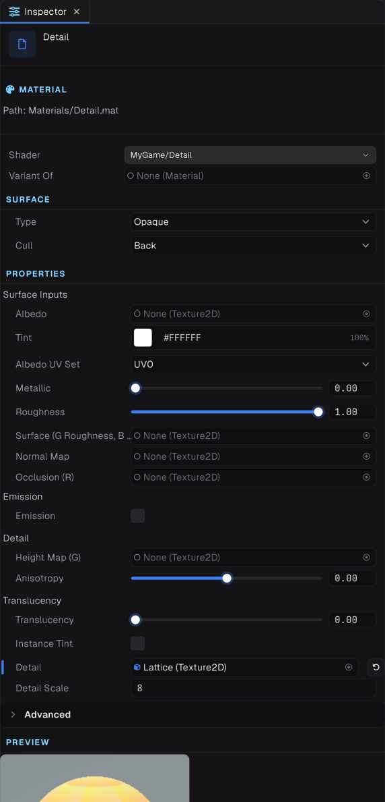

## Variants

A variant axis is a switch resolved at compile time. Each combination of values is its own compiled shader, so unused features cost nothing at runtime.

Declare axes with pragmas anywhere in the program or its includes:

```glsl
#pragma variant _DETAIL                 // toggle: defines _DETAIL when on
#pragma variant _STYLE SOFT TOON FLAT   // enum: defines _STYLE_SOFT, _STYLE_TOON or _STYLE_FLAT
```

Then branch with the preprocessor:

```glsl
#ifdef _DETAIL
    s.BaseColor *= texture(_DetailTex, s.UV * _DetailScale).rgb * 2.0;
#endif

#if defined(_STYLE_TOON)
    // ...
#endif
```

### Setting variants




From properties, so the inspector drives them:

```glsl
_DetailTex("Detail", Texture2D) = "white" {} [Keyword(_DETAIL)]     // on while a texture is set
_Glow("Glow", Integer) = 0 [Toggle(_GLOW)]                           // on while not zero
_Style("Style", Integer) = 0 [KeywordEnum(_STYLE)]                   // picks by index
```

Or from code, which overrides what the properties drive:

```csharp
material.SetKeyword("_DETAIL", true);
material.SetKeyword("_STYLE", "TOON");
bool on = material.IsKeywordEnabled("_DETAIL");
material.RevertKeyword("_DETAIL");   // back to what the properties say
```

### Global axes

```glsl
#pragma variant global GRAPHITE_DEBUG OFF ALBEDO NORMALS
```

A `global` axis is set by the renderer or a view, never by a material. The built-in shaders use one for the editor's debug views.

### Keep the count down

Every axis multiplies the number of combinations: four toggles is sixteen variants per pass. Variants compile on demand, the first time something draws them, and objects show flat grey until theirs is ready. Builds precompile only the variants your materials use. Prefer a uniform and a branch for cheap switches, and variants for expensive features.

## Globals

A global is a value every material can read, set once from C# rather than per material: wind, wetness, time of day, a player position.

```glsl
#pragma global float _Wetness
#pragma global vec4 _PlayerPosition
```

Read them by name like any property. Put the pragma in a shared include so every shader agrees.

```csharp
Material.SetGlobalFloat("_Wetness", rain.Intensity);
Material.SetGlobalVector("_PlayerPosition", new Float4(p.X, p.Y, p.Z, 1f));
```

Also available: `SetGlobalColor`, `SetGlobalInt`, `SetGlobalMatrix`, `SetGlobalTexture` and `SetGlobalTexture3D`.

> [!NOTE]
> In a material pass, a loose `uniform` that is neither a property nor a global is a compile error. If you meant a shared value, declare it with `#pragma global`.
