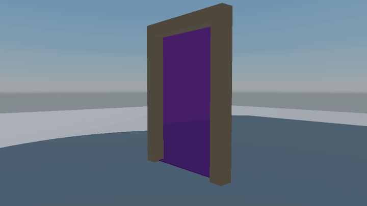

Render state commands go inside a `Pass`, before `GLSLPROGRAM`, in any order. Anything you leave out uses the default.

## Culling

| Command | Effect |
| --- | --- |
| `Cull Back` | Discard back faces (default) |
| `Cull Front` | Discard front faces |
| `Cull Off` | Draw both sides |

## Depth

| Command | Values | Default |
| --- | --- | --- |
| `ZTest` | `Disabled`, `Never`, `Less`, `Equal`, `LessEqual`, `Greater`, `NotEqual`, `GreaterEqual`, `Always` | `LessEqual` |
| `ZWrite` | `On`, `Off` | `On` |
| `ZClip` | `On`, `Off` (clamp depth instead of clipping) | `On` |
| `Offset factor units` | Depth bias, for example `Offset -1 -1` to pull toward the camera | none |

## Blending

```glsl
Blend    SourceAlpha InverseSourceAlpha   // both colour and alpha
BlendRGB One One                          // colour only
BlendAlpha One Zero                       // alpha only
BlendOp  Add                              // Add, Subtract, ReverseSubtract, Minimum, Maximum
```

Any `Blend` command turns blending on. Factors: `Zero`, `One`, `SourceColor`, `InverseSourceColor`, `SourceAlpha`, `InverseSourceAlpha`, `DestinationColor`, `InverseDestinationColor`, `DestinationAlpha`, `InverseDestinationAlpha`, `BlendFactor`, `InverseBlendFactor`.

| Look | Command |
| --- | --- |
| Alpha blending | `Blend SourceAlpha InverseSourceAlpha` |
| Additive (fire, glow) | `Blend One One` |
| Premultiplied alpha | `Blend One InverseSourceAlpha` |
| Multiply (shadows, tint) | `Blend DestinationColor Zero` |

## Colour mask and alpha to coverage

- `ColorMask RGB` writes only the channels listed. Any combination of `R`, `G`, `B` and `A`; the default is `RGBA`.
- `AlphaToMask On` turns alpha into MSAA coverage for smooth cutout edges without sorting.

## Stencil

A `Stencil` block turns the stencil test on for the pass.

```glsl
Stencil
{
    Ref 1
    ReadMask 255
    WriteMask 255
    Comp Always
    Pass Replace
    Fail Keep
    ZFail Keep
}
```

| Command | Meaning |
| --- | --- |
| `Ref` | The reference value |
| `ReadMask`, `WriteMask` | Bits compared, bits written |
| `Comp` | `Never`, `Less`, `Equal`, `LessEqual`, `Greater`, `NotEqual`, `GreaterEqual`, `Always` |
| `Pass` | What happens when stencil and depth both pass |
| `Fail` | When the stencil test fails |
| `ZFail` | When stencil passes but depth fails |

Operations: `Keep`, `Zero`, `Replace`, `IncrementAndClamp`, `DecrementAndClamp`, `Invert`, `IncrementAndWrap`, `DecrementAndWrap`. Add `Front` or `Back` to any comparison or operation (`CompFront`, `PassBack` and so on) to set the faces separately.

### Example: a portal window




The window marks its pixels, then the world behind it draws only there.

```glsl
// On the window shader
Stencil { Ref 1 Comp Always Pass Replace }
```

```glsl
// On the shader for objects seen through the portal
Stencil { Ref 1 Comp Equal }
```

