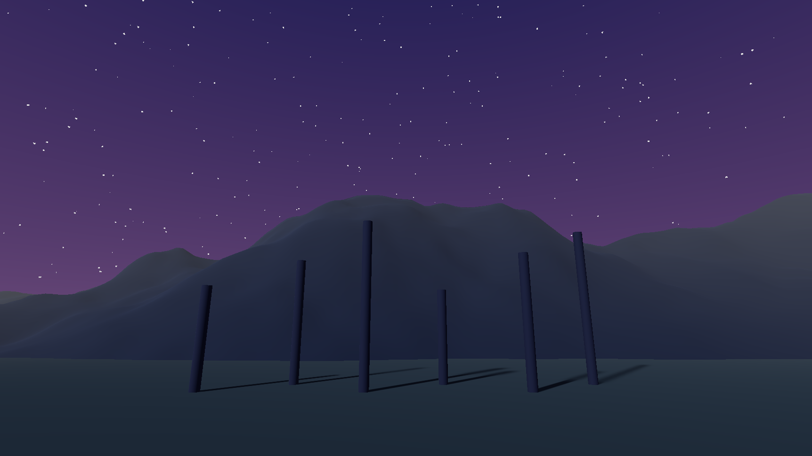

A sky is a shader with a pass tagged `"LightMode" = "Sky"`. It draws as a fullscreen triangle at the far plane where nothing else drew, and it is also rendered into the **sky probe**, so your sky lights the scene's ambient and reflections.



## A stylized sky with stars

```glsl
Shader "MyGame/StarrySky"
{
    Properties
    {
        _ZenithColor("Zenith", Color) = (0.02, 0.03, 0.10, 1.0)
        _HorizonColor("Horizon", Color) = (0.25, 0.15, 0.30, 1.0)
        _GroundColor("Ground", Color) = (0.03, 0.03, 0.04, 1.0)
        _StarDensity("Star Density", Float) = 400.0
        _StarBrightness("Star Brightness", Float) = 3.0 [HDR]
    }

    Pass
    {
        Tags { "LightMode" = "Sky" }
        GLSLPROGRAM
        Vertex
        {
            #include "Graphite/Sky.glsl"
            void main() { }
        }
        Fragment
        {
            #include "Graphite/Sky.glsl"
            uniform vec4 _ZenithColor;
            uniform vec4 _HorizonColor;
            uniform vec4 _GroundColor;
            uniform float _StarDensity;
            uniform float _StarBrightness;
            layout(location = 0) out vec4 outColor;

            float Hash(vec3 p)
            {
                p = fract(p * 0.3183099 + 0.1);
                p *= 17.0;
                return fract(p.x * p.y * p.z * (p.x + p.y + p.z));
            }

            void main()
            {
                vec3 dir = Graphite_SkyDirection();
                float up = dir.y;

                vec3 color = up > 0.0
                    ? mix(_HorizonColor.rgb, _ZenithColor.rgb, pow(up, 0.5))
                    : mix(_HorizonColor.rgb, _GroundColor.rgb, clamp(-up * 4.0, 0.0, 1.0));

                vec3 cell = floor(dir * _StarDensity);
                float star = step(0.998, Hash(cell)) * smoothstep(0.0, 0.2, up);
                color += vec3(star * _StarBrightness);

                outColor = vec4(color, 1.0);
            }
        }
        ENDGLSL
    }
}
```

- Include `Graphite/Sky.glsl` in both stages, **before** any other library file. A sky has no object, so it leaves object data out.
- The vertex `main` stays empty: the library already draws the fullscreen triangle.
- `Graphite_SkyDirection()` is the unit world direction of the pixel.

## Using it

Make a material from the shader and assign it as the scene's sky in the Environment panel, or from code:

```csharp
public sealed class SkySwitcher : Component
{
    public Material NightSky;

    public override void Start()
    {
        Scene.Current.Environment.SkyMaterial = NightSky;
    }
}
```

The built-in skies are a good reference: `Procedural`, `Gradient`, `Cubemap`, `Panorama` and `SixSided`. Load one with `Shader.LoadDefault(DefaultShader.GradientSky)`, or create one with `SceneEnvironment.CreateSkyMaterial(BuiltInSky.Procedural)`.

> [!TIP]
> It is also rendered into the sky probe so keep your skies cheap.
