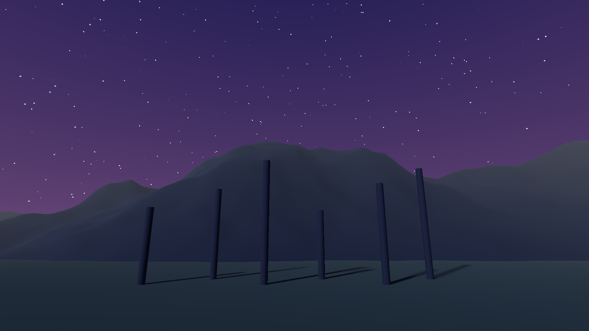

A sky is a shader with a pass tagged `"LightMode" = "Sky"`. It draws as a fullscreen triangle at the far plane where nothing else drew, and it is also rendered into the **sky probe**, so your sky lights the scene's ambient and reflections. The easiest way to write one is a `Surface "Sky"` block, which takes one function: the light seen along a direction.



## A stylized sky with stars

```glsl
Shader "MyGame/StarrySky"
{
    Properties
    {
        _ZenithColor("Zenith", Color) = (0.02, 0.03, 0.10, 1.0)
        _HorizonColor("Horizon", Color) = (0.25, 0.15, 0.30, 1.0)
        _GroundColor("Ground", Color) = (0.03, 0.03, 0.04, 1.0)
        _Intensity("Intensity", Float) = 0.5
        _StarDensity("Star Density", Float) = 400.0
        _StarBrightness("Star Brightness", Float) = 3.0
    }

    Surface "Sky"
    {
        GLSLPROGRAM
        uniform vec4 _ZenithColor;
        uniform vec4 _HorizonColor;
        uniform vec4 _GroundColor;
        uniform float _Intensity;
        uniform float _StarDensity;
        uniform float _StarBrightness;

        float Hash(vec3 p)
        {
            p = fract(p * 0.3183099 + 0.1);
            p *= 17.0;
            return fract(p.x * p.y * p.z * (p.x + p.y + p.z));
        }

        vec3 Sky(vec3 direction)
        {
            float up = direction.y;
            vec3 color = up > 0.0
                ? mix(_HorizonColor.rgb, _ZenithColor.rgb, pow(up, 0.5))
                : mix(_HorizonColor.rgb, _GroundColor.rgb, clamp(-up * 4.0, 0.0, 1.0));

            vec3 cell = floor(direction * _StarDensity);
            float star = step(0.998, Hash(cell)) * smoothstep(0.0, 0.2, up);
            color += vec3(star * _StarBrightness);

            return color * _Intensity;
        }
        ENDGLSL
    }
}
```

- `Sky(direction)` gets the unit world direction of the pixel and returns light in **nits**. The model multiplies it by the camera's exposure for you.
- Pick nits that match the scene: a clear daytime sky is thousands of nits, a night sky well under one. This one is a night sky, so use auto exposure or a low camera `EV100` with it. See [Exposure](../03-rendering/02-cameras-and-post-processing.md#exposure-and-physical-light).
- `Graphite/Skies.glsl` gives you the scene's sun: `Graphite_SunDirection()` and `Graphite_SunIlluminance()`, its colour times lux. The built-in Procedural sky is `Graphite_ProceduralSky` over those.

## A hand-written sky pass

`Surface "Sky"` expands to one pass. Writing it yourself looks like this:

```glsl
Pass
{
    Tags { "LightMode" = "Sky" }
    GLSLPROGRAM
    Vertex
    {
        #include "Graphite/Sky.glsl"
        void main() { }
    }
    Fragment
    {
        #include "Graphite/Sky.glsl"
        layout(location = 0) out vec4 outColor;
        void main()
        {
            vec3 nits = vec3(0.2, 0.4, 1.0) * 5000.0 * max(Graphite_SkyDirection().y, 0.0);
            outColor = vec4(Graphite_SaturateHalf(nits * Graphite_Exposure()), 1.0);
        }
    }
    ENDGLSL
}
```

- Include `Graphite/Sky.glsl` in both stages, **before** any other library file. A sky has no object, so it leaves object data out.
- The vertex `main` stays empty: the library already draws the fullscreen triangle.
- Multiply by `Graphite_Exposure()` yourself, and clamp with `Graphite_SaturateHalf`.

## Using it

Make a material from the shader and assign it as the scene's sky in the Environment panel, or from code:

```csharp
public sealed class SkySwitcher : Component
{
    public Material NightSky;

    public override void Start()
    {
        Scene.Environment.SkyMaterial = NightSky;
    }
}
```

The built-in skies are all `Surface "Sky"` shaders and a good reference: `Procedural`, `Gradient`, `Cubemap`, `Panorama` and `SixSided`. See [Sky, fog and clouds](../03-rendering/04-environment.md) for the sky probe's capture settings. Load one with `Shader.LoadDefault(DefaultShader.GradientSky)`, or create one with `SceneEnvironment.CreateSkyMaterial(BuiltInSky.Procedural)`.

> [!TIP]
> It is also rendered into the sky probe so keep your skies cheap.
