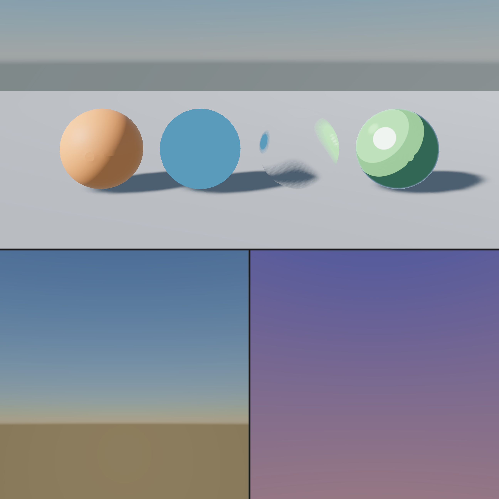

Load any built-in shader from code with `Shader.LoadDefault(DefaultShader.Name)`.

```csharp
var material = new Material(Shader.LoadDefault(DefaultShader.Lit));
material.Surface = new SurfaceSettings(SurfaceType.Cutout);
```

## Lit

`DefaultShader.Lit`, `Graphite/Lit`. The standard physically based surface, and the `"Lit"` surface model, which takes a Surface function, a `Vertex` block and a `Lighting` block. It has Forward, Prepass, ShadowCaster and Debug passes.

| Property | Type | Notes |
| --- | --- | --- |
| `_MainTex`, `_MainColor` | Texture, Color | Albedo and tint |
| `_MainTexUV` | Integer | UV0 or UV1 |
| `_AlphaCutoff` | Float | Shown for cutout surfaces |
| `_Metallic`, `_Roughness` | Float | Defaults 0 and 1 |
| `_SurfaceTex`, `_SurfaceTexUV` | Texture | G roughness, B metallic, multiplying the values above. Sets `_SURFACEMAP` |
| `_NormalTex`, `_NormalScale`, `_NormalTexUV` | Texture | Tangent space normal map. Sets `_NORMALMAP` |
| `_OcclusionTex`, `_OcclusionStrength`, `_OcclusionTexUV` | Texture | R channel. Sets `_OCCLUSIONMAP` |
| `_Emission` | Integer | Toggles `_EMISSION` |
| `_EmissionTex`, `_EmissiveColor`, `_EmissionIntensity`, `_EmissionTexUV` | | Emission is texture times colour times intensity |
| `_ParallaxMap`, `_Parallax`, `_ParallaxSteps` | Texture | Height in G, parallax occlusion mapping on UV0. Sets `_PARALLAXMAP` |
| `_Anisotropy`, `_AnisoDirectionMap` | Float, Texture | Anisotropic highlights, direction in RG. Toggles `_ANISOTROPIC` |
| `_TranslucencyStrength`, `_TranslucencyMap` | Float, Texture | B thickness, G extra occlusion. Toggles `_TRANSLUCENCY` |
| `_ScatteringPower`, `_ScatteringDistortion`, `_ScatteringScale` | Float | Shape the light passing through |
| `_InstanceTint` | Integer | Toggles `_INSTANCE_TINT`: instance colours multiply the vertex colour |

Every texture can read from UV0 or UV1 through its `UV` property, except parallax, anisotropy and translucency, which use UV0.

## Unlit

`DefaultShader.Unlit`, `Graphite/Unlit`, and the `"Unlit"` surface model, which takes a Surface function and a `Vertex` block. Texture times tint times vertex colour, with fog.

| Property | Notes |
| --- | --- |
| `_MainTex`, `_MainColor`, `_MainTexUV` | Texture, tint and UV set |
| `_AlphaCutoff` | Shown for cutout surfaces |
| `_InstanceTint` | Instance colours |

## Skies

| Shader | `DefaultShader` | Use |
| --- | --- | --- |
| Procedural | `ProceduralSky` | A physically inspired atmosphere that follows the sun |
| Gradient | `GradientSky` | A zenith, horizon and ground gradient |
| Cubemap | `CubemapSky` | A cubemap |
| Panorama | `PanoramaSky` | An equirectangular image |
| Six Sided | `SixSidedSky` | Six separate textures |

`SceneEnvironment.CreateSkyMaterial(BuiltInSky.Procedural)` makes a ready-to-use sky material. See [Custom skies](11-custom-skies.md) to write your own.

## Graphite utility shaders

| Shader | Use |
| --- | --- |
| `Graphite/Fallback` | Flat grey. Drawn while a shader compiles or after it fails, and a good `Fallback` for your own shaders |
| `Graphite/DepthCaster` | Depth-only Prepass and ShadowCaster passes |

## Prowl shaders

| `DefaultShader` | Use | Key properties |
| --- | --- | --- |
| `Particle` | Particle systems | `_MainTex`, `_MainColor` |
| `Sprite` | 2D sprites | `_MainTex`, `_MainColor`, `_Tiling`, `_Offset` |
| `Line` | The line renderer | `_MainTex` |
| `Terrain` | Terrain, with up to 8 splat layers, holes, Prepass and ShadowCaster | `_Heightmap`, `_Splatmap0`, `_Splatmap1`, `_HolesMap`, `_Layer0` to `_Layer7` albedo, `_Layer0Normal` and so on, plus tiling, roughness and metallic per layer |
| `Grass` | Terrain grass and details, with wind and translucency | `_MainTex`, `_AlphaCutoff`, `_WindStrength`, `_WindSpeed`, `_Billboard`, `_Translucency` |
| `Refraction` | Refracting glass and water surfaces through the scene colour | `_RefractionStrength`, `_NoiseScale`, `_Tint`, `_BlurRadius`, `_BlurSteps` |
| `DefaultUI`, `DefaultText`, `DefaultTextMesh` | The GameObject UI and text | |
| `Gizmos`, `GizmoIcon`, `Invalid` | Editor drawing, and the pink invalid shader | |

> [!TIP]
> The built-in shaders are the best examples of hand-written passes. Grass shows vertex animation with translucency, Refraction shows the scene colour, and Terrain shows texture arrays of layers. Read them in the engine's `Assets/Defaults/Shaders` folder.
