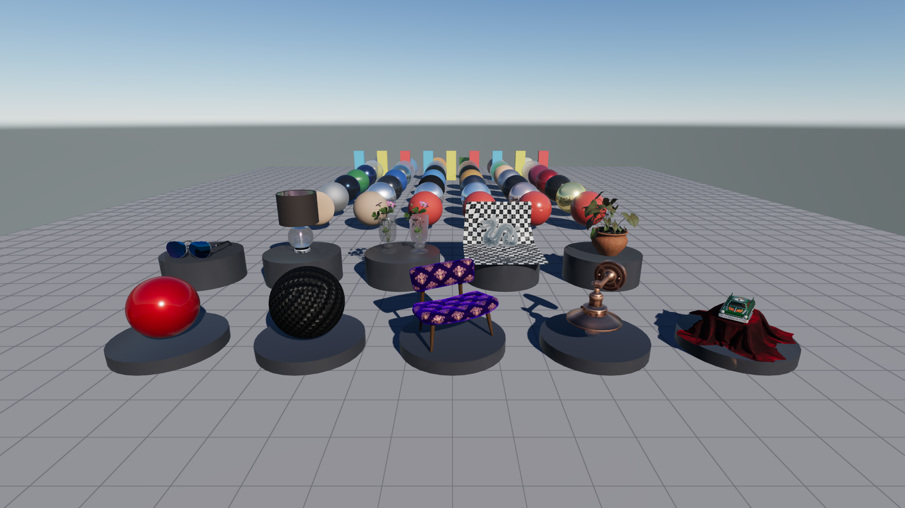

Load any built-in shader from code with `Shader.LoadDefault(DefaultShader.Name)`.

```csharp
var material = new Material(Shader.LoadDefault(DefaultShader.Lit));
material.Surface = new SurfaceSettings(SurfaceType.Cutout);
```

## Lit

`DefaultShader.Lit`, `Graphite/Lit`. The standard physically based surface, OpenPBR Surface v1.1.1, and the `"Lit"` surface model, which takes a Surface function, a `Vertex` block and a `Lighting` block. It has Forward, Transmission, BackDepth, Prepass, ShadowCaster and Debug passes.

| Group | Properties | Turns on |
| --- | --- | --- |
| Base | `base_weight`, `base_color`, `base_metalness`, `base_diffuse_roughness` | |
| Specular | `specular_weight`, `specular_color`, `specular_roughness`, `specular_roughness_anisotropy`, `specular_ior` | `PBR_ANISOTROPY` while the anisotropy is above 0 |
| Transmission | `transmission_weight`, `transmission_color`, `transmission_depth`, `transmission_scatter`, `transmission_scatter_anisotropy`, `transmission_dispersion_scale`, `transmission_dispersion_abbe_number` | `PBR_TRANSMISSION` |
| Subsurface | `subsurface_weight`, `subsurface_color`, `subsurface_radius`, `subsurface_radius_scale`, `subsurface_scatter_anisotropy` | `PBR_SUBSURFACE` |
| Coat | `coat_weight`, `coat_color`, `coat_roughness`, `coat_roughness_anisotropy`, `coat_ior`, `coat_darkening` | `PBR_COAT` |
| Fuzz | `fuzz_weight`, `fuzz_color`, `fuzz_roughness` | `PBR_FUZZ` |
| Emission | `emission_luminance` (nits), `emission_color` | |
| Thin film | `thin_film_weight`, `thin_film_thickness`, `thin_film_ior` | `PBR_THIN_FILM` |
| Geometry | `geometry_opacity`, `geometry_thin_walled` | `PBR_THIN_WALLED`, which also draws both sides |
| Extras | `ambient_occlusion`, `ambient_occlusion_map_strength`, `normal_scale`, `coat_normal_scale`, `tangent_rotation`, `alpha_cutoff` | |
| Parallax | `height_scale` with `geometry_height_map` | `PBR_PARALLAX` |

Every texturable input `X` has a `[Map]` texture `X_map`, plus `geometry_normal_map`, `geometry_coat_normal_map`, `geometry_tangent_map` and `geometry_height_map`. See [Materials](../03-rendering/01-materials.md).

## Unlit

`DefaultShader.Unlit`, `Graphite/Unlit`, and the `"Unlit"` surface model, which takes a Surface function and a `Vertex` block. `base_color` times its map and the vertex colour, glowing at `emission_luminance` nits, with fog.

| Property | Notes |
| --- | --- |
| `base_color`, `base_color_map` | Colour and texture |
| `emission_luminance` | Nits, 20000 by default, which shows `base_color` as it is at EV100 14 |
| `alpha_cutoff` | Shown for cutout surfaces |

## Skies

All `Surface "Sky"` shaders, giving their light in nits.

| Shader | `DefaultShader` | Properties |
| --- | --- | --- |
| Procedural | `ProceduralSky` | `_SunSize`, `_SunGlow`, `intensity`, `_Tint`, `_GroundColor`. Lit by the scene's sun |
| Gradient | `GradientSky` | `_TopColor`, `_BottomColor`, `_Exponent`, `intensity` (nits, 20000) |
| Cubemap | `CubemapSky` | `_Cubemap`, `_Tint`, `intensity` (nits, 20000), `_Rotation` |
| Panorama | `PanoramaSky` | `_Panorama` (equirectangular), `_Tint`, `intensity`, `_Rotation` |
| Six Sided | `SixSidedSky` | `_CubeRight`, `_CubeLeft`, `_CubeTop`, `_CubeBottom`, `_CubeFront`, `_CubeBack`, `_Tint`, `intensity` |

`SceneEnvironment.CreateSkyMaterial(BuiltInSky.Procedural)` makes a ready-to-use sky material. See [Custom skies](11-custom-skies.md) to write your own.

## Graphite utility shaders

| Shader | Use |
| --- | --- |
| `Graphite/Fallback` | Flat grey. Drawn while a shader compiles or after it fails, and a good `Fallback` for your own shaders |
| `Graphite/DepthCaster` | The shadow of materials without a ShadowCaster pass |
| `Graphite/Water` | The [Ocean](../03-rendering/05-ocean.md)'s surface, drawn by the Ocean component |

## Prowl shaders

| `DefaultShader` | Use | Key properties |
| --- | --- | --- |
| `Particle` | Particle systems, lit or unlit, with soft particles | `_MainTex`, `_MainColor` |
| `Sprite` | 2D sprites | `_MainTex`, `_MainColor`, `_Tiling`, `_Offset` |
| `Line` | The line renderer | `_MainTex` |
| `Terrain` | Terrain: a `Surface "Lit"` shader blending up to 8 splat layers, with holes | `_Heightmap`, `_Splatmap0`, `_Splatmap1`, `_HolesMap`, `_Layer0` to `_Layer7` albedo, `_Layer0Normal` and so on, plus tiling, roughness and metallic per layer |
| `Grass` | Terrain grass and details: a `Surface "Lit"` shader with thin walled subsurface for light through the blades, and wind | `base_color`, `specular_roughness`, `subsurface_weight`, `subsurface_color`, `_WindStrength`, `_WindSpeed`, `_Billboard`, `_AlignToNormal` |
| `Refraction` | Refracting glass and water surfaces through the scene colour | `_RefractionStrength`, `_NoiseScale`, `_Tint`, `_BlurRadius`, `_BlurMIP`, `_BlurSteps` |
| `DefaultUI`, `DefaultText`, `DefaultTextMesh` | The GameObject UI and text | |
| `Gizmos`, `GizmoIcon`, `Invalid` | Editor drawing, and the pink invalid shader | |

`Sprite`, `Line` and unlit particles write their colour as it is, whatever the camera's exposure, so a sprite always shows its texture's colours. Use the Unlit shader for glowing things that should brighten and dim with the exposure like the rest of the scene.

For clear glass on ordinary meshes, the Lit shader's transmission is usually the better choice than `Refraction`, see [Transmission](07-transparency-and-screen-effects.md#transmission).
