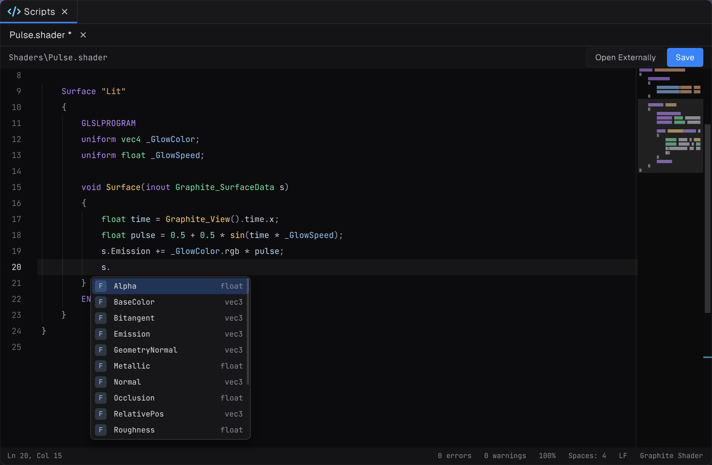

Prowl's shaders are `.shader` files in Graphite's **ShaderDef** format: a short, ShaderLab-style wrapper that holds render state, material properties and variant switches around plain GLSL. Prism, Prowl's own managed compiler, turns the GLSL into SPIR-V for Vulkan. There is no external toolchain to install.

## Two ways to write a shader

| | Surface shader | Hand-written passes |
| --- | --- | --- |
| You write | A `Surface` function, plus optional `Vertex` and `Lighting` blocks | Every pass: vertex and fragment code |
| You get for free | Lighting, shadows, lightmaps, probes, decals, fog, normal maps, parallax, cutout and transparency | Only what you write |
| Good for | Colour, normals, roughness, emission, alpha, vertex animation, custom lighting such as toon | Refraction, skies, anything that is not a lit surface |

Start with a surface shader. It now covers most effects; reach for passes when you need full control.

## What a shader file looks like

```glsl
Shader "MyGame/Rim"
{
    Properties
    {
        _RimColor("Rim Color", Color) = (0.3, 0.6, 1.0, 1.0)
        _RimPower("Rim Power", Float) = 3.0 [Range(0.5, 8)]
    }

    Surface "Lit"
    {
        GLSLPROGRAM
        uniform vec4 _RimColor;
        uniform float _RimPower;

        void Surface(inout Graphite_SurfaceData s)
        {
            float rim = 1.0 - max(dot(s.Normal, s.ViewDir), 0.0);
            s.Emission += _RimColor.rgb * pow(rim, _RimPower);
        }
        ENDGLSL
    }

    Fallback "Graphite/Fallback"
}
```

## The workflow in the editor




1. Create a shader from the project browser's create menu, or add a `.shader` file to your Assets folder.
2. Open it in the built-in code editor, which autocompletes surface data fields and library functions.
3. Save. The shader reimports, and materials using it update.
4. Create a material, pick your shader, and tune its properties in the inspector.

Compile errors appear in the console as `file:line: error`, where the line is the line in your `.shader` file, or in the include that failed.

> [!NOTE]
> Variants compile the first time something draws them. While a variant compiles, or if it failed, objects draw in flat grey from `Graphite/Fallback`. Builds precompile every variant your materials actually use.

## In this section

- [Your first shader](01-your-first-shader.md)
- [Surface shaders](02-surface-shaders.md)
- [Properties and attributes](03-properties-and-attributes.md)
- [Writing passes](04-writing-passes.md)
- [Vertex animation](05-vertex-animation.md)
- [Custom lighting and toon shading](06-custom-lighting.md)
- [Transparency and screen effects](07-transparency-and-screen-effects.md)
- [Variants and globals](08-variants-and-globals.md)
- [Render state and stencil](09-render-state-and-stencil.md)
- [Include library reference](10-include-library.md)
- [Custom skies](11-custom-skies.md)
- [Built-in shaders](12-built-in-shaders.md)
