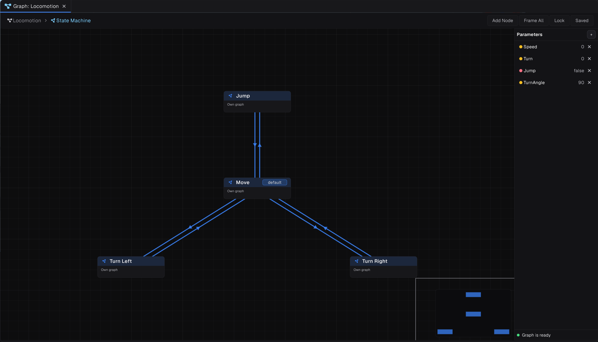
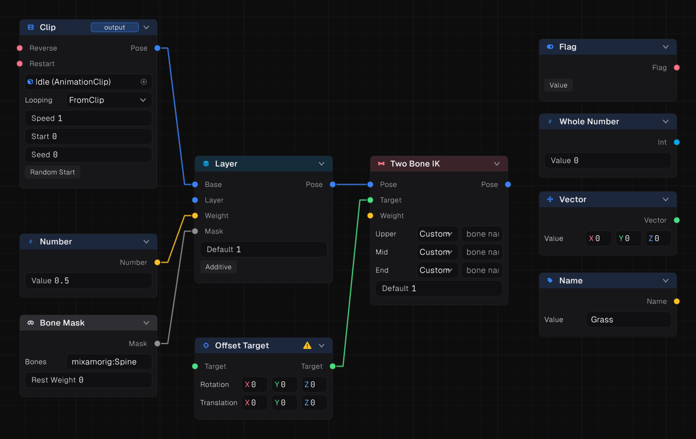
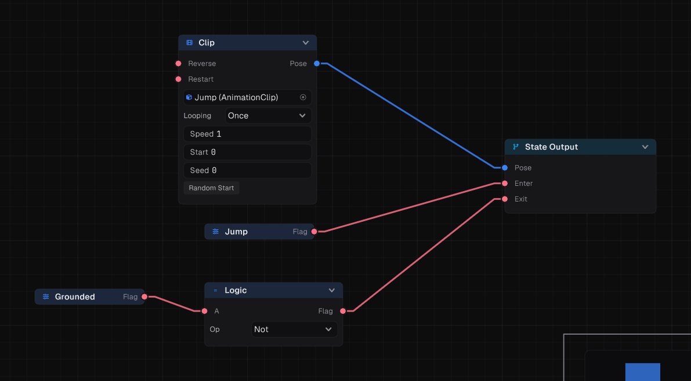
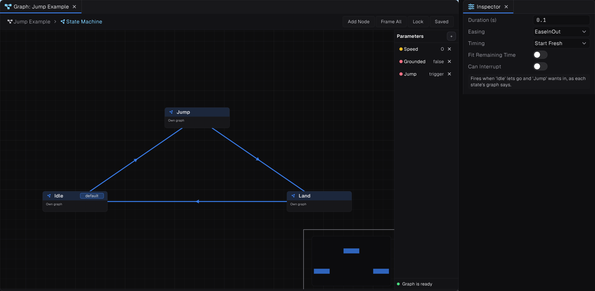
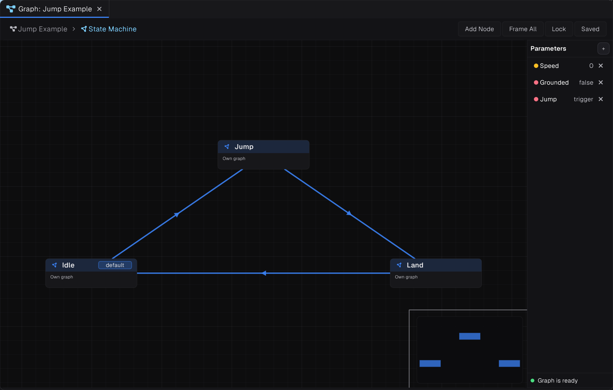
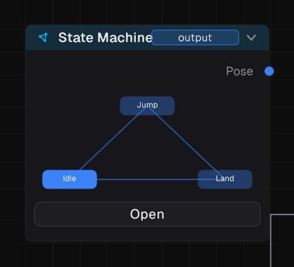

> [!IMPORTANT]
> Transitions in Prowl's graphs have no conditions of their own. Instead, **each state decides when it wants to be entered and when it is willing to be left.** Read this page before building a graph, or it will never leave its first state.

## Creating a graph



Create an **Animation Graph** from the project browser's create menu, then assign it to an Animator's **Graph** field. Double-click it to open the graph editor:

- The canvas shows the root of the graph, usually a state machine.
- The **Parameters** panel on the right lists the values your scripts set.
- Double-click a state to open the small graph inside it. The breadcrumb at the top takes you back.
- A minimap helps navigate large graphs.

## Nodes and pins

Nodes connect through typed pins:

| Pin kind | Carries |
| --- | --- |
| **Pose** | A full skeleton pose |
| **Number** | A float |
| **Flag** | A bool |
| **Integer** | An int |
| **Vector** | A 3D vector |
| **Target** | A point or bone to reach for, used by IK |
| **Mask** | Per-bone weights |
| **Id** | A name |

> [!WARNING]
> **An unwired required Number pin reads 0**, not the value shown in the editor. Feed constants with a **Number** node.

The first pose node you add to the graph becomes its **root**, the pose the Animator shows.



## State machines

A **State Machine** node holds states and the transitions between them. Each state is its own small graph, ending in a **State Output** node with three pins:

| Pin | Meaning |
| --- | --- |
| **Pose** | What the state plays |
| **Enter** | Whether the state *wants to be entered* |
| **Exit** | Whether the state *is willing to be left* |

### The gate rule



**A transition from A to B fires only when A's Exit is true and B's Enter is true.**

A new state starts with **Enter closed** and **Exit open**. So:

- With nothing wired into Enter, **nothing ever transitions into that state**.
- Wire a condition into Enter to make it conditional, or open it permanently.
- Wire a condition into Exit to keep a state playing until something is done, such as a one-shot attack.

This puts each condition in one place. "Jump when the Jump trigger fires" lives on the Jump state's Enter, however many states can lead to Jump.

### Default state and Any State

- The **default** state is where the machine starts.
- The **Any State** transitions to its targets from every other state, ignoring the source's Exit. It still respects the target's Enter. Use it for interrupts like hit reactions and death.

### Transitions



| Setting | Meaning |
| --- | --- |
| **Duration (s)** | Blend time in seconds (default 0.2) |
| **Easing** | `Linear`, `EaseIn`, `EaseOut`, `EaseInOut` |
| **Timing** | **Start Fresh**: the target starts from its beginning. **Match Time**: it starts at the source's sync position. **Synchronized**: phase locked to the source through the transition, using foot sync |
| **Fit Remaining Time** | The blend may not outlast what is left of the source |
| **Can Interrupt** | May cut in while the target is still blending in from elsewhere |

Use **Synchronized** timing between walk and run so the feet stay in step.

### Finishing states

- **State Done** is true once the state has played through (`Threshold` 0.99 of its progress), or after a number of seconds. Wire it into **Exit** for one-shot states, and set the clip's **Looping** to `Once`.
- **State Query** reads how long the machine has been in its state, or how far through it is.

### Triggers

A trigger is a Flag parameter marked **Trigger**. It turns itself off once a transition fires on it, so you can set it from a key press and forget it.

## Example: idle, jump and land




States: **Idle** (default), **Jump**, **Land**. Parameters: `Jump` (Flag, Trigger) and `Grounded` (Flag).

| State | Pose | Enter | Exit |
| --- | --- | --- | --- |
| Idle | Clip: idle, looping | Parameter `Grounded` | open |
| Jump | Clip: jump, `Once` | Parameter `Jump` | Logic Not of `Grounded` |
| Land | Clip: land, `Once` | Parameter `Grounded` | State Done |

Transitions: Idle → Jump (0.1 s), Jump → Land (0.05 s), Land → Idle (0.2 s).

```csharp
using Prowl.Runtime;

public sealed class JumpAnimation : Component
{
    public Animator Animator;
    private CharacterController _controller;

    public override void OnEnable() => _controller = GetComponent<CharacterController>();

    public override void Update()
    {
        Animator.SetBool("Grounded", _controller.IsGrounded);
        if (_controller.IsGrounded && Input.GetKeyDown(KeyCode.Space))
            Animator.SetTrigger("Jump");
    }
}
```



## Sub-graphs

- A **Sub Graph** node runs another graph as one node. A graph asset's parameters become its inputs.
- A state can play a graph asset instead of its own nodes, which keeps big machines readable.
- A **Graph Slot** is a named hole the game fills at runtime with `animator.SetGraphSlot("Weapon", rifleGraph)`, falling back to its input.

## Editing graphs from the terminal

The [Prowl CLI](../07-editor/01-prowl-cli.md) can build graphs: `prowl command graph Anim/Hero.animgraph --action types` lists every node with its pins and settings, and `--action edit --ops '<json>'` applies edits as one undo step. This is how AI agents build graphs for you.
