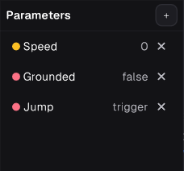
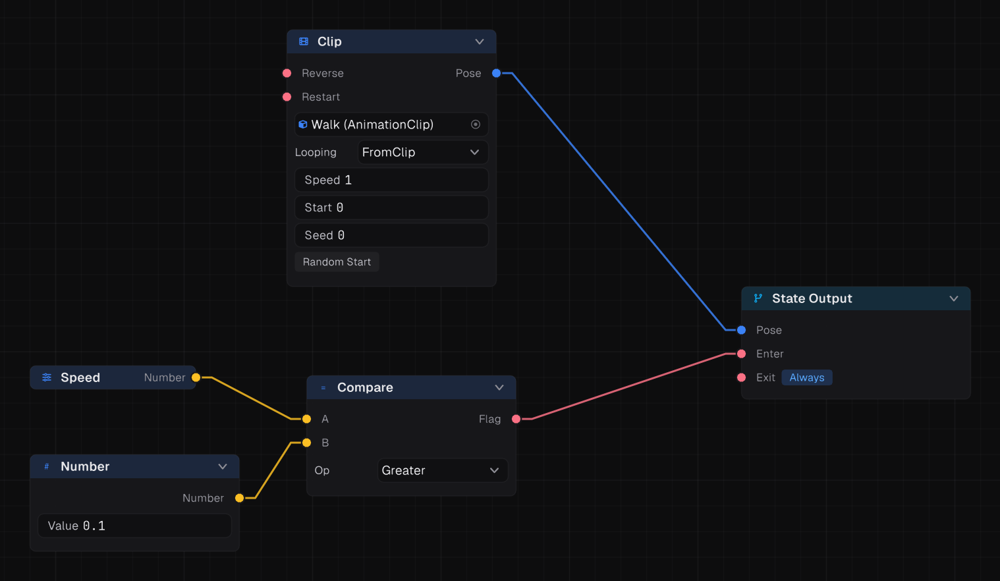

## Parameters

A parameter is a value the game sets on the Animator each frame, declared in the graph's Parameters panel.

| Kind | Set with | Read in the graph |
| --- | --- | --- |
| Number | `SetFloat("Speed", 3.2f)` | Number pin |
| Flag | `SetBool("Grounded", true)` | Flag pin |
| Flag, Trigger | `SetTrigger("Attack")`, `ResetTrigger("Attack")` | Turns itself off when a transition fires on it |
| Integer | `SetInt("Weapon", 2)` | Integer pin |
| Vector | `SetVector("MoveDir", dir)` | Vector pin |
| Target | `SetTarget("LookTarget", target)` | Target pin, for IK |
| Id | `SetId("Surface", new StringID("Grass"))` | Id pin |

Each has a getter: `GetFloat`, `GetBool`, `GetInt`, `GetVector`, `GetTarget`, `GetId`. A parameter must exist in the graph to be set.

Read a parameter with a **Parameter** node whose **Name** setting matches.

> [!TIP]
> Set parameters in `Update`. The Animator evaluates after every `Update` and before `LateUpdate`.

## Value nodes

### Constants

**Number**, **Whole Number**, **Flag**, **Vector** and **Name**.

### Maths and tests

| Node | Does |
| --- | --- |
| **Maths** | `Add`, `Subtract`, `Multiply`, `Divide`, `Min`, `Max`, `Absolute`, `Negate` |
| **Compare** | `A` against `B`: `Greater` (default), `GreaterOrEqual`, `Less`, `LessOrEqual`, `Equal`, `NotEqual` |
| **In Range** | True while a number is between Min and Max |
| **Logic** | `And`, `Or`, `Not` of flags |
| **Remap** | Maps a range onto another, optionally clamped |
| **Angle** | Wraps or flips an angle in degrees |
| **Curve** | Shapes a number through an authored curve |
| **Choose Number** | The value beside the first true condition, or a default, optionally eased |

### Smoothing

| Node | Does |
| --- | --- |
| **Spring** | Chases its input under a spring (Frequency, Damping) |
| **Ease** | Eases toward its input over Seconds |
| **Hold Value** | Samples once, for example on entering a state, and holds it |
| **Timer** | Counts seconds, optionally looping, with a Reset flag |
| **Noise** | A wandering number for idle variation |

### Vectors and targets

**Make Vector**, **Vector Component** (X, Y, Z or length), **Negate Vector**, **Target Info** (is set, point, distance, horizontal and vertical angle) and **Offset Target**.

### Names

**Name Matches** tests a name against a comma-separated list. **Name To Number** maps names to numbers, such as surface types to footstep volumes.

### Virtual parameters

A **Virtual Parameter** names a value computed inside the graph. Parameter nodes elsewhere read it by that name like a real parameter, so you can compute "is moving" once and use it everywhere.

## Recipes

**Moving or not:** Parameter `Speed` → Compare `A`; Number 0.1 → Compare `B`; Op `Greater`. Wire it into the Walk state's Enter. For Idle's Enter, use Compare with `LessOrEqual`.

**Grounded and not attacking:** Logic `And` of Parameter `Grounded` and Logic `Not` of Parameter `Attacking`.

**Smooth a jittery input:** Parameter `Speed` → Spring (Frequency 4, Damping 1) → Blend 1D's Parameter pin.

