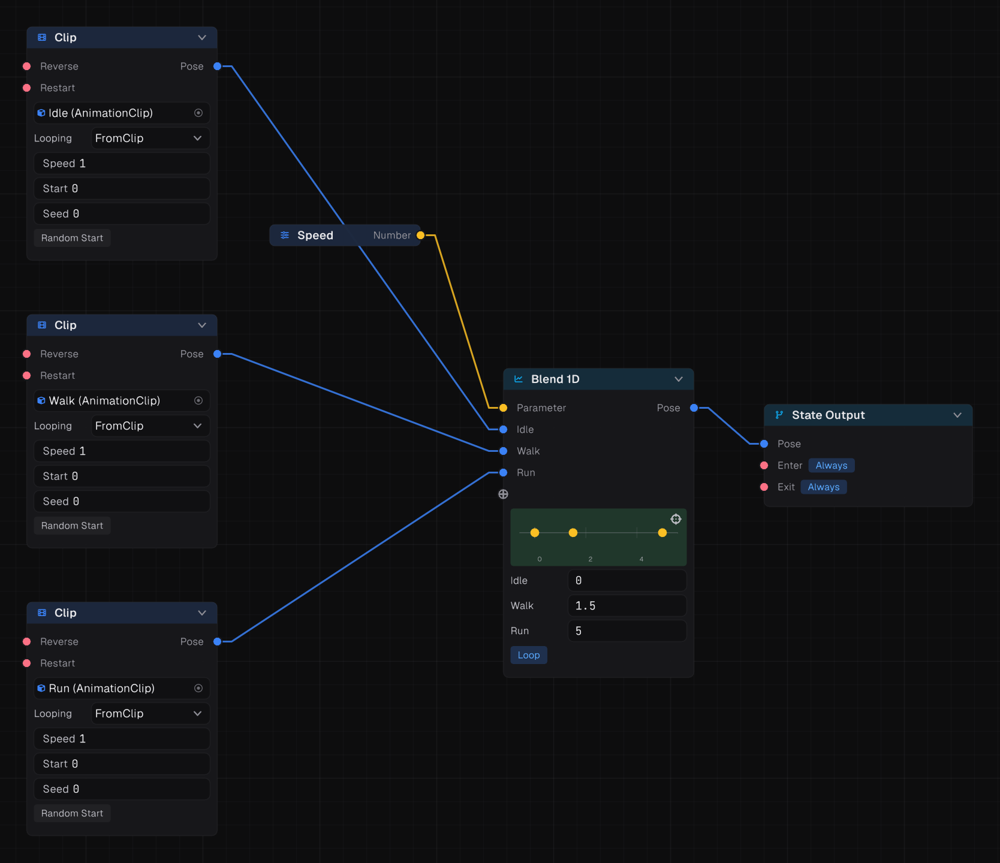
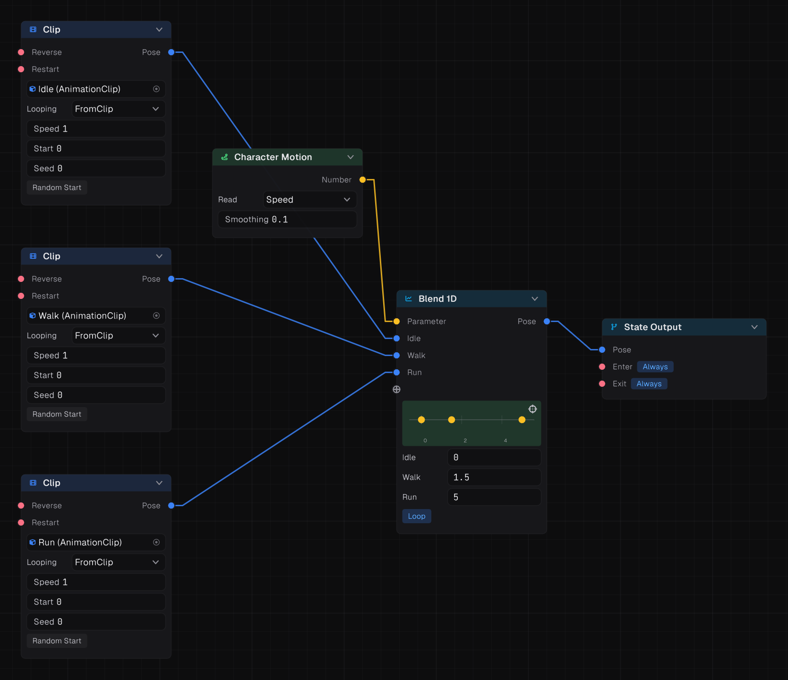
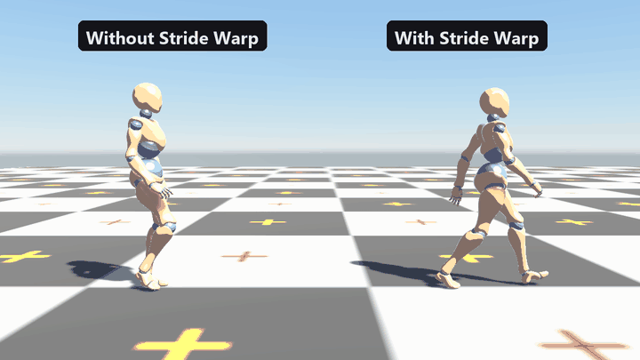
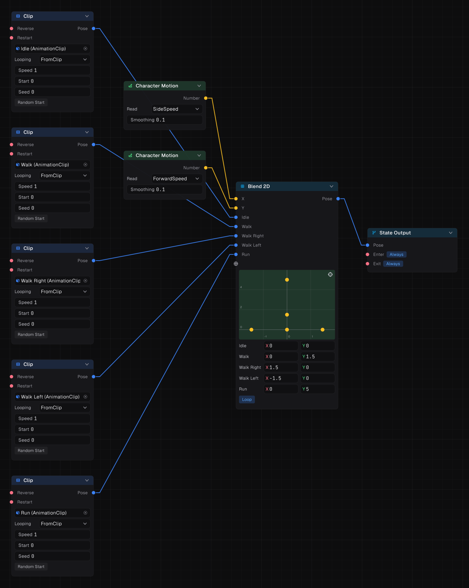
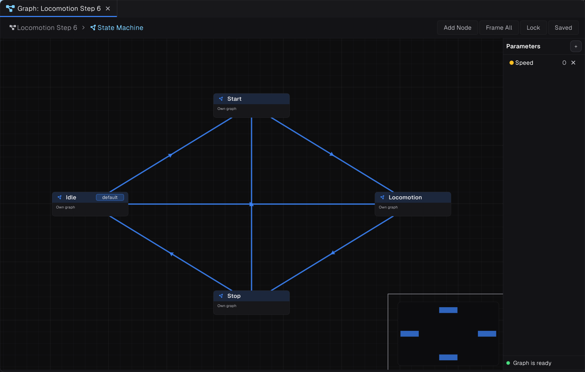
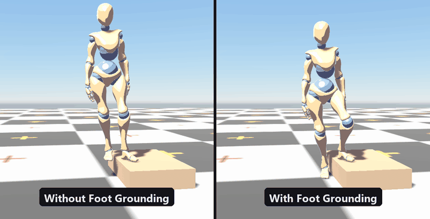
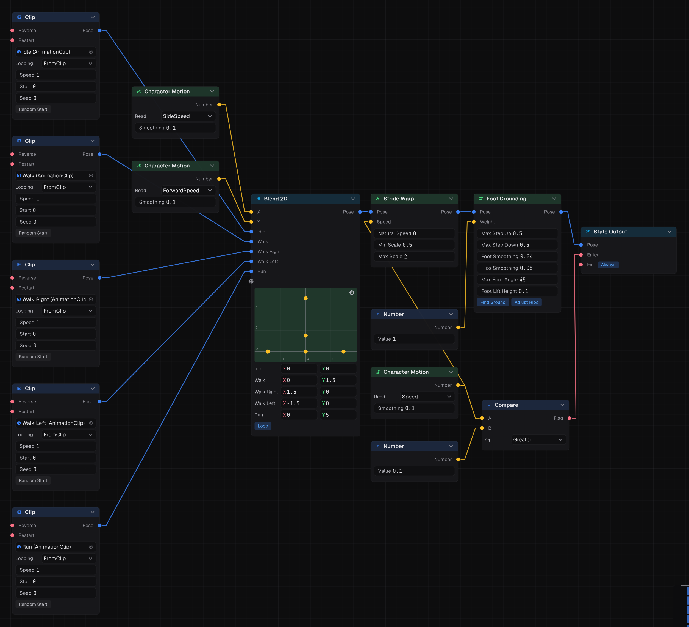

This walkthrough builds character locomotion from scratch: idle, walk, run and strafe, blended by speed, with feet that do not slide and that plant on slopes.


## What you need

- A character imported as **Humanoid** (Foot Grounding needs it; the rest works on Generic rigs too).
- Clips: idle, walk forward, run forward, and optionally strafe left and right and walk back.
- A `CharacterController` on the character's root, and the model with its Animator as a child.

Root travel is extracted by default, so the clips play in place while your script moves the character.

## Step 1: a speed-driven blend



Inside the root state machine, make a **Locomotion** state. Inside it:

1. Add a **Blend 1D** and wire it into State Output → Pose.
2. Add three **Clip** nodes (idle, walk, run) and wire them into the Blend 1D's pose inputs.
3. Set each input's threshold to the speed it represents, in metres per second: idle 0, walk 1.5, run 5.
4. Add a **Parameter** node named `Speed` and wire it into the Blend 1D's **Parameter** pin.
5. Open the state's **Enter** permanently, since it is the only state for now.

> [!NOTE]
> Each Blend 1D input's threshold is set on its input. They default to 1, so set every one. Clips under a blend follow the blend's timeline instead of their own looping, so walk and run stay in phase.

### The script

```csharp
using Prowl.Runtime;
using Prowl.Vector;

[RequireComponent(typeof(CharacterController))]
public sealed class PlayerLocomotion : Component
{
    public Animator Animator;
    public float WalkSpeed = 1.5f;
    public float RunSpeed = 5f;
    public float Gravity = 20f;

    private CharacterController _controller;
    private float _fall;

    public override void OnEnable() => _controller = GetComponent<CharacterController>();

    public override void Update()
    {
        Float2 input = Input.GetWASD();
        float speed = Input.GetKey(KeyCode.ShiftLeft) ? RunSpeed : WalkSpeed;
        Float3 move = (Transform.Forward * input.Y + Transform.Right * input.X) * speed;

        _fall = _controller.IsGrounded ? -2f : _fall - Gravity * Time.DeltaTime;
        _controller.Move(new Float3(move.X, _fall, move.Z) * Time.DeltaTime);

        Animator.SetFloat("Speed", Float2.Length(new Float2(move.X, move.Z)));
    }
}
```

## Step 2: let the graph read the movement itself



Instead of a `Speed` parameter, a **Character Motion** node measures how the character actually moved this frame, smoothed over its **Smoothing** time. Its **Read** setting picks what:

| Read | Gives |
| --- | --- |
| `Speed` | Ground speed |
| `ForwardSpeed`, `SideSpeed`, `VerticalSpeed` | Speed along each axis, relative to facing |
| `Direction` | Angle of travel relative to facing |
| `TurnRate` | How fast the character is turning |
| `Velocity` | The full velocity, as a Vector |

Replace the Parameter with Character Motion (`Speed`) and the script no longer needs to set anything. The animation follows whatever moves the character: input, AI or physics.

## Step 3: stop the feet sliding



A blend only matches the ground speed at its exact thresholds. Between them, or when gameplay speed differs from the clip, feet slide.

- **Velocity Blend** replaces Blend 1D for travelling clips. It blends by the speed each clip *actually covers*, measured from its root motion, so you do not set thresholds.
- **Stride Warp** after the blend bends the playback rate so the clip covers the ground at the speed you ask. Feed its **Speed** pin from Character Motion. **Min Scale** and **Max Scale** (0.5 and 2 by default) stop it looking silly; a **Natural Speed** of 0 measures it from the clip.

## Step 4: strafing with Blend 2D



For eight-way movement, use **Blend 2D** with Character Motion `SideSpeed` on **X** and `ForwardSpeed` on **Y**. Place each clip at its velocity: idle (0, 0), walk forward (0, 1.5), walk back (0, -1.5), strafe right (1.5, 0), strafe left (-1.5, 0), and run forward (0, 5).

With only forward clips, **Orientation Warp** bends a forward clip so it heads toward a **Direction** vector or by an angle in **Degrees**. It must sit directly on a Clip node. Clip events can limit the stretch of the clip it may turn in; see [Clip events](07-clip-events.md).

## Step 5: turning on the spot


Add a **Turn** state with a turn-in-place clip under a **Turn Warp**, which makes it turn by exactly the angle asked, read when it starts. Have your script set a Number parameter `TurnAngle`: the signed angle in degrees between where the character faces and where it should face.

The state wants in while the character is nearly still **and** the angle is above 45 degrees either way, and lets go when the clip is done:

## Step 6: starts and stops



Add **Start** and **Stop** states with one-shot clips:

| State | Enter | Exit |
| --- | --- | --- |
| Start | Speed above 0.1 | State Done |
| Locomotion | Speed above 0.1 | Speed at or below 0.1 |
| Stop | Speed at or below 0.1 | State Done, or a **Transition Window** event |
| Idle | Speed at or below 0.1 | Speed above 0.1 |

Use **Synchronized** timing on the transitions between Start, Locomotion and Stop so the feet stay in step.

## Step 7: feet on uneven ground



Put **Foot Grounding** last, just before State Output, or on the root after the state machine. It finds the ground under each foot, moves the feet by its height, drops the hips so both legs reach, and tilts planted feet onto slopes.

| Setting | Default |
| --- | --- |
| Find Ground | on (off to wire in your own heights and normals) |
| Max Step Up, Max Step Down | 0.5 m |
| Adjust Hips | on |
| Foot Smoothing, Hips Smoothing | 0.04 s, 0.08 s |
| Max Foot Angle | 45° |
| Foot Lift Height | 0.1 m |

Wire a **Number** 1 into its **Weight**, or blend it down while jumping.

**Foot Lock** pins a planted foot in world space while its **Locked** flag is true. Drive Locked from a **Foot Phase** node, which reads the foot markers in the clip. Set its Upper, Mid and End bones to the hip, knee and ankle.

## The finished graph



