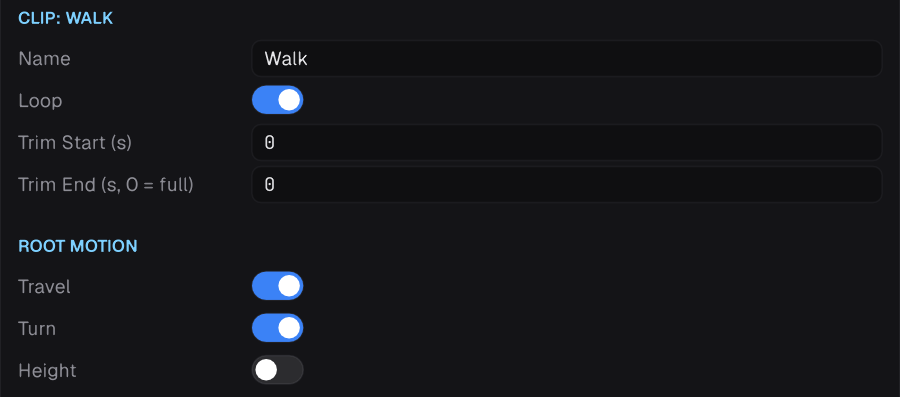
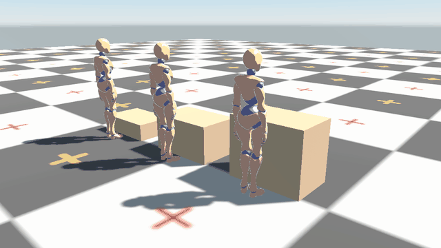

Root motion is the movement baked into a clip: the travel of a walk, the turn of a turn-in-place, the leap of a vault. Prowl extracts it so the clip plays in place, then hands you the movement.

## Extraction



Per clip, under **Root Motion** in the model inspector:

| Setting | Default | Meaning |
| --- | --- | --- |
| **Travel** | on | Horizontal movement becomes root motion |
| **Turn** | on | Turning becomes root motion |
| **Height** | off | Vertical movement becomes root motion. On a humanoid it follows the lower foot, so a crouch stays in the pose and a climb or jump moves the character |

Turn **Travel** off for clips whose movement should stay in the pose.

## Using root motion

### Directly on the Animator

`animator.ApplyRootMotion = true` moves the Animator's own Transform. Simple, but it moves through walls.

### Through a CharacterController

Leave `ApplyRootMotion` off and feed the delta into `Move` in `LateUpdate`, after the Animator has run. The delta is in the character's local space.

```csharp
using Prowl.Runtime;
using Prowl.Vector;

public sealed class RootMotionMover : Component
{
    public float Gravity = 20f;

    private Animator _animator;
    private CharacterController _controller;
    private float _fall;

    public override void OnEnable()
    {
        _animator = GetComponentInChildren<Animator>();
        _controller = GetComponent<CharacterController>();
    }

    public override void LateUpdate()
    {
        var delta = _animator.RootMotionDelta;
        _fall = _controller.IsGrounded ? -2f : _fall - Gravity * Time.DeltaTime;

        _controller.Move(Transform.Rotation * delta.position + new Float3(0f, _fall * Time.DeltaTime, 0f));
        Transform.Rotation = Transform.Rotation * delta.rotation;
    }
}
```

## Shaping root motion in the graph

| Node | Does |
| --- | --- |
| **Root Motion** | Keeps `All`, `Horizontal`, `Rotation` or `None` of the channels, scales travel and turn, and caps speed and turn rate |
| **Stride Warp** | Changes playback rate so travel matches a requested speed |
| **Orientation Warp** | Bends a travelling clip toward a direction |
| **Turn Warp** | Makes a turn clip turn by an exact angle |
| **Target Warp** | Stretches a clip's travel so it lands on a displacement |

In a **Layer Stack**, **Base Root Motion Only** (on by default) takes root motion from the base pose only, so an upper-body layer never pushes the character.

## Example: jump onto a ledge



1. In the model inspector, turn on **Height** under **Root Motion** for the jump clip, so the climb is part of the root motion the warp bends.
2. Give the clip a **Target Warp** event from takeoff to touchdown. Without one the whole clip is bent, so the feet slide while they are on the ground. See [Clip events](07-clip-events.md).
3. In the Jump state, wire a Vector parameter `JumpOffset` into a **Target Warp** node's **Displacement**.
4. Before triggering the jump, raycast for the ledge and set the offset from the character to the landing point, in the character's local space:

```csharp
Float3 local = Transform.InverseTransformPoint(ledgePoint);
animator.SetVector("JumpOffset", local);
animator.SetTrigger("Jump");
```

The clip now lands on the ledge, whatever its height and distance.

