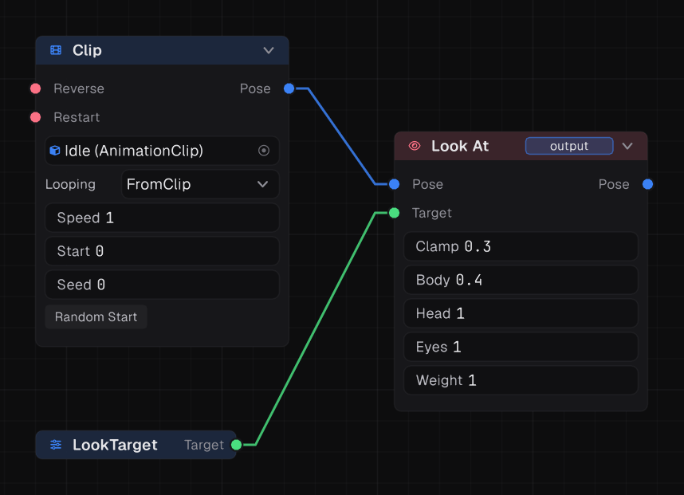
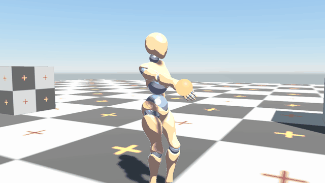
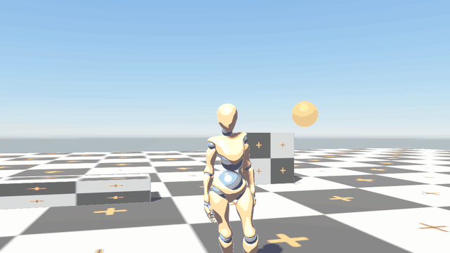
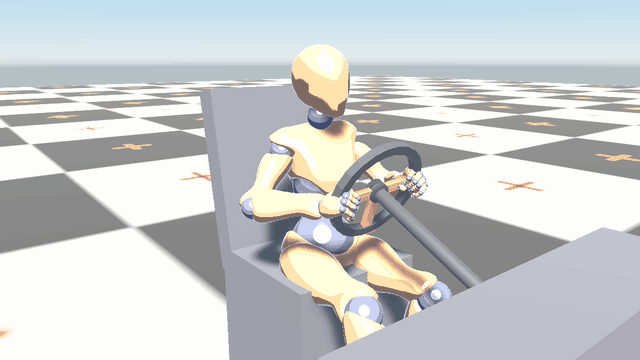
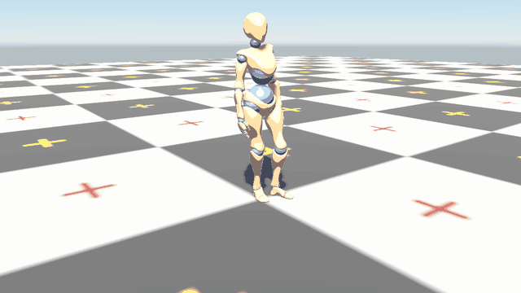

IK nodes take a pose and adjust bones so a limb reaches a **target**. They run in the graph after the animation, so they always work on top of whatever is playing.

## Targets



A target is a point, with rotation, in the world or on a bone. Add a **Target** parameter to the graph and set it from a script:

```csharp
using Prowl.Motion;
using Prowl.Runtime;
using Prowl.Vector;
using Prowl.Vector.Spatial;

public sealed class LookAtPlayer : Component
{
    public Animator Animator;
    public GameObject Player;

    public override void Update()
    {
        Float3 eyes = Player.Transform.Position + new Float3(0f, 1.6f, 0f);
        Animator.SetTarget("LookTarget", Target.FromWorld(new Transform3D(eyes, Quaternion.Identity, Float3.One)));
    }
}
```

- `Target.FromWorld(transform)` is a point in the scene. Prowl converts it into the character's space for you.
- `Target.FromBone(boneIndex)` tracks one of the character's own bones, with an optional offset.
- An unset target reads as not set. **Target Info** with `IsSet` turns that into a flag, so IK can switch itself off.

Other target nodes: **Offset Target** shifts and turns a target by a fixed amount, and **Target Info** reads its point, distance, or horizontal and vertical angle.

## Two Bone IK



Bends a limb so its end reaches the target: a hand on a door handle, a foot on a pedal.

| Input or setting | Meaning |
| --- | --- |
| Pose, Target | The pose to adjust and where to reach |
| Upper, Mid, End | The three bones, such as `@RightUpperArm`, `@RightLowerArm`, `@RightHand` |
| Weight | 0 is the animation, 1 is fully on target |

The bend direction comes from the animated pose, so a slightly bent elbow in the clip bends the right way.

A bone name starting with `@` is a humanoid bone, found through the avatar, so it works on any humanoid rig. Without the `@` it is the rig's own bone name, such as `mixamorig:RightArm`. A name the rig does not have leaves the node doing nothing.

## IK Rig

Solves several effectors together, each with its own chain, target and weight. Each input names its effector and its bone chain as a comma-separated list, for example `@RightUpperArm,@RightLowerArm,@RightHand`. Use it for two-handed grips or full-body reaching, where effectors pull on shared bones.

## Look At



Turns the spine, head and eyes toward a target.

| Setting | Default | Meaning |
| --- | --- | --- |
| Body | 0.4 | How much the spine helps |
| Head | 1 | How much the head turns |
| Eyes | 1 | How much the eyes turn |
| Clamp | 0.3 | Limits how far it will turn |
| Weight | 1 | Overall strength |

All five can be driven by numbers, so you can fade it in and out.

## Aim Constraint and Copy Transform

- **Aim Constraint** points one bone's axis at a target: a turret barrel, a head looking along an arrow.
- **Copy Transform** puts a bone where another bone or a target is, copying position, rotation or both. Use it to keep a weapon's support hand on its grip.

## Smooth weights, no popping

Never snap IK weight between 0 and 1. Wire **Target Info** (`IsSet`) through **Choose Number** or a number into **Ease**, and the Ease into the IK node's Weight:

## Example: hands on a steering wheel



1. Add two Target parameters, `LeftGrip` and `RightGrip`.
2. After the driving pose, add an **IK Rig** with two effectors: the left arm chain with `LeftGrip`, the right arm chain with `RightGrip`.
3. Each frame, set the targets from two empty GameObjects parented to the wheel:

```csharp
Animator.SetTarget("LeftGrip", Target.FromWorld(new Transform3D(LeftHandle.Transform.Position, LeftHandle.Transform.Rotation, Float3.One)));
Animator.SetTarget("RightGrip", Target.FromWorld(new Transform3D(RightHandle.Transform.Position, RightHandle.Transform.Rotation, Float3.One)));
```

The hands follow the wheel as it turns.

## Secondary motion


| Node | Does |
| --- | --- |
| **Spring Bones** | A chain from a **Root** bone lags and settles: tails, ponytails, antennas. **Stiffness** 40 and **Damping** 6 by default |
| **Twist Distribution** | Spreads a bone's roll across its twist bones, for clean forearms |
| **Pose Smoothing** | Damps the whole pose with a half life |

## Ragdolls



The **Ragdoll** node (humanoid only) builds a physics ragdoll that follows the pose:

| Setting | Meaning |
| --- | --- |
| Muscle Strength | How hard joints turn toward the animation |
| Pin Strength | How hard the body is held to the animation |
| Pinning | `All` parts, or only the `Hips` |
| Blend | 1 follows the animation, 0 goes limp |
| Total Mass | 70 kg by default |

Drive **Blend** down to 0 on death for a limp fall, or keep it near 1 for an active ragdoll that staggers when hit.

