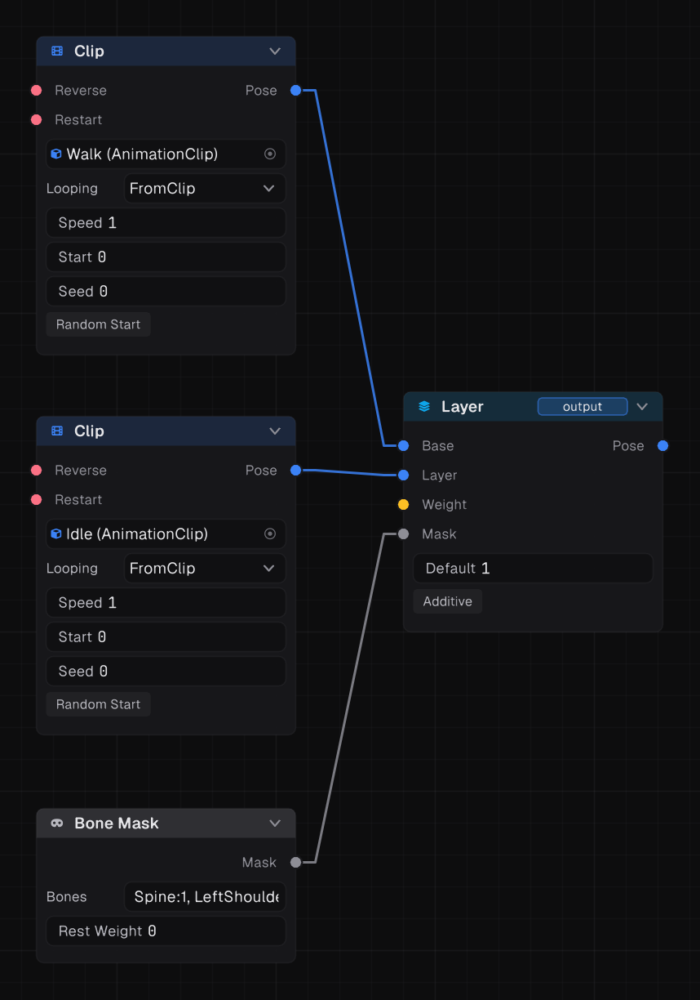
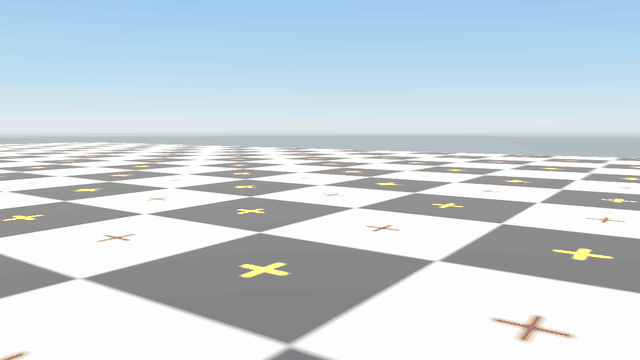
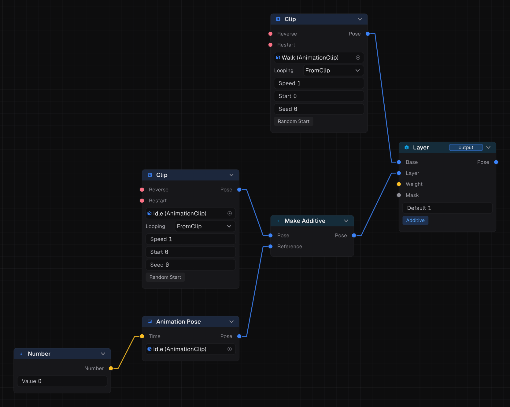

Layers combine poses: run with the legs while aiming with the arms, or add breathing on top of everything.

## Layer

Blends a **Layer** pose over a **Base** pose, through an optional **Mask**. With **Additive** on, it adds the layer on top instead of replacing.

## Layer Stack

A stack of layers over a base, each with its own **Layer** pose, **Weight** and **Mask**. **Base Root Motion Only** (on by default) takes root motion from the base, so upper-body layers never move the character.

## Masks



A mask is a weight per bone.

| Node | Builds a mask from |
| --- | --- |
| **Bone Mask** | Seed bones with weights, spread down the hierarchy. **Rest Weight** covers bones no seed reaches |
| **Mask Asset** | An Avatar Mask asset |
| **Blend Masks** | Two masks mixed by a number |
| **Choose Mask** | Whichever mask an integer picks |

A Bone Mask's bones are written as `Bone:weight` pairs, comma separated. An `@` names a humanoid bone, without it the name is the rig's own bone:

```
@Spine:1, @LeftShoulder:1, @RightShoulder:1
```

Spreading means `@Spine:1` covers the whole upper body. Lower a child to soften it: `@Spine:1, @Neck:0.5`.

## Example: shoot while running



The legs keep running and the upper body aims. Ease the weight in when the player raises the weapon.

## Additive animation

**Make Additive** turns a pose into its difference from a reference pose. Layer the result with **Additive** on, and it adds that difference to whatever plays underneath.

- A lean or breathing clip, made additive against its own first frame, works on idle, walk and run alike.
- A flinch can play over any action.
- **Zero Pose** is the additive identity, useful as a neutral input.



## Muscle Layer

For humanoids, **Muscle Layer** blends in muscle space instead of bone space, so a layered pose keeps its meaning on a differently proportioned body. It can also be additive, and takes an Avatar Mask.

## Mirroring

**Mirror** swaps left and right while its **Enabled** flag is true or unwired. One set of left-foot-first clips covers both sides.
