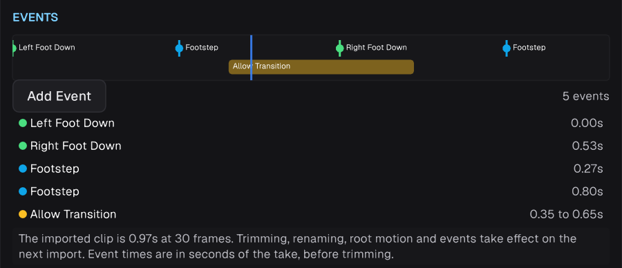
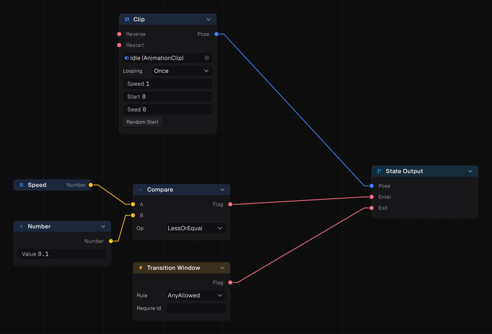

Clip events are markers on an animation clip: a single moment, or a stretch when it has a duration. Add them per clip in the model's inspector. Times are in seconds from the clip's start.

## Event kinds

| Kind | Marks | Read by |
| --- | --- | --- |
| **Named** | A gameplay moment: footstep sound, hit frame, spawn point | **Event Fired** node, and scripts |
| **Foot** | A foot planting or passing | **Foot Phase** node, synchronized transitions, foot locking |
| **Transition Window** | A stretch that allows or blocks leaving the clip | **Transition Window** node |
| **Orientation Warp** | The stretch an Orientation Warp may turn the clip in | Orientation Warp |
| **Target Warp** | The stretch a Target Warp may bend travel in, and along which axes | Target Warp |
| **Root Motion** | A stretch where the clip's own root motion passes an override | Root Motion |
| **Snap To Frame** | A stretch sampled a frame at a time instead of smoothly | Playback |

## Foot events and sync

Mark when each foot goes down and when it passes the other. Then:

- **Synchronized** transitions keep walk, run and stop clips phase locked, so a run never starts on the wrong foot.
- **Foot Phase** reads `LeftFootDown`, `RightFootDown`, `LeftFootPassing`, `RightFootPassing`, or the combined `LeftPhase` and `RightPhase`. Feed it into **Foot Lock** to pin planted feet.
- Mirrored clips swap the feet automatically.

## Transition windows

A stop, attack or landing often has frames where leaving looks bad. Mark the good stretch as a Transition Window, then wire a **Transition Window** node into the state's **Exit**. The state lets go only inside the window.

## Named events in the graph

**Event Fired** is true on a frame where the clip fired one of the listed names. **Match All** requires every name. Use it to gate states, such as allowing a combo follow-up only after the `ComboOpen` event.

## Named events in scripts

`Animator.Events` holds the events sampled this frame. Read it in `LateUpdate`, after the Animator has evaluated, to play footstep sounds or spawn effects. Look up its members with `prowl command api --type SampledEventsBuffer`.
