Prowl ships 84 graph node types, grouped as they are in the editor's add menu. In saved graphs and the CLI, each node has the id shown in its table.

> [!TIP]
> Your own nodes appear in the add menu too: any class deriving from `AnimationGraphNode` with a parameterless constructor is found automatically.

## Sources

Where poses come from.

### Animation Pose

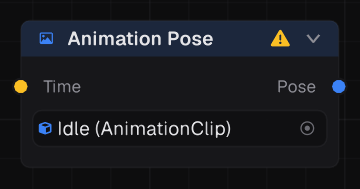

Samples one clip at a time a value node picks, with no clock of its own.

| | |
| --- | --- |
| Id | `motion.animationPose` |
| Inputs | Time |
| Settings | Clip |

### Clip

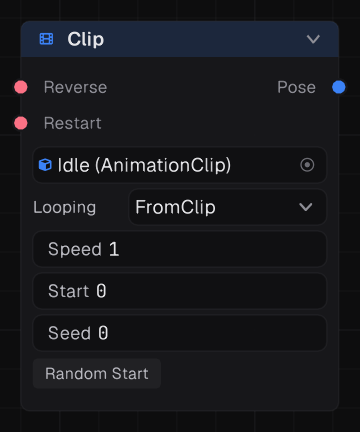

Plays one animation clip.

| | |
| --- | --- |
| Id | `motion.clip` |
| Inputs | Reverse, Restart |
| Settings | Clip, Looping, Speed, Start, Random Start |

### External Pose

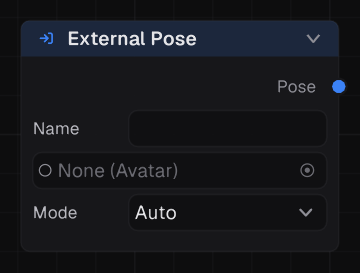

A pose the game writes in each frame: a ragdoll, a hit reaction, a tracked performer.

| | |
| --- | --- |
| Id | `motion.externalPose` |
| Inputs | None |
| Settings | Source, Mode |

### Graph Output

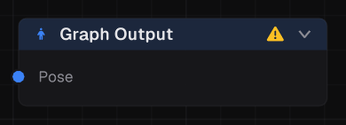

What an embedded sub graph plays.

| | |
| --- | --- |
| Id | `motion.graphOutput` |
| Inputs | Pose |
| Settings | None |

### Graph Slot

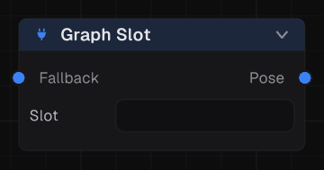

A named hole the game plugs a running graph into, falling back to its input.

| | |
| --- | --- |
| Id | `motion.externalGraphSlot` |
| Inputs | Fallback |
| Settings | None |

### Reference Pose

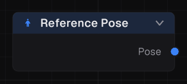

The rig as it was authored.

| | |
| --- | --- |
| Id | `motion.referencePose` |
| Inputs | None |
| Settings | None |

### Sub Graph

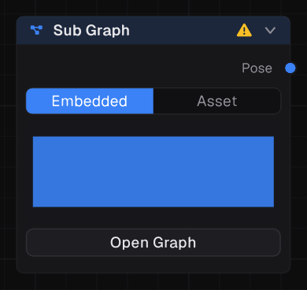

Runs another graph as one node, either its own nodes or a graph asset. An asset's parameters are ports: wire in what each should read, or leave one at its default.

| | |
| --- | --- |
| Id | `motion.subGraph` |
| Inputs | None |
| Settings | Graph asset or embedded nodes |

### Zero Pose

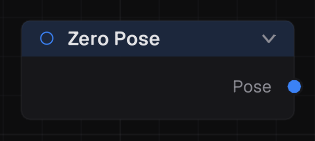

The additive identity: no rotation, no translation.

| | |
| --- | --- |
| Id | `motion.zeroPose` |
| Inputs | None |
| Settings | None |

## Logic

State machines and nodes that choose between poses.

### Choose Pose at Random

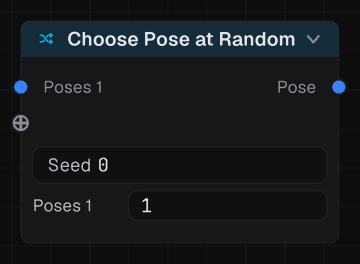

Picks one input at random each time it starts. Each input carries its weight.

| | |
| --- | --- |
| Id | `motion.randomSelector` |
| Inputs | Poses |
| Settings | None |

### Choose Pose by Condition

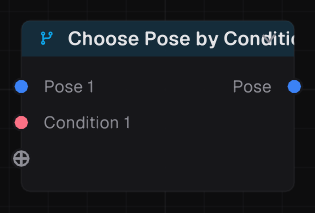

Shows the first input whose condition reads true.

| | |
| --- | --- |
| Id | `motion.conditionSelector` |
| Inputs | Pose, Condition |
| Settings | None |

### Choose Pose by Index

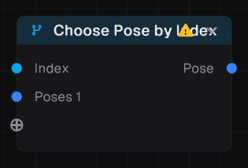

Shows whichever input an integer picks.

| | |
| --- | --- |
| Id | `motion.selector` |
| Inputs | Index, Poses |
| Settings | None |

### Sequence

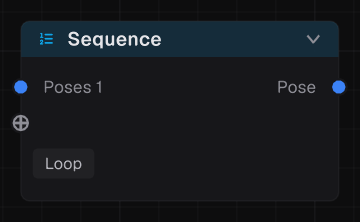

Plays its inputs one after another.

| | |
| --- | --- |
| Id | `motion.sequence` |
| Inputs | Poses |
| Settings | Loop |

### State Done

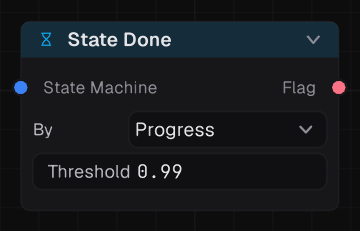

True once the current state has played through, or has run for a while. Inside a state, it reads that state's machine unless wired.

| | |
| --- | --- |
| Id | `motion.stateFinished` |
| Inputs | State Machine |
| Settings | By, Threshold, Seconds |

### State Machine

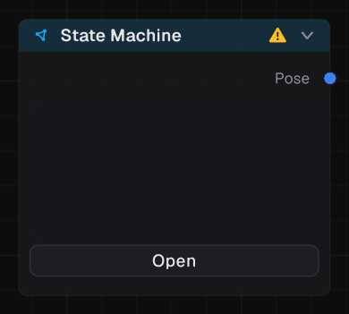

States and the transitions between them.

| | |
| --- | --- |
| Id | `motion.stateMachine` |
| Inputs | None |
| Settings | None |

### State Output

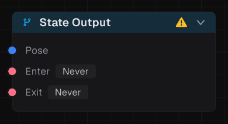

What a state plays, whether it wants to be entered, and whether it is willing to be left.

| | |
| --- | --- |
| Id | `motion.stateOutput` |
| Inputs | Enter, Exit, Pose |
| Settings | None |

### State Query

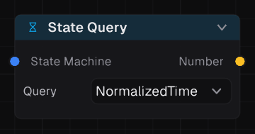

How long a state machine has been in its state, or how far through it is. Inside a state, it reads that state's machine unless wired.

| | |
| --- | --- |
| Id | `motion.stateQuery` |
| Inputs | State Machine |
| Settings | Query |

## Blending

Mixing poses together.

### Blend 1D

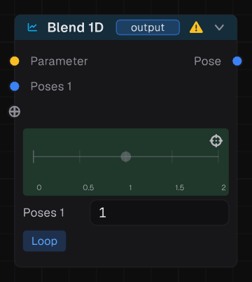

Blends a line of poses by one number. Each input carries its threshold. The clips under it follow its timeline rather than their own looping.

| | |
| --- | --- |
| Id | `motion.blend1d` |
| Inputs | Parameter, Poses |
| Settings | Loop |

### Blend 2D

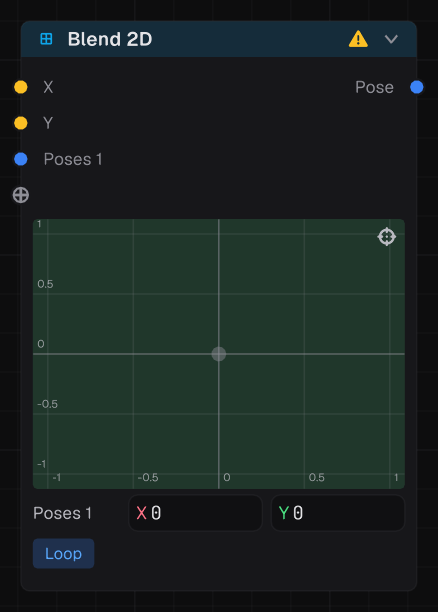

Blends a field of poses by two numbers. Each input carries its position. The clips under it follow its timeline rather than their own looping.

| | |
| --- | --- |
| Id | `motion.blend2d` |
| Inputs | X, Y, Poses |
| Settings | Loop |

### Crossfade

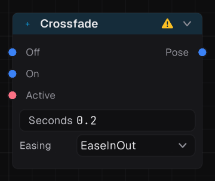

Fades from one pose to the other as a flag turns on, and back as it turns off.

| | |
| --- | --- |
| Id | `motion.crossfade` |
| Inputs | Off, On, Active |
| Settings | Seconds, Easing |

### Layer

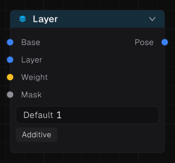

Blends a layer over a base pose through an optional mask, or adds it on top.

| | |
| --- | --- |
| Id | `motion.layer` |
| Inputs | Base, Layer, Mask |
| Settings | Mask, Additive |

### Layer Stack

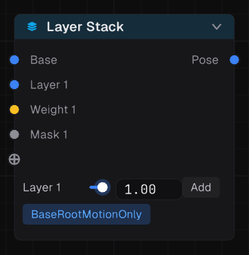

A stack of layers over a base pose, each with its own weight, mask and additive flag.

| | |
| --- | --- |
| Id | `motion.layerBlend` |
| Inputs | Base, Layer, Weight, Mask |
| Settings | Mask, Base Root Motion Only |

### Make Additive

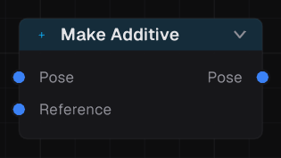

Turns a pose into the difference from a reference.

| | |
| --- | --- |
| Id | `motion.makeAdditive` |
| Inputs | Pose, Reference |
| Settings | None |

### Muscle Layer

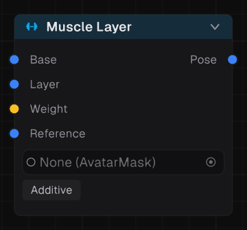

Layers in muscle space, so the body keeps its meaning where a bone blend would not.

> [!NOTE]
> Requires a humanoid Avatar.

| | |
| --- | --- |
| Id | `motion.muscleLayer` |
| Inputs | Base, Layer, Weight, Reference |
| Settings | Additive, Mask |

### Velocity Blend

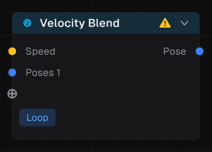

Blends travelling clips by the speed each one actually covers. The clips under it follow its timeline rather than their own looping.

| | |
| --- | --- |
| Id | `motion.velocityBlend` |
| Inputs | Speed, Poses |
| Settings | Loop |

### Weighted Blend

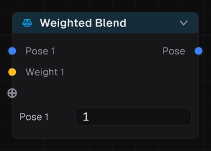

Mixes any number of poses by weight, normalized across them.

| | |
| --- | --- |
| Id | `motion.weightedBlend` |
| Inputs | Pose, Weight |
| Settings | None |

## Locomotion

Making travel, turning and footwork look right.

### Character Motion

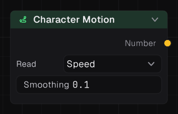

How the character is moving and turning, read from where it goes each frame.

| | |
| --- | --- |
| Id | `motion.characterMotion` |
| Inputs | None |
| Settings | Read, Smoothing |

### Foot Grounding

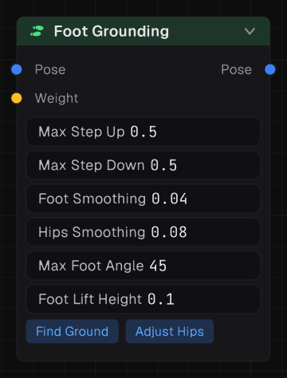

Moves the feet by the height of the ground under them, drops the hips so both legs reach, and tilts planted feet onto slopes. The ground is found by the node, or wired in as world heights.

> [!NOTE]
> Requires a humanoid Avatar.

| | |
| --- | --- |
| Id | `motion.footGrounding` |
| Inputs | Pose, Left Y, Right Y, Weight, Left Normal (optional), Right Normal (optional) |
| Settings | Find Ground, Adjust Hips, Max Step Up, Max Step Down, Foot Smoothing, Hips Smoothing, Max Foot Angle, Foot Lift Height |

### Foot Lock

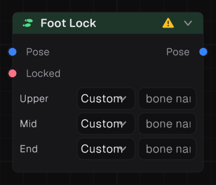

Pins a planted foot in world space so it stops sliding.

| | |
| --- | --- |
| Id | `motion.footLock` |
| Inputs | Pose, Locked |
| Settings | Upper, Mid, End |

### Orientation Warp

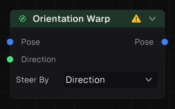

Bends a travelling clip so it heads where it is steered: toward a direction, or by an angle in degrees.

| | |
| --- | --- |
| Id | `motion.orientationWarp` |
| Inputs | Pose, Direction, Degrees |
| Settings | Steer By |

### Root Motion

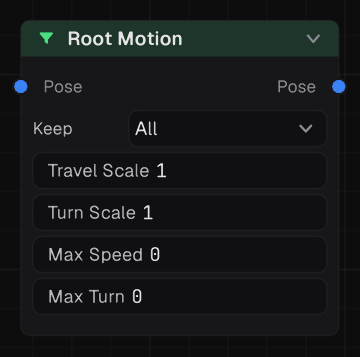

Keeps, scales and caps the root motion: which channels survive, how much travel and turn, and how fast either may go.

| | |
| --- | --- |
| Id | `motion.rootMotionFilter` |
| Inputs | Pose |
| Settings | Keep, Travel Scale, Turn Scale, Max Speed, Max Turn |

### Stride Warp

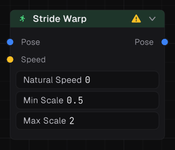

Bends playback rate so the clip covers ground at the speed asked for.

| | |
| --- | --- |
| Id | `motion.strideWarp` |
| Inputs | Pose, Speed |
| Settings | Natural Speed, Min Scale, Max Scale |

### Target Warp

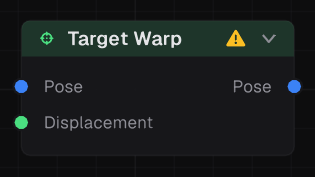

Stretches a clip's travel so it lands on a displacement.

| | |
| --- | --- |
| Id | `motion.targetWarp` |
| Inputs | Pose, Displacement |
| Settings | None |

### Turn Warp

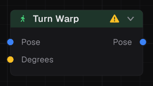

Makes a clip that turns on the spot turn by the angle asked, in degrees, read when it starts.

| | |
| --- | --- |
| Id | `motion.turnWarp` |
| Inputs | Pose, Degrees |
| Settings | None |

## Rig

IK, constraints, secondary motion and ragdolls.

### Aim Constraint

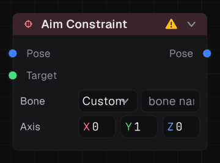

Points one bone's axis at a target.

| | |
| --- | --- |
| Id | `motion.aimConstraint` |
| Inputs | Pose, Target |
| Settings | Bone |

### Copy Transform

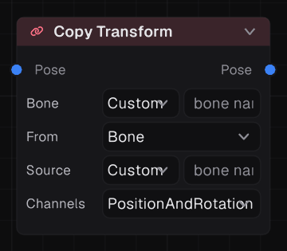

Puts a bone where another bone is, or where a target says.

| | |
| --- | --- |
| Id | `motion.copyConstraint` |
| Inputs | Pose, Target |
| Settings | Bone, Source, From, Channels |

### IK Rig

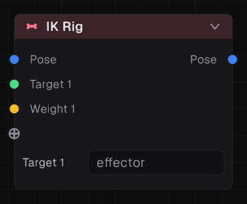

Solves several effectors at once. Each input names its effector and its bone chain.

| | |
| --- | --- |
| Id | `motion.iKRig` |
| Inputs | Pose, Target, Weight |
| Settings | None |

### Look At

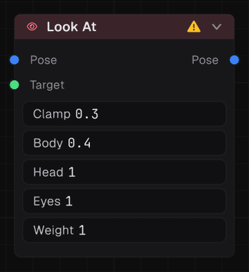

Turns the spine, head and eyes toward a target.

| | |
| --- | --- |
| Id | `motion.lookAt` |
| Inputs | Pose, Target |
| Settings | Clamp, Body, Head, Eyes, Weight |

### Ragdoll

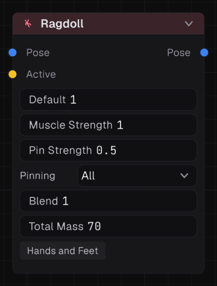

Makes a physics ragdoll of the humanoid that follows the pose, and shows the pose it took. Muscles turn the joints toward the animation, the pin holds every part or only the hips to it. Active slides from following (1) to limp (0).

| | |
| --- | --- |
| Id | `motion.ragdoll` |
| Inputs | Pose |
| Settings | Muscle Strength, Pin Strength, Blend, Total Mass, Pinning, Hands and Feet |

### Spring Bones

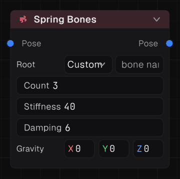

Gives a chain secondary motion that lags and settles.

| | |
| --- | --- |
| Id | `motion.springBones` |
| Inputs | Pose |
| Settings | Root, Stiffness, Damping |

### Twist Distribution

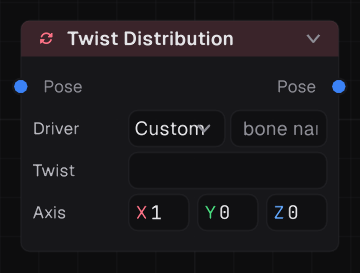

Spreads a bone's roll across twist bones, written as 

| | |
| --- | --- |
| Id | `motion.twistDistribution` |
| Inputs | Pose |
| Settings | Driver |

### Two Bone IK

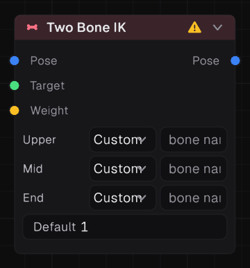

Bends a limb so its end reaches a target.

| | |
| --- | --- |
| Id | `motion.twoBoneIK` |
| Inputs | Pose, Target, Weight |
| Settings | Upper, Mid, End, Weight |

## Modify

Changing a pose after it is made.

### Inertial Blend

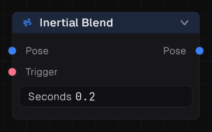

Smooths a sudden pose change out over time.

| | |
| --- | --- |
| Id | `motion.inertialBlend` |
| Inputs | Pose, Trigger |
| Settings | Seconds |

### Mirror

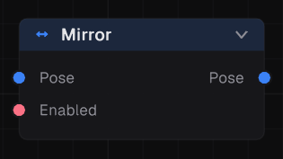

Swaps left and right, while Enabled reads true or is left unwired.

| | |
| --- | --- |
| Id | `motion.mirror` |
| Inputs | Pose, Enabled |
| Settings | None |

### Passthrough

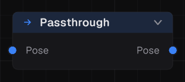

Hands its input straight on, for keeping a graph tidy.

| | |
| --- | --- |
| Id | `motion.passthrough` |
| Inputs | Pose |
| Settings | None |

### Pose Smoothing

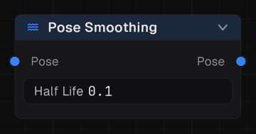

Damps the pose so it lags and settles.

| | |
| --- | --- |
| Id | `motion.poseSmoothing` |
| Inputs | Pose |
| Settings | Half Life |

### Pose Snapshot

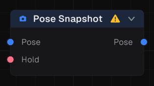

Freezes the pose while a flag reads true.

| | |
| --- | --- |
| Id | `motion.poseSnapshot` |
| Inputs | Pose, Hold |
| Settings | None |

### Speed Scale

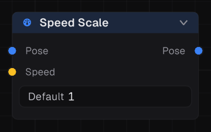

Plays its input faster or slower.

| | |
| --- | --- |
| Id | `motion.speedScale` |
| Inputs | Pose |
| Settings | Speed |

## Masks

Per-bone weights for layers.

### Blend Masks

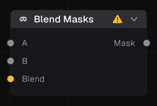

Mixes two masks by a number.

| | |
| --- | --- |
| Id | `motion.maskBlend` |
| Inputs | A, B, Blend |
| Settings | None |

### Bone Mask

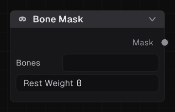

A mask seeded from bones and their weights, spread down the hierarchy. Bones no seed reaches take the rest weight.

| | |
| --- | --- |
| Id | `motion.boneMask` |
| Inputs | None |
| Settings | Rest Weight |

### Choose Mask

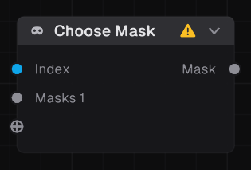

Picks whichever mask an integer chooses.

| | |
| --- | --- |
| Id | `motion.maskSelector` |
| Inputs | Index, Masks |
| Settings | None |

### Mask Asset

A mask saved as an asset.

| | |
| --- | --- |
| Id | `motion.maskAsset` |
| Inputs | None |
| Settings | None |

## Channels

Scalar channels carried with a pose, for corrective shapes.

### Drive Channels

Writes scalar channels onto a pose. Each input names the channel it drives.

| | |
| --- | --- |
| Id | `motion.channelLayer` |
| Inputs | Pose, Value |
| Settings | Mode |

### Driven Channel

Drives a channel from how far a bone has turned, for a corrective shape.

| | |
| --- | --- |
| Id | `motion.drivenChannel` |
| Inputs | Pose |
| Settings | Bone, From, To |

### Read Channel

Reads a scalar channel out of a pose.

| | |
| --- | --- |
| Id | `motion.poseChannel` |
| Inputs | Pose |
| Settings | Default |

## Events

Reading the markers authored on clips.

### Event Fired

True on a frame the clip fired one of these named events.

| | |
| --- | --- |
| Id | `motion.idEvent` |
| Inputs | None |
| Settings | Match All |

### Foot Phase

True while the clip says a foot is in the chosen phase.

| | |
| --- | --- |
| Id | `motion.footEvent` |
| Inputs | None |
| Settings | Phase |

### Transition Window

True while the clip marks a good moment to leave it.

| | |
| --- | --- |
| Id | `motion.transitionEvent` |
| Inputs | None |
| Settings | Rule |

## Values

Numbers, flags, vectors and targets that drive other nodes.

### Angle

Wraps or flips an angle in degrees.

| | |
| --- | --- |
| Id | `motion.floatAngle` |
| Inputs | Degrees |
| Settings | Op |

### Choose Number

The value beside the first condition that reads true, or the default when none does.

| | |
| --- | --- |
| Id | `motion.pickNumber` |
| Inputs | Condition, Value |
| Settings | Default, Ease Time, Easing |

### Compare

Tests two numbers against each other.

| | |
| --- | --- |
| Id | `motion.floatCompare` |
| Inputs | A, B |
| Settings | Op |

### Curve

Shapes a number through an authored curve.

| | |
| --- | --- |
| Id | `motion.curve` |
| Inputs | Value |
| Settings | Curve |

### Ease

Eases toward its input rather than jumping to it.

| | |
| --- | --- |
| Id | `motion.floatEase` |
| Inputs | Value |
| Settings | Seconds, Start Value, Easing, Use Start Value |

### Flag

A fixed true or false.

| | |
| --- | --- |
| Id | `motion.constBool` |
| Inputs | None |
| Settings | Value |

### Hold Value

Samples its input once and holds it.

| | |
| --- | --- |
| Id | `motion.cachedValue` |
| Inputs | Value, Sample |
| Settings | Mode |

### In Range

True while a number sits between two bounds.

| | |
| --- | --- |
| Id | `motion.floatRange` |
| Inputs | Value |
| Settings | Min, Max, Inclusive |

### Logic

And, Or, or Not of flags.

| | |
| --- | --- |
| Id | `motion.logic` |
| Inputs | A, B |
| Settings | Op |

### Make Vector

Builds a vector from three numbers.

| | |
| --- | --- |
| Id | `motion.vectorCreate` |
| Inputs | X, Y, Z |
| Settings | None |

### Maths

Combines two numbers, or changes one.

| | |
| --- | --- |
| Id | `motion.floatMath` |
| Inputs | A, B |
| Settings | Op |

### Name

A fixed name, for matching against events and states.

| | |
| --- | --- |
| Id | `motion.constId` |
| Inputs | None |
| Settings | Value |

### Name Matches

Tests a name against a comma separated list.

| | |
| --- | --- |
| Id | `motion.idComparison` |
| Inputs | None |
| Settings | Comparison |

### Name To Number

Maps each name in a list to the number beside it.

| | |
| --- | --- |
| Id | `motion.idToFloat` |
| Inputs | None |
| Settings | Default |

### Negate Vector

Points a vector the other way.

| | |
| --- | --- |
| Id | `motion.vectorNegate` |
| Inputs | Vector |
| Settings | None |

### Noise

A wandering number, for idle variation.

| | |
| --- | --- |
| Id | `motion.noise` |
| Inputs | None |
| Settings | Frequency, Amplitude |

### Number

A fixed number.

| | |
| --- | --- |
| Id | `motion.constFloat` |
| Inputs | None |
| Settings | Value |

### Offset Target

Shifts and turns a target by a fixed amount.

| | |
| --- | --- |
| Id | `motion.targetOffset` |
| Inputs | Target |
| Settings | None |

### Parameter

Reads a value the game sets on the animator.

| | |
| --- | --- |
| Id | `motion.parameter` |
| Inputs | None |
| Settings | None |

### Remap

Maps a number from one range onto another. Clamp stops it at the ends, which with the same range on both sides is a plain clamp.

| | |
| --- | --- |
| Id | `motion.floatRemap` |
| Inputs | Value |
| Settings | In Min, In Max, Out Min, Out Max, Clamp |

### Spring

Chases its input under a spring, so it never jumps.

| | |
| --- | --- |
| Id | `motion.floatSpring` |
| Inputs | Value |
| Settings | Frequency, Damping |

### Target Info

Reads something out of a target: whether it is set, its point, a distance or an angle.

| | |
| --- | --- |
| Id | `motion.targetInfo` |
| Inputs | Target |
| Settings | Info |

### Timer

Counts seconds, optionally looping.

| | |
| --- | --- |
| Id | `motion.timer` |
| Inputs | Reset |
| Settings | Loop, Normalized |

### Vector

A fixed direction or position.

| | |
| --- | --- |
| Id | `motion.constVector` |
| Inputs | None |
| Settings | Value |

### Vector Component

Reads one component of a vector, or its length.

| | |
| --- | --- |
| Id | `motion.vectorInfo` |
| Inputs | Vector |
| Settings | Component |

### Virtual Parameter

Names a value, which Parameter nodes can then read by that name like any parameter.

| | |
| --- | --- |
| Id | `motion.virtualParameter` |
| Inputs | Value |
| Settings | None |

### Whole Number

A fixed integer.

| | |
| --- | --- |
| Id | `motion.constInt` |
| Inputs | None |
| Settings | Value |
