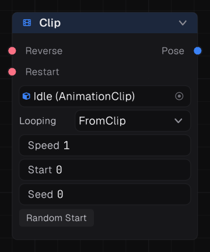
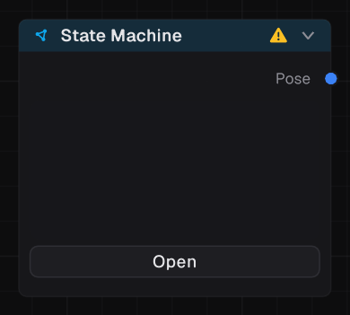
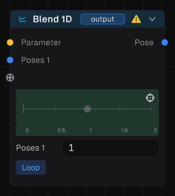
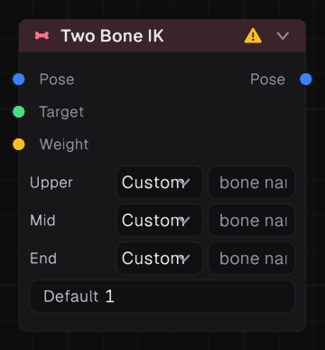

Prowl has 84 graph nodes, grouped like the editor's add menu. Three are hidden from that menu: Graph Output, State Output and Parameter.

How to read the tables:

- A setting marked `*` is a number that can also be wired as a pin. It is listed under Settings only.
- "(many)" means the pin repeats. Some carry a value, such as a weight.

> [!TIP]
> Your own nodes show up in the add menu too. Any class that derives from `AnimationGraphNode` and has a parameterless constructor is found automatically.

## Sources

Where poses come from.

| Node | Does | Inputs | Settings |
| --- | --- | --- | --- |
| Animation Pose | Shows a clip at the time you wire in. It has no clock of its own. | Time | Clip |
| Clip | Plays one animation clip. | Reverse, Restart | Clip, Looping, Speed, Start, Random Start, Seed |
| External Pose | Shows a pose the game writes each frame, such as a ragdoll. | | Name, Source, Mode |
| Graph Output (hidden) | Holds the pose an embedded sub graph plays. | Pose | |
| Graph Slot | A named slot the game can plug a graph into. Empty slots play Fallback. | Fallback | Slot |
| Reference Pose | The rig as it was authored. | | |
| Sub Graph | Runs another graph as one node. An asset's parameters appear as pins. | | Embedded, Graph |
| Zero Pose | A pose with no turn and no movement, for use as a base to add onto. | | |

## Logic

State machines and nodes that choose between poses.

| Node | Does | Inputs | Settings |
| --- | --- | --- | --- |
| Choose Pose at Random | Picks one pose at random each time it starts. Each pose has a weight. | Poses (many) | Seed |
| Choose Pose by Condition | Plays the first pose whose condition is true. | Pose, Condition (many) | |
| Choose Pose by Index | Plays the pose that a whole number picks. | Index, Poses (many) | |
| Sequence | Plays its poses one after another. | Poses (many) | Loop |
| State Done | True when the current state has finished, or has run long enough. | State Machine | By, Threshold, Seconds |
| State Machine | Holds states and the moves between them. | | |
| State Output (hidden) | Sets what a state plays, and when it can be entered or left. | Enter, Exit, Pose | |
| State Query | Reports how long a state machine has been in its state, or how far through it is. | State Machine | Query |

Inside a state, State Done and State Query use that state's machine unless you wire one in.

## Blending

Mixing poses together.

| Node | Does | Inputs | Settings |
| --- | --- | --- | --- |
| Blend 1D | Blends poses by one number. Each pose has a threshold. | Parameter, Poses (many) | Loop |
| Blend 2D | Blends poses by two numbers. Each pose has a position. | X, Y, Poses (many) | Loop |
| Crossfade | Fades to the On pose when Active turns true, and back when it turns false. | Off, On, Active | Seconds, Easing |
| Layer | Blends a layer over a base pose, or adds it on top. | Base, Layer, Mask | Weight*, Additive |
| Layer Stack | Stacks layers over a base pose, each with a weight and mask. | Base, Layer, Weight, Mask (many) | Base Root Motion Only |
| Make Additive | Turns a pose into its difference from a reference pose. | Pose, Reference | |
| Muscle Layer | Layers poses by muscle instead of by bone. Needs a humanoid Avatar. | Base, Layer, Weight, Reference | Additive, Mask |
| Velocity Blend | Blends travelling clips by the speed each one covers. | Speed, Poses (many) | Loop |
| Weighted Blend | Mixes poses by weight. The weights are scaled to add up to 1. | Pose, Weight (many) | |

Blend 1D, Blend 2D and Velocity Blend play their clips on their own timeline, so each clip's own looping is ignored.

## Locomotion

Making travel, turning and footwork look right.

| Node | Does | Inputs | Settings |
| --- | --- | --- | --- |
| Character Motion | Reads how the character moves and turns, from where it goes each frame. | | Read, Smoothing |
| Foot Grounding | Puts feet on the ground, lowers the hips, and tilts feet onto slopes. Needs a humanoid Avatar. | Pose, Left Y, Right Y, Weight, Left Normal (optional), Right Normal (optional) | Find Ground, Max Step Up, Max Step Down, Adjust Hips, Foot Smoothing, Hips Smoothing, Max Foot Angle, Foot Lift Height |
| Foot Lock | Pins a planted foot in place so it does not slide. | Pose, Locked | Upper, Mid, End |
| Orientation Warp | Turns a travelling clip toward a direction, or by an angle in degrees. | Pose, Direction, Degrees | Steer By |
| Root Motion | Keeps, scales and caps root motion. | Pose | Keep, Travel Scale*, Turn Scale*, Max Speed*, Max Turn* |
| Stride Warp | Changes playback speed so the clip covers ground at the speed you ask for. | Pose, Speed | Natural Speed*, Min Scale*, Max Scale* |
| Target Warp | Stretches a clip's travel so it ends at a given offset. | Pose, Displacement | |
| Turn Warp | Makes an on-the-spot turn clip turn by a given angle in degrees, read when it starts. | Pose, Degrees | |

## Rig

IK, constraints, secondary motion and ragdolls.

| Node | Does | Inputs | Settings |
| --- | --- | --- | --- |
| Aim Constraint | Points a bone's axis at a target. | Pose, Target | Bone, Axis |
| Copy Transform | Copies a bone's or a target's transform onto a bone. | Pose, Target | Bone, From, Source, Channels |
| IK Rig | Reaches with several bone chains at once. Each target names its chain. | Pose, Target, Weight (many) | |
| Look At | Turns the spine, head and eyes toward a target. | Pose, Target | Clamp*, Body*, Head*, Eyes*, Weight* |
| Ragdoll | Runs a physics ragdoll of the humanoid that follows the pose, and outputs its pose. | Pose | Active*, Muscle Strength*, Pin Strength*, Pinning, Blend*, Total Mass, Hands and Feet |
| Spring Bones | Gives a bone chain a springy lag that settles. | Pose | Root, Count, Stiffness*, Damping*, Gravity |
| Twist Distribution | Spreads a bone's roll across twist bones. | Pose | Driver, Twist, Axis |
| Two Bone IK | Bends a limb so its end reaches a target. | Pose, Target | Upper, Mid, End, Weight* |

- Ragdoll: Active is 1 to follow the animation and 0 to go limp. Blend sets how much of the ragdoll pose shows. Pinning holds every part or only the hips to the animation.
- Twist Distribution: write Twist as "bone:share" pairs.
- Two Bone IK: Weight is one pin. Wire a number into it, or leave it unwired and type a value on the node.

## Modify

Changing a pose after it is made.

| Node | Does | Inputs | Settings |
| --- | --- | --- | --- |
| Inertial Blend | Smooths a sudden pose change over time. | Pose, Trigger | Seconds |
| Mirror | Swaps left and right while Enabled is true, or when it is unwired. | Pose, Enabled | |
| Passthrough | Passes its input on unchanged, to keep a graph tidy. | Pose | |
| Pose Smoothing | Smooths the pose so it lags and settles. | Pose | Half Life* |
| Pose Snapshot | Freezes the pose while Hold is true. | Pose, Hold | |
| Speed Scale | Plays its input faster or slower. | Pose | Speed* |

## Masks

Per-bone weights for layers.

| Node | Does | Inputs | Settings |
| --- | --- | --- | --- |
| Blend Masks | Mixes two masks by a number. | A, B, Blend | |
| Bone Mask | Builds a mask from bones and weights, spread down the hierarchy. Other bones get the rest weight. | | Bones, Rest Weight |
| Choose Mask | Picks the mask that a whole number chooses. | Index, Masks (many) | |
| Mask Asset | Uses a mask saved as an asset. | | Mask |

## Channels

Number channels carried with a pose, used for corrective shapes.

| Node | Does | Inputs | Settings |
| --- | --- | --- | --- |
| Drive Channels | Writes number channels onto a pose. Each input names its channel. | Pose, Value (many) | Mode |
| Driven Channel | Sets a channel from how far a bone has turned. | Pose | Bone, Channel, From, To |
| Read Channel | Reads a number channel from a pose. | Pose | Channel, Default |

## Events

Reading the markers set on clips.

| Node | Does | Inputs | Settings |
| --- | --- | --- | --- |
| Event Fired | True on a frame when the clip fires one of the named events. | | Names, Match All |
| Foot Phase | True while the clip says a foot is in the chosen phase. | | Phase |
| Transition Window | True while the clip marks a good moment to leave it. | | Rule, Require Id |

## Values

Numbers, flags, vectors and targets that drive other nodes.

| Node | Does | Inputs | Settings |
| --- | --- | --- | --- |
| Angle | Wraps or flips an angle in degrees. | Degrees | Op |
| Choose Number | Gives the value of the first true condition, or Default. | Condition, Value (many) | Default*, Ease Time, Easing |
| Compare | Tests two numbers against each other. | A, B | Op |
| Curve | Passes a number through a curve. | Value | Curve |
| Ease | Moves smoothly toward its input instead of jumping. | Value | Seconds, Easing, Use Start Value, Start Value |
| Flag | A fixed true or false. | | Value |
| Hold Value | Reads its input once and keeps that value. | Value, Sample | Mode |
| In Range | True while a number is between two bounds. | Value | Min, Max, Inclusive |
| Logic | Combines flags with And, Or or Not. | A, B | Op |
| Make Vector | Builds a vector from three numbers. | X, Y, Z | |
| Maths | Combines two numbers, or changes one. | A, B | Op |
| Name | A fixed name, for matching events and states. | | Value |
| Name Matches | Tests a name against a list of names. | Name | Comparison, Names |
| Name To Number | Gives the number that sits beside the matching name in a list. | Name | Names, Values, Default |
| Negate Vector | Flips a vector to point the other way. | Vector | |
| Noise | A slowly wandering number, for idle variety. | | Frequency, Amplitude, Seed, Octaves |
| Number | A fixed number. | | Value |
| Offset Target | Shifts and turns a target by a fixed amount. | Target | Rotation, Translation |
| Parameter (hidden) | Reads a value the game sets on the animator. | | Name |
| Remap | Maps a number from one range onto another. With Clamp on, it stops at the ends. | Value | In Min, In Max, Out Min, Out Max, Clamp |
| Spring | Follows its input like a spring, so it never jumps. | Value | Frequency, Damping |
| Target Info | Reads one fact from a target, such as its point or distance. | Target | Info |
| Timer | Counts seconds. Loop is the loop length in seconds, and 0 means no loop. With Normalized on it counts 0 to 1 over each loop. | Reset | Loop, Normalized |
| Vector | A fixed direction or position. | | Value |
| Vector Component | Reads one part of a vector, or its length. | Vector | Component |
| Virtual Parameter | Names a value so Parameter nodes can read it. | Value | Name |
| Whole Number | A fixed whole number. | | Value |

## Node ids

Saved graphs and the CLI use node ids. Most are `motion.` plus the name in camel case, such as `motion.footLock`. These differ:

| Node | Id |
| --- | --- |
| Angle | `motion.floatAngle` |
| Blend Masks | `motion.maskBlend` |
| Choose Mask | `motion.maskSelector` |
| Choose Number | `motion.pickNumber` |
| Choose Pose at Random | `motion.randomSelector` |
| Choose Pose by Condition | `motion.conditionSelector` |
| Choose Pose by Index | `motion.selector` |
| Compare | `motion.floatCompare` |
| Copy Transform | `motion.copyConstraint` |
| Drive Channels | `motion.channelLayer` |
| Ease | `motion.floatEase` |
| Event Fired | `motion.idEvent` |
| Flag | `motion.constBool` |
| Foot Phase | `motion.footEvent` |
| Graph Slot | `motion.externalGraphSlot` |
| Hold Value | `motion.cachedValue` |
| IK Rig | `motion.ikRig` |
| In Range | `motion.floatRange` |
| Layer Stack | `motion.layerBlend` |
| Make Vector | `motion.vectorCreate` |
| Maths | `motion.floatMath` |
| Name | `motion.constId` |
| Name Matches | `motion.idComparison` |
| Name To Number | `motion.idToFloat` |
| Negate Vector | `motion.vectorNegate` |
| Number | `motion.constFloat` |
| Offset Target | `motion.targetOffset` |
| Read Channel | `motion.poseChannel` |
| Remap | `motion.floatRemap` |
| Root Motion | `motion.rootMotionFilter` |
| Spring | `motion.floatSpring` |
| State Done | `motion.stateFinished` |
| Transition Window | `motion.transitionEvent` |
| Vector | `motion.constVector` |
| Vector Component | `motion.vectorInfo` |
| Whole Number | `motion.constInt` |
