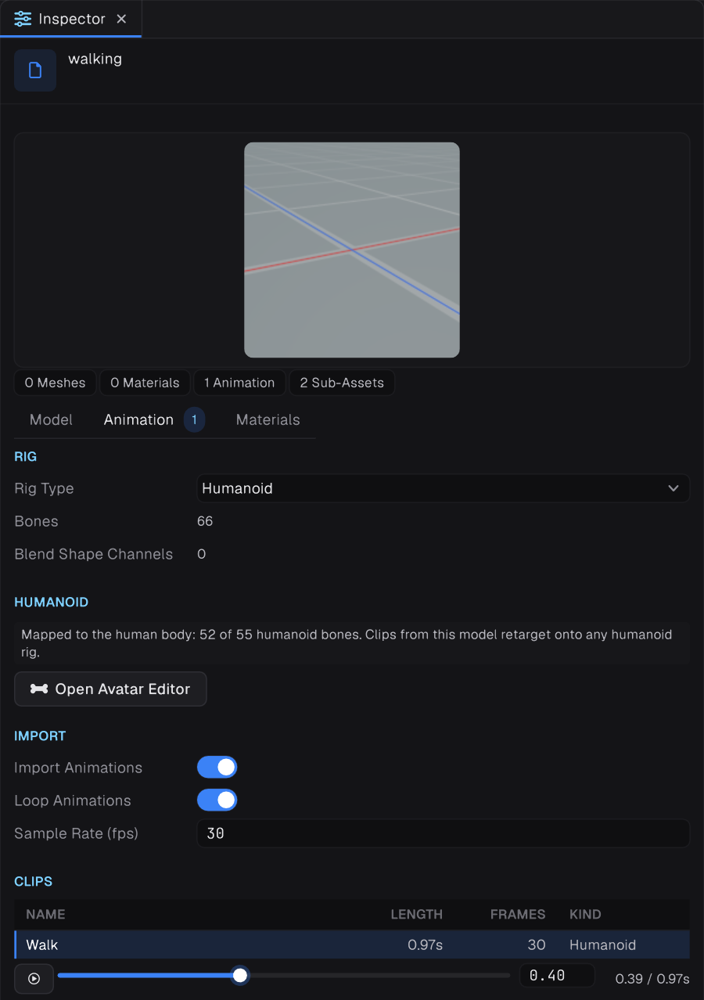
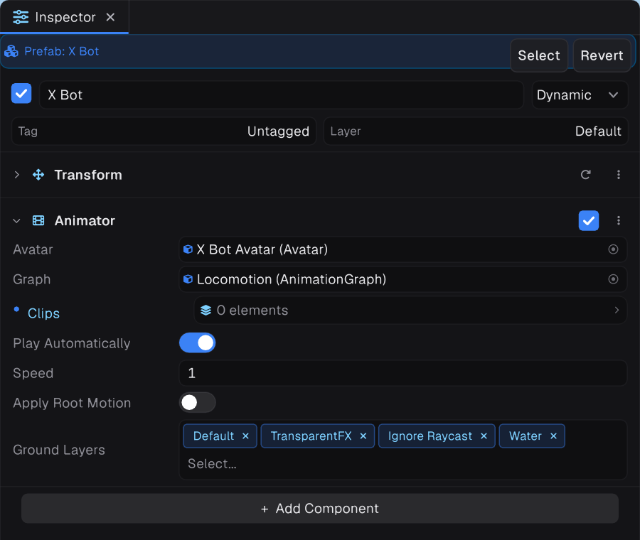
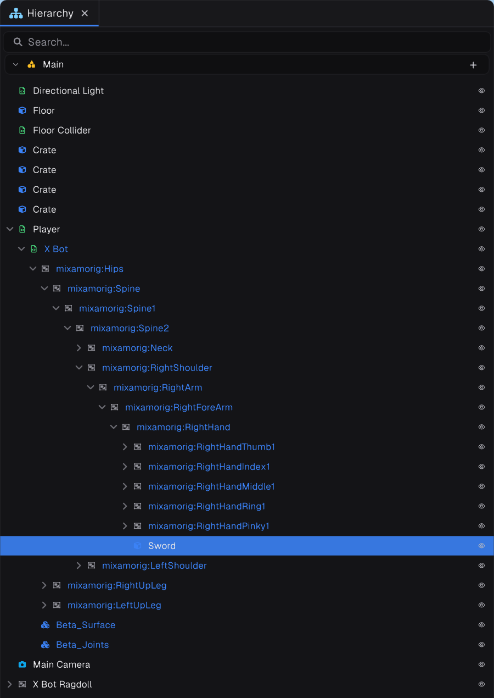

Prowl's animation system is built on Prowl.Motion. A character animates through three pieces:

| Piece | What it is |
| --- | --- |
| **Animator** | The component that plays animation on a hierarchy of bones |
| **Avatar** | The rig description: which bones exist, and for humanoids, which bone is which |
| **Animation Graph** | A `.animgraph` asset of state machines, blends, IK and logic that decides the pose |

## Importing a character




A model file imports as a prefab with sub-assets: meshes, materials, an Avatar named `<model> Avatar`, and one `AnimationClip` per take. Unless the rig type is None, the importer adds an Animator to the root with the Avatar and clips filled in.

### Rig type

| Rig type | Use for |
| --- | --- |
| None | Static models |
| Generic (default) | Anything: creatures, props, weapons, arms. A clip plays on another model only where bone names match exactly |
| Humanoid | Two-legged characters. Clips retarget between any humanoids, and humanoid-only nodes such as Foot Grounding, Muscle Layer and Ragdoll work |

> [!TIP]
> First-person arm rigs usually fail humanoid mapping. Keep arms and their weapon animations Generic, with matching bone names.

### Clip settings

Each take has settings in the model's inspector: **Name**, **Loop**, **Trim Start (s)**, **Trim End (s, 0 = full)**, and under **Root Motion** the channels **Travel**, **Turn** and **Height**.

**Root travel and turn are extracted by default**, so a walk clip plays in place and its movement becomes root motion. See [Root motion](04-root-motion.md).

## Playing clips without a graph

For props and simple objects you do not need a graph:

```csharp
var animator = GetComponent<Animator>();
animator.Play("Open");                       // by name, from the Animator's Clips
animator.CrossFade(closeClip, 0.25f);        // blend to a clip over seconds
```

`PlayAutomatically` plays the first clip on start.

## The Animator




- It needs an **Avatar**, or nothing animates.
- It runs after every `Update` and before `LateUpdate`. **Set parameters in `Update`. Override bones in `LateUpdate`.**
- Assign a graph to its **Graph** field. Parameters are set with `SetFloat`, `SetBool`, `SetInt`, `SetTrigger`, `SetVector`, `SetTarget` and `SetId`. See [Parameters and values](02-parameters-and-values.md).
- Call `Rebind()` after adding or removing bones under it.

## Bones are GameObjects




Bones are ordinary GameObjects under the Animator, bound by name. To hold a sword, parent it under the hand bone and zero its local position.

> [!WARNING]
> Never rename bones. The Animator and the skinned mesh find them by name and path.

## In this section

- [Graph basics](01-graph-basics.md): states, Enter and Exit gates, transitions
- [Parameters and values](02-parameters-and-values.md)
- [Locomotion](03-locomotion.md): a complete walk and run setup
- [Root motion](04-root-motion.md)
- [IK and constraints](05-ik-and-constraints.md)
- [Layers and masks](06-layers-and-masks.md)
- [Clip events](07-clip-events.md)
- [Node reference](08-node-reference.md): every node
