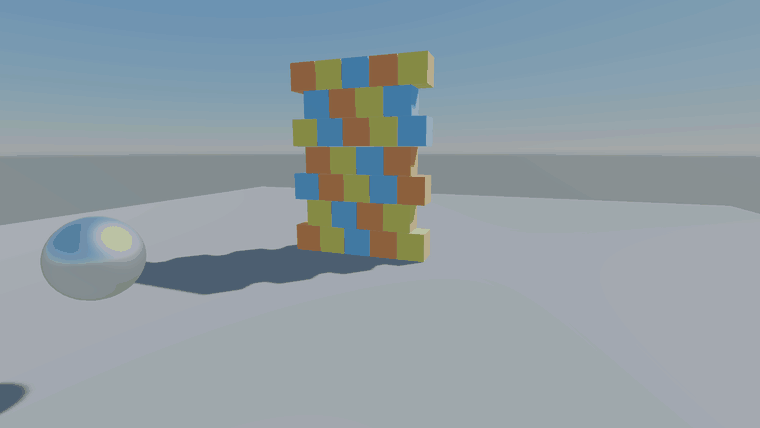
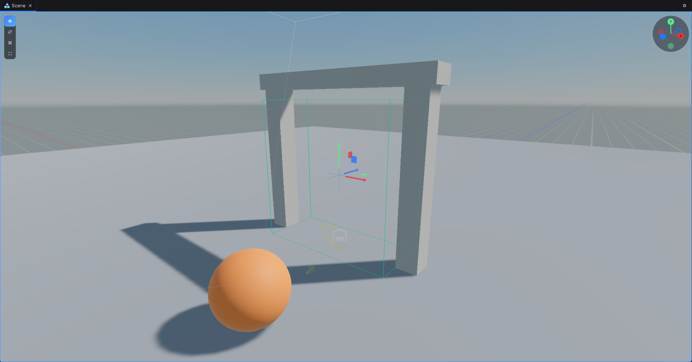

To make an object fall and bounce, see [Make an object fall and bounce](../09-how-to/50-make-an-object-fall-and-bounce.md). To react when something enters a zone, see [Detect when the player enters an area](../09-how-to/51-detect-when-the-player-enters-an-area.md).

## Rigidbody3D



- `MotionType` is `Dynamic`, `Kinematic` or `Static` (namespace `Jitter2.Dynamics`).
- `LinearVelocity`, `AngularVelocity`, `Mass`, `AffectedByGravity`.
- `AddForce(force, ForceMode)`, `ApplyImpulse(impulse)`, `MovePosition`, `MoveRotation`.
- A collider with no `Rigidbody3D` on it or a parent is static. Interpolation is on by default.

> [!WARNING]
> `LinearDamping` and `AngularDamping` are the fraction of velocity removed every 1/60 s, whatever the timestep. The range is 0 to 1 and both default to 0. Small values are strong: 0.1 leaves under 1 percent of the speed after one second.

## Colliders

Box, sphere, capsule, cylinder, cone, convex or concave mesh, and terrain. `WheelCollider` is a raycast wheel for vehicles, not a shape.

## Collision callbacks

`OnCollisionBegin`, `OnCollisionStay` and `OnCollisionEnd(Collision collision)` fire on both objects. `collision.GameObject` is the other object, and `collision.Normal` points toward this one.

## Triggers




Colliders have no trigger flag. Add a `TriggerVolume` component instead:

```csharp
[RequireComponent(typeof(TriggerVolume))]
public sealed class Checkpoint : Component
{
    public override void OnTriggerEnter(Rigidbody3D other)
    {
        Debug.Log($"{other.GameObject.Name} reached the checkpoint");
    }
}
```

Character controllers entering a trigger raise `OnCharacterEnter/Stay/Exit` instead.
