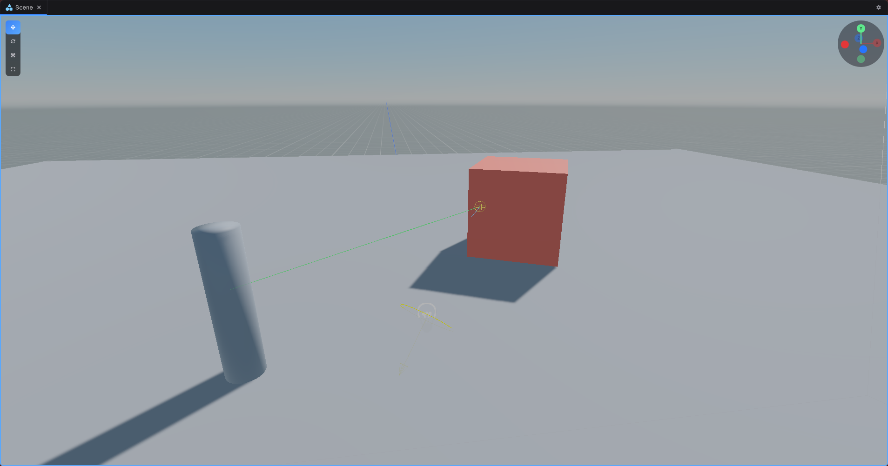

Queries live on each scene's `Physics` and are **main thread only**. Inside a component use `GameObject.Scene.Physics`, since `Scene` there is the component's own property. Elsewhere `Scene.Current.Physics` works.



## Raycasts

```csharp
if (GameObject.Scene.Physics.Raycast(Transform.Position, Transform.Forward, 100f, out RaycastHit hit))
{
    Debug.Log($"Hit {hit.Transform.GameObject.Name} at {hit.Point}");
}
```

> [!IMPORTANT]
> Without a filter the distance comes before the `out` parameter: `Raycast(origin, direction, maxDistance, out hit)`. With a filter, `out` moves before the distance: `Raycast(origin, direction, out hit, maxDistance, filter)`.

## Other queries

- `RaycastAll(origin, direction, maxDistance, hits)` fills a list, nearest first.
- `Linecast(from, to, out hit)`
- `SphereCast(origin, radius, direction, maxDistance, out ShapeCastHit hit)`
- `OverlapSphere(position, radius, hits)` and `OverlapBox(position, size, rotation, hits)`. Box sizes are full extents.

## Filters

```csharp
var filter = new QueryFilter(LayerMask.Everything).Ignoring(myBody);
var enemies = LayerMask.FromMask(1u << LayerMask.NameToLayer("Enemy"));
```

`hit.Collider` is not set for terrain, and `hit.Rigidbody` is not set for static colliders, so check them with `IsValid()` rather than `== null`, which is a compile error on engine objects. Use `hit.Transform.GameObject` to find what was hit.
