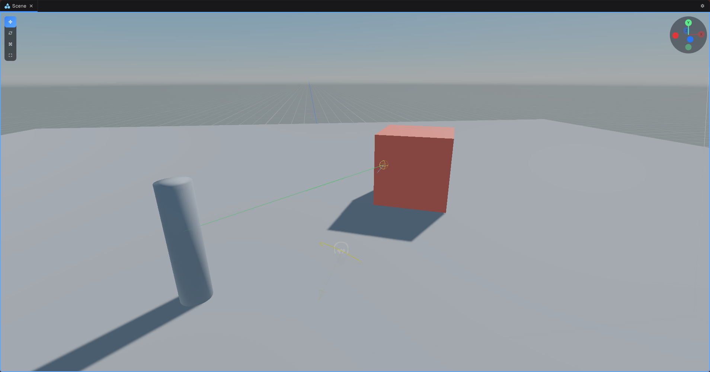

Every world has its own physics, and queries are **main thread only**. The static `Physics` class queries the world your code runs in, so a component always hits its own world. `Scene.Physics` inside a component, or `world.Physics` for any world, is the same API on one world in particular.



## Raycasts

```csharp
if (Physics.Raycast(Transform.Position, Transform.Forward, 100f, out RaycastHit hit))
{
    Debug.Log($"Hit {hit.Transform.GameObject.Name} at {hit.Point}");
}
```

> [!IMPORTANT]
> The distance comes before the `out` parameter, and a filter goes last: `Raycast(origin, direction, maxDistance, out hit, filter)`.

## Other queries

- `RaycastAll(origin, direction, maxDistance, hits)` fills a list, nearest first. Pass a filter as the last argument to skip layers or bodies.
- `Linecast(from, to, out hit)`
- `SphereCast(origin, radius, direction, maxDistance, out ShapeCastHit hit)`
- `OverlapSphere(position, radius, hits)` and `OverlapBox(position, size, rotation, hits)`. Box sizes are full extents.

## Filters

```csharp
var filter = new QueryFilter(LayerMask.Everything).Ignoring(myBody);
var enemies = LayerMask.FromMask(1u << LayerMask.NameToLayer("Enemy"));
```

`hit.Collider` is not set for terrain, and `hit.Rigidbody` is not set for static colliders, so check them with `IsValid()` rather than `== null`, which is a compile error on engine objects. Use `hit.Transform.GameObject` to find what was hit.
