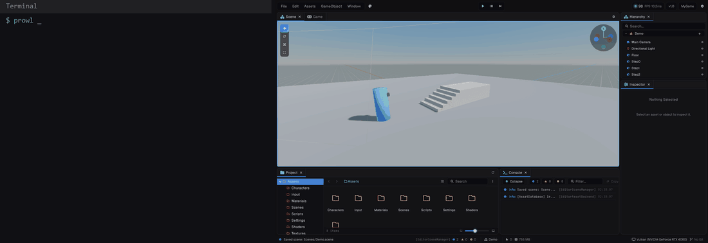

The `prowl` command talks to a running editor. New projects ship with agent skills that teach AI agents these commands.

## Verbs

| Command | What it does |
| --- | --- |
| `prowl status` | Open project, open scenes, play state and selection |
| `prowl command` | List the commands the editor exposes |
| `prowl command <name> [args]` | Run a command |
| `prowl eval <code>` | Run C# in the editor and print the result |
| `prowl eval_file <path>` | Run the C# in a file |

Add `--json` for raw output and `--timeout <seconds>` for long commands. Exit codes are 0 for success, 1 for an error and 130 when cancelled.

## Addressing things

| Ref | Means |
| --- | --- |
| `/Player/Camera` | A GameObject by hierarchy path |
| `/Player:Rigidbody3D` | A component on that object |
| `#guid` | A GameObject, component or asset by identifier |
| `@selection` | The current selection |
| `@active` | The selected object the inspector shows |
| `scene:Level2:/Player` | A path or `#guid` looked up in one open scene only. Use the scene's path instead of its name when two open scenes share a name |
| `Models/Gun.fbx` | An asset path, relative to Assets |

With several scenes open, a path is looked up across all of them, and the ids the CLI returns carry a `scene:` prefix so they stay exact. During play, refs resolve in the play world's copies of the scenes.

## Scenes

The `scene` command works on the open scenes, as [Multi scene editing](02-multi-scene-editing.md) describes. Without an action it lists them with whether each is loaded, active and changed.

| Action | Does |
| --- | --- |
| `--action open --path Scenes/Level.scene` | Replaces the open scenes with this one |
| `--action openadditive --path Scenes/Lighting.scene` | Adds a scene after the open ones |
| `--action newadditive` | Adds an empty untitled scene after the open ones |
| `--action new` | Replaces the open scenes with a new untitled one |
| `--action load --scene Audio`, `--action unload --scene Audio` | Loads or unloads a listed scene, keeping it listed |
| `--action remove --scene Audio` | Takes a scene out of the hierarchy |
| `--action setactive --scene Lighting` | Makes it the active scene |
| `--action save` | Saves every changed scene. With `--scene`, only that one |
| `--action saveas --scene Lighting --path Scenes/Night.scene` | Saves a scene to a new file, the active scene without `--scene` |
| `--action info --scene Level` | One scene with its roots |

`--scene` takes a scene's name, or its path relative to Assets. Anything that would close a scene with unsaved changes is refused unless you pass `--force`. Scenes cannot be opened, closed or saved during play.

`tree` lists the roots grouped under their scene, with a `Persistent` group during play once something is persistent. `go --action create` takes `--scene` to create a root in a scene other than the active one.

## A typical session




```bash
prowl status
prowl command go create --name Gun --parent /Player --components Rigidbody3D,BoxCollider
prowl command scene --action openadditive --path Scenes/Lighting.scene
prowl command set /Player:CharacterController Height 1.8
prowl command compile
prowl command play --action start
prowl command screenshot
prowl command play --action stop
```

> [!TIP]
> `compile` waits for the hot reload and returns errors with file, line and column, so a script or agent can fix them and try again.
