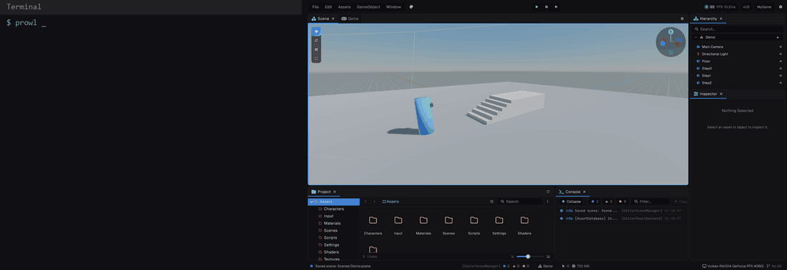

The `prowl` command talks to a running editor. New projects ship with agent skills that teach AI agents these commands.

## Verbs

| Command | What it does |
| --- | --- |
| `prowl status` | Open project, scene and play state |
| `prowl command` | List the commands the editor exposes |
| `prowl command <name> [args]` | Run a command |
| `prowl eval <code>` | Run C# in the editor and print the result |
| `prowl eval_file <path>` | Run the C# in a file |

Add `--json` for raw output and `--timeout <seconds>` for long commands. Exit codes are 0 for success, 1 for an error and 130 when cancelled.

## Addressing things

| Ref | Means |
| --- | --- |
| `/Player/Camera` | A GameObject by hierarchy path |
| `/Player:Rigidbody3D` | A component on that object |
| `@selection` | The current selection |
| `Models/Gun.fbx` | An asset path, relative to Assets |

## A typical session




```bash
prowl status
prowl command go create --name Gun --parent /Player --components Rigidbody3D,BoxCollider
prowl command set /Player:CharacterController Height 1.8
prowl command compile
prowl command play --action start
prowl command screenshot
prowl command play --action stop
```

> [!TIP]
> `compile` waits for the hot reload and returns errors with file, line and column, so a script or agent can fix them and try again.
