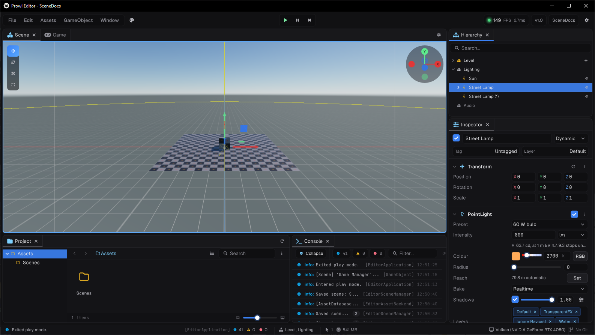
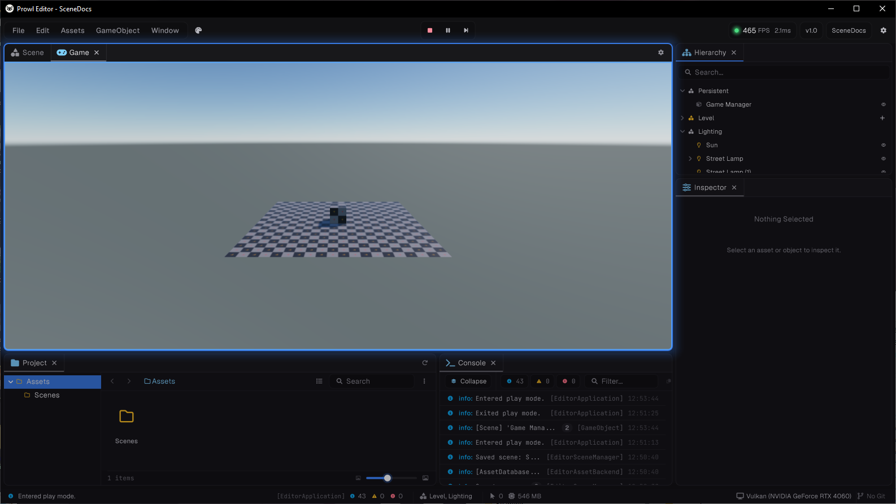

The editor can have several scenes open at once. Each open scene is a section of one edit world, with a header of its own in the hierarchy. This is how you split a big level into parts that different people can work on, keep lighting or gameplay in a scene of its own, or build the scene you stream in beside the level it streams into.

## Opening scenes

| To | Do |
| --- | --- |
| Replace everything with one scene | Double click a scene asset, use **File > Open Scene**, or drop a scene asset on the scene view |
| Add a scene beside the open ones | Drag a scene asset into the hierarchy |
| List a scene without loading it | Hold **Alt** while dragging it into the hierarchy |
| Start over with a new scene | **File > New Scene** or **Ctrl+N** |

Opening a scene that is already listed points you at its header instead, so one scene is never open twice. Replacing the open scenes asks first when one has unsaved changes, and clears the undo history.



## Scene headers

Each scene has a header row with its name, a mark when it has unsaved changes, and a marker on the active scene. Collapse a header to hide its objects. Its **+** button creates a new object in that scene. Right click it for:

| Item | Does |
| --- | --- |
| **Set Active Scene** | Makes it the active scene |
| **Save Scene**, **Save Scene As** | Saves just this scene |
| **Save All** | Saves everything unsaved |
| **Add New Scene** | Adds an empty untitled scene after the open ones |
| **Unload Scene** | Removes its objects but keeps it listed, greyed, so one click loads it back |
| **Load Scene** | Loads an unloaded scene back in place |
| **Remove Scene** | Unloads it and takes it out of the hierarchy |
| **Select Scene Asset** | Shows the `.scene` file in the project panel |
| **Hide in Scene View**, **Show in Scene View** | Hides its objects from the scene view and from picking |

Unload and Remove ask first when the scene has unsaved changes. The last loaded scene cannot be unloaded or removed, only replaced by opening another.

Hiding is a view setting for you only. It is never saved, and hidden scenes still play and still show in the game view.

## The active scene

Exactly one loaded scene is active:

- New objects go into it, unless an object is selected, in which case they go into the selected object's scene.
- The scene view shows its sky, ambient light and fog, and the Environment panel edits its settings.
- Its lightmap settings drive a bake.

Unloading the active scene makes the next loaded scene active, or the previous one when it was last.

## Moving objects between scenes

Drag a root object onto another scene's header, or between that scene's roots, to move it there. Parenting it under an object in another scene moves it too. Either way the move is one undo step, both scenes are marked as changed, and objects owned by the moved object, like a ragdoll's puppet, move with it.

Duplicating and pasting keep the copy in the source's scene.

## References between scenes

A saved reference can only point within its own scene, so in edit mode:

- The object picker only offers objects from the field's own scene.
- Dropping an object from another scene onto a reference field is refused, with a message naming its scene.
- Moving an object to another scene clears every reference that would now cross between scenes, in either direction, and logs each one. Undoing the move brings them back.
- As a last line, saving writes any reference that leaves the scene as empty.

At runtime there is no such rule. Code can freely point objects in different sections at each other.

## Saving

| Action | Saves |
| --- | --- |
| **Ctrl+S** | Every changed scene, plus everything else unsaved |
| **File > Save Scene As**, **Ctrl+Shift+S** | The active scene, to a new file |
| A header's **Save Scene** or **Save Scene As** | That scene only |

An untitled scene asks for a path when it is saved. Saving a scene as the file of another open scene is refused.

Each scene tracks its own changes. An edit marks only the scene of what it changed, and undoing or redoing marks it again. Nothing is marked during play.

The editor remembers which scenes were open, which were loaded, which was active and which were hidden, and opens them the same way next time. A scene that has gone missing is skipped with a warning.

## Play mode

Pressing **Play** copies every loaded scene into a new play world:

- The play world holds one section per loaded scene, in the same order, with the same active scene. Unloaded scenes are left out. Hidden scenes play like any other.
- Each section keeps the scene it came from as its `Source`, so `Scene.Source` in game code is the scene you opened.
- The play world becomes `SceneInstance.Main`. Game code that loads a level replaces the play world's content and never touches your open scenes.
- `SceneBuild.List` holds the enabled scenes from Build Settings, so `SceneBuild.Find` works as it will in the built game.
- The edit world sleeps underneath, untouched. Its `[ExecuteAlways]` components get `OnDisable`.
- The hierarchy shows the play world's sections, plus a **Persistent** header once something is made persistent.
- Scenes cannot be opened, closed or saved until play stops.



Stopping play destroys the play world and every world game code opened during it, then wakes the edit world exactly as it was, with your selection and each scene's unsaved state as they were. Changes made to objects during play are lost.

Async code started during play is cut off when play stops: its world's `Token` and `GameTask.SessionToken` are cancelled, and pending continuations are dropped.

| Preference (**Window > General > Preferences > Play Mode**) | Effect |
| --- | --- |
| **Save Scene On Play** | Saves changed scenes before play starts. Untitled scenes are not saved |
| **Keep Undo History** | Keeps the edit history through play instead of clearing it. Play has its own history while it runs |

Prefab editing works the same way: the prefab opens in a world of its own while every open scene sleeps underneath, and comes back as it was.

## Baking with several scenes

One lightmap bake covers every loaded scene, so shadows and bounced light cross between them. It uses the active scene's lightmap settings.

- Each scene gets its own lightmap pages, in a `<scene name>_lightmaps` folder beside its file, and its own light probes.
- An untitled scene blocks the bake until you save it, since its output has nowhere to go.
- Unloaded scenes take no part and keep what they had.
- A bake marks the baked scenes as changed but never saves them. Save to keep the result.
- A bake that finishes during play waits for play to end before it is applied.
- A nav mesh surface stores its data beside its own scene, and a reflection probe bake marks the probe's own scene.

At runtime, light probes from several loaded scenes are merged into one set. With probes in only one scene, its stored set is used as is.

## Build settings

**Add Open** in Build Settings adds every open scene that is saved and not in the list yet, in order. The first scene in the list is the one a built game starts with.

## Editor scripting

Editor code reaches the open scenes through `EditorSceneManager`, in `Prowl.Editor.GUI.SceneView`. Every call that changes the scenes is refused during play and prefab editing (check `CanEditScenes`), and none of them prompt: a call that would close a scene with unsaved changes is refused unless you pass `force`.

```csharp
using Prowl.Editor.GUI.SceneView;
using Prowl.Runtime;
using Prowl.Runtime.Resources;

Scene? lighting = EditorSceneManager.SceneAt("Levels/Forest_Lighting.scene");
if (lighting.IsValid() && EditorSceneManager.CanEditScenes)
{
    OpenScene open = EditorSceneManager.OpenAdditive(lighting!);   // loads at the end of the frame
}
```

Loading happens at the end of the frame: a call returns at once with `IsLoaded` false, and `SceneLoaded` fires once the section exists.

| Member | Does |
| --- | --- |
| `OpenScenes` | Every scene in the hierarchy, loaded or not, in order |
| `ActiveScene` | The active scene |
| `Open(scene, force)` | Replaces the open scenes with this one, and clears the undo history |
| `OpenAdditive(scene, load)` | Adds a scene after the others, loaded unless `load` is false |
| `New(additive, force)` | An untitled scene. The first gets a camera, a light and a floor. An additive one is empty |
| `Load(open)`, `Unload(open, force)`, `Remove(open, force)` | Load, unload or remove a listed scene |
| `SetActive(open)`, `Move(open, index)` | Make it active, or move it in the list |
| `IsDirty(open)`, `HasDirtyScenes`, `MarkDirty(open)` | Unsaved state |
| `Save(open)`, `SaveAs(open, path)`, `SaveAll()` | Save. `Save` is false for an untitled scene |
| `GetSetup()`, `RestoreSetup(setup, force)` | Read and apply the list of open scenes with their loaded and active state |
| `SceneOf(gameObject)`, `SceneOf(section)` | The open scene an object or edit world section belongs to |
| `SceneOpened`, `SceneLoaded`, `SceneClosing`, `SceneSaved` | Events |
| `EditWorld` | The world the open scenes are edited in |
| `PlayWorld` | The play world, null outside play |
| `EditedWorld` | The world the panels act on: the prefab world while editing a prefab, otherwise Main |

An `OpenScene` has `Scene` (null while untitled), `Section` (null while unloaded), `Name`, `Path`, `IsLoaded`, `IsActive`, `IsDirty` and `IsHiddenInSceneView`. It lives from open until remove, through any number of loads and unloads.

The [Prowl CLI](01-prowl-cli.md) has the same operations through its `scene` command.
