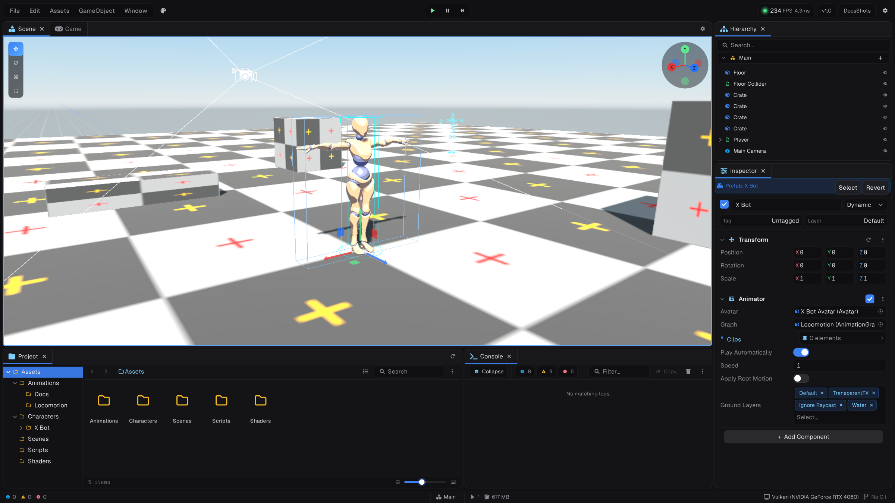

The editor is built with Paper, Prowl's immediate-mode UI. It includes the scene view, hierarchy, inspector, project browser, console, game view and frame stats in dockable panels, with 12 themes and 12 interface languages.

- [Prowl CLI](01-prowl-cli.md)
- [Project structure](02-project-structure.md)