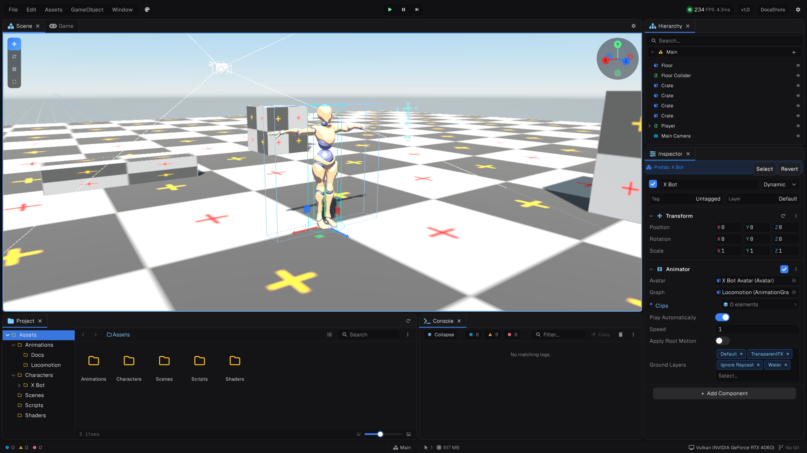

The editor is built with Paper, Prowl's immediate-mode UI. It includes the scene view, hierarchy, inspector, project browser, console, game view and frame stats in dockable panels, with 12 themes and 12 interface languages.

- [Prowl CLI](01-prowl-cli.md)
- [Multi scene editing](02-multi-scene-editing.md)
- [Extending the editor](03-extending-the-editor.md)
- [Assets and importers](04-assets-and-importers.md)
- [Building your game](05-building-your-game.md)
- [Debugging and profiling](06-debugging-and-profiling.md)
